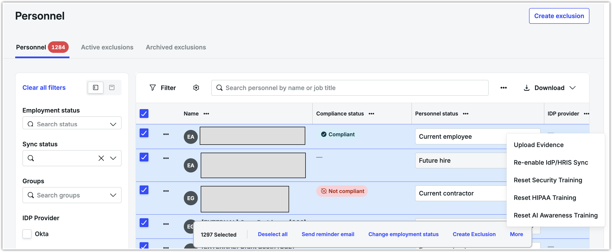
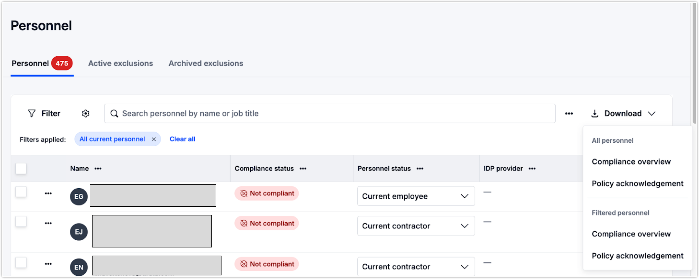
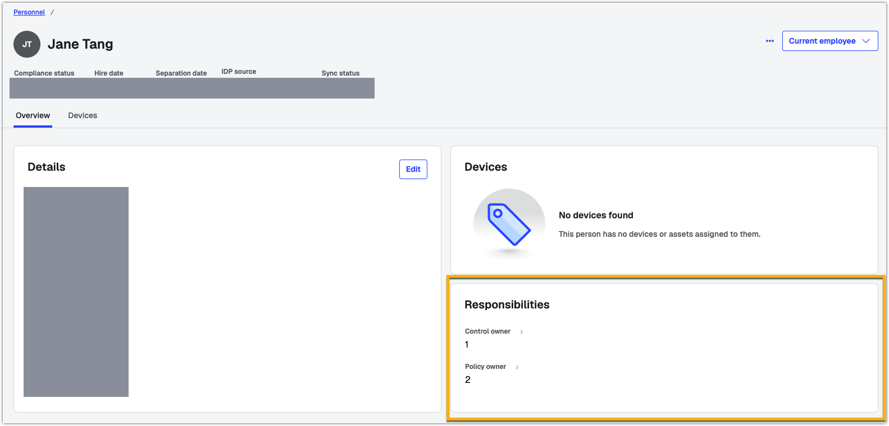

# Personnel Overview

Source: https://help.drata.com/en/articles/13467999-personnel-overview
Collection: Understand the Drata Platform › Personnel
Updated: 2026-11-09
Fetched: 2026-11-22
Description: Learn how to navigate Drata’s Personnel page, filter and view employee compliance data, and export records for audit readiness.

## Article text

### Email address reuse and personnel records

Drata uses work email addresses as primary identifiers when matching personnel records from your identity provider (IdP) and HRIS. Because of this, we do not recommend reusing email addresses between different employees. If an email address is reused, Drata may match the new employee to the former employee's personnel record. This can cause employment details, such as hire date, separation date, and employment status, to appear under the wrong person. Compliance evidence, such as training, access reviews, and offboarding checks, may also be associated with the wrong individual.

### Recommended practice

Assign each employee a unique work email address that is not reused, even after they leave your organization.

If you must reuse an email address:

- Update the former employee's identity record in your IdP or HRIS with a placeholder email address that will not be reused, such as `former-jdoe+archive@yourdomain.com`.
- After that update is complete, create the new employee's identity record using the reused email address.
- Have the new employee sign in to Drata with SSO so the updated identity can sync. On subsequent syncs, Drata can associate the reused email address with the new employee while keeping the former employee's history separate.

The **Personnel page** centralizes all employee compliance data in one place. From here, you can view compliance requirements, filter by attributes, and export reports. This page helps organizations stay audit-ready by ensuring no one slips through compliance gaps.

## Prerequisites

- Required Drata roles: Admins, Information Security Leads, Workspace Managers, or Personnel Compliance Managers.
- Personnel data sources: **Identity Provider (IdP), HRIS Provider, or Manual entries** (for former personnel or accounts not managed in IdP/HRIS)

**To access the Personnel page:** Go to **Governance → Personnel**.

## Filter and Search Personnel

Use filters and search to quickly narrow down personnel records.

- **Employment status**: Filter by current, former, contractor, or out-of-scope personnel.
- **Compliance**: Identify individuals missing required actions, such as security training or policy acknowledgements.
- **Sync status**: See whether records are synced from an IdP or HRIS.
- **Group**: Filter by IdP groups (available only when group syncing is enabled).

You can also use the **search bar** to look up individuals by name or job title.

**Why this matters:** Filters make it easy to target specific remediation work. For example, you can pull a list of only non-compliant contractors and quickly act on them.

## Take action on selected personnel

1. Select one or more personnel to access available actions. Some actions are grouped under the **More** menu.

### Send reminder email

Send a reminder email to selected individuals who have incomplete, user-actionable compliance requirements. The reminder directs them to My Drata to complete required actions in My Drata.

**Notes:**

- Reminder emails are sent only to other personnel. You cannot send a reminder to yourself.
- When individuals are selected, reminders are sent only to those selected.

### Change employment status

Update an individual's employment status to reflect their current relationship with your organization. You can also select a new employment status from the Personnel status column dropdown.

**Available statuses:**

- Current employee
- Former employee
- Current contractor
- Former contractor
- Out of scope (ignore)
- Out of scope (service account)

**Notes:**

- Future hire, Former employee (manually added), and Former contractor (manually added) statuses cannot be updated.
- Manually changing employment status pauses IdP or HRIS syncing for that individual.

### Create exclusions

Exclude selected individuals from specific compliance checks when those requirements do not apply to them. Exclusions are used to document justified exceptions, such as roles that are not required to complete background checks.

You can apply exclusions in bulk by grouping personnel in your identity provider. For example, create an IdP group for individuals who should be excluded from background checks and sync that group to Drata. Then, on the Personnel page, filter by the group, select the applicable individuals, and create the exclusion.

When creating an exclusion, you define:

- **Who** the exclusion applies to (individuals or groups)
- **Which compliance checks** are excluded
- **How long** the exclusion applies
- **Why** the exclusion exists (this reason appears in audit reports)

### Upload evidence

Upload evidence for selected individuals to support specific personnel requirements, such as MFA, security training, or background checks. This is commonly used when evidence is collected outside of automated integrations.

### Re-enable IdP/HRIS sync

Re-enable IdP or HRIS syncing for selected individuals. This resumes automated updates to personnel details from connected systems.

### Reset training requirements

Reset completed training requirements so individuals must complete them again. This is typically used after policy updates or framework changes.

Available options include:

- **Reset Security Training**
- **Reset HIPAA Training** (HIPAA framework required)
- **Reset AI Awareness Training** (NIST AI framework required)

## Download Personnel Data

You can export personnel data directly from the Personnel page as CSV files:

- **Compliance Overview**: A complete snapshot of personnel compliance status, including custom fields.
- **Policy Acknowledgement**: A detailed report showing which policies each individual has acknowledged.

---

## Reassign a person's responsibilities

A person's profile shows a **Responsibilities** card listing what they're currently responsible for — Control owner, Policy owner, and (per TW-1108's scope) Vendor, Evidence, and Risk, each with a count. This appears whether the person is a current or former employee, so you can always see what still needs reassigning even after someone leaves.

> 🎓 **Want to learn more?** Dive deeper into this topic and see it in action! Check out our dedicated Personnel course over at the **[Drata Academy](https://academy.drata.com/personnel-course)**.

## Images

- [image 01] ../../images/ux/personnel/personnel-overview--01.png
- [image 02] ../../images/ux/personnel/personnel-overview--02.png
- [image 03] ../../images/ux/personnel/personnel-overview--03.png

## Related articles

- [Populating and Managing Personnel Data in Drata (Concept Guide)](populating-and-managing-personnel-data-in-drata-concept-guide.md)
- [Why active employees may appear as former employees in Drata? (Concept Guide)](why-active-employees-may-appear-as-former-employees-in-drata-concept-guide.md)
- [Personnel exclusions](personnel-exclusions.md)
- [Future Hire Personnel](future-hire-personnel.md)
- [Managing Personnel Compliance in Drata Training Video (New Experience)](managing-personnel-compliance-in-drata-training-video-new-experience.md)
