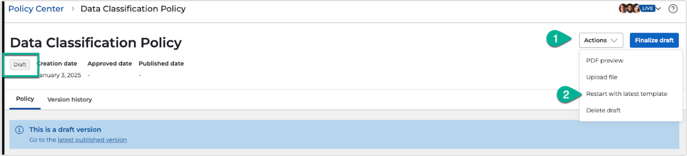
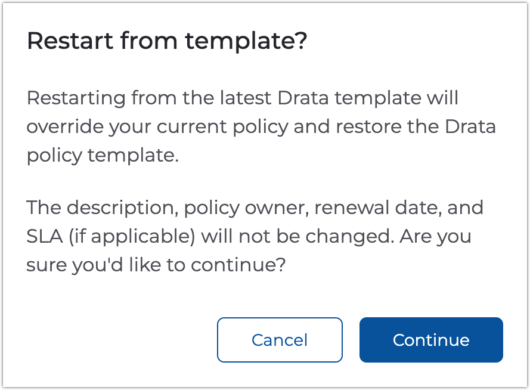

# Policy Coverage for Privacy

Source: https://help.drata.com/en/articles/6422263-policy-coverage-for-privacy
Collection: Policy Guidance
Updated: 2026-08-05
Fetched: 2026-11-22
Description: This article covers updating policies for privacy frameworks.

## Article text

## HERE'S WHY

A key part of being compliant with privacy regulations (like GDPR) is updating your organization’s policies to include privacy focused content. We want to make it easy to use our policy center to account for those privacy needs.

## BEFORE DIVING IN

- The privacy frameworks that we currently support with these new privacy focused policy versions are GDPR, HIPAA, and CCPA.
- We are only updating the templates for certain policies that need privacy content. We will **not **make any changes to your existing policies in your policy center. Please see below for steps on how to utilize these new templates.

## OVERVIEW

**New Customers: **When you have a privacy framework enabled for your account, we will automatically update the templates for these policies in your policy center and you don't need to do anything else.

- Data Classification Policy
- Data Protection Policy
- Data Deletion Policy
- Incident Response Plan
- Physical Security Policy
- Risk Assessment Policy
- System Access Control Policy
- Vendor Management Policy

**Upgrades: **If you have a security framework, and later add a privacy framework, you may access the privacy templates by following the below steps for each of the 8 policies:

1. Go to your policy center and select the edit icon or the policy row itself.
2. Edit the Policy and select Upload file or Author policy.
3. Select the **Actions** button and then **Revert with latest template**.
   
4. Confirm and continue on the double confirmation modal.
   
5. Finalize your draft when you are done.

## Images

- [image 01] ../../images/ux/policies/policy-coverage-for-privacy--01.png
- [image 02] ../../images/ux/policies/policy-coverage-for-privacy--02.png

## Related articles

- [Policy Acknowledge Grouping](policy-acknowledge-grouping.md)
- [2023: CCPA Updates](2023-ccpa-updates.md)
- [ISO 27701:2019 Framework Updates](iso-27701-2019-framework-updates.md)
- [What Is a Subprocessor?](what-is-a-subprocessor.md)
- [Section 5: Policy Owners](section-5-policy-owners.md)
