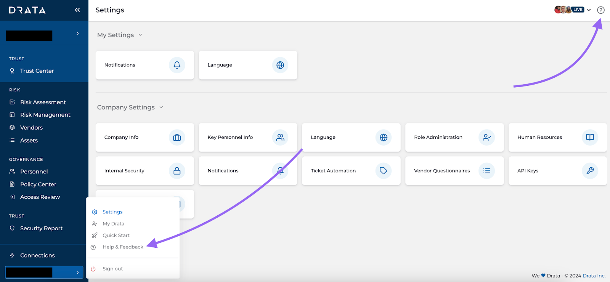

# Policy managers overview

Source: https://help.drata.com/en/articles/8885275-policy-managers-overview
Collection: Settings › Role Administration
Updated: 2026-07-06
Fetched: 2026-11-22
Description: Learn more about policy manager role, permissions, and functionality in Drata.

## Article text

In this help article, learn and discover the functionalities available to policy manager roles within Drata.

Note: If your role has the read-only permissions enabled, you can only view, filter, and download the data on the pages available to the role. You cannot modify the data or do certain actions available on that page.

- Tasks
- Governance
- Settings
- Help Menu

### Tasks

Access to policy renewals. To learn more about Tasks, go to[Task](manage-tasks-in-drata.md).

### Governance

Access the following pages under the Governance section on the navigation bar.

- Policy Center page: View, download, create, or edit policies. To learn more, go to[Policy Center: Link your policies to your controls](https://help.drata.com/en/articles/8746925-policy-center-link-your-policies-to-your-controls).

### Settings

The Settings page can be found as an option under the user menu. Policy managers have access to 'My Settings'.

### Help Menu

Select the help icon or Help & Feedback option to access the Help & Feedback drawer.

This drawer displays sections containing the help center, upcoming features, and community.

### Additional resources

- [Role Administration & RBAC](role-administration-rbac.md)

## Images

- [image 01] ../../images/ux/settings/information-security-leads-overview--01.png

## Related articles

- [Information security leads overview](information-security-leads-overview.md)
- [Risk managers overview](risk-managers-overview.md)
- [Access reviewer overview](access-reviewer-overview.md)
- [Control managers overview](control-managers-overview.md)
- [Personnel compliance managers overview](personnel-compliance-managers-overview.md)
