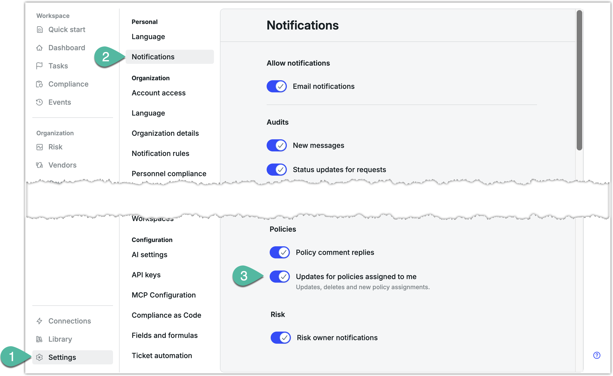

# Policy Owner Notifications

Source: https://help.drata.com/en/articles/13553723-policy-owner-notifications
Collection: Understand the Drata Platform › Policies
Updated: 2026-11-09
Fetched: 2026-11-22

## Article text

Policy owners receive notifications when changes are made to the policies they manage. These notifications help ensure policy accountability and continuity.

By default, **policy owner notifications are enabled**. Each policy owner can turn notifications on or off at any time.

## Manage policy notifications

To update your policy notification settings:

1. Select **Settings → Notifications**.
2. Ensure notifications are enabled.
3. Under **Policies**, turn **Updates to policies assigned to me** on or off.

### When policy owners receive notifications

A policy owner receives an email notification in the following scenarios:

- **New assignment: **A policy is assigned to a new owner by someone other than the owner.
- **Owner removal: **A policy owner is removed by someone other than the owner.
- **Policy update: **A policy is updated by someone other than the policy owner.
- **Access removal: **A policy owner's access to Drata is removed. Drata automatically reassigns the policy to the first available Admin, and the Admin receives an email notification about the reassignment.

## Images

- [image 01] ../../images/ux/settings/policy-owner-notifications--01.png

## Related articles

- [Task notifications](task-notifications.md)
- [Create a policy](create-a-policy.md)
- [Personal settings: Notifications (New Experience)](personal-settings-notifications-new-experience.md)
- [Section 5: Control Owners](section-5-control-owners.md)
- [Section 5: Policy Owners](section-5-policy-owners.md)
