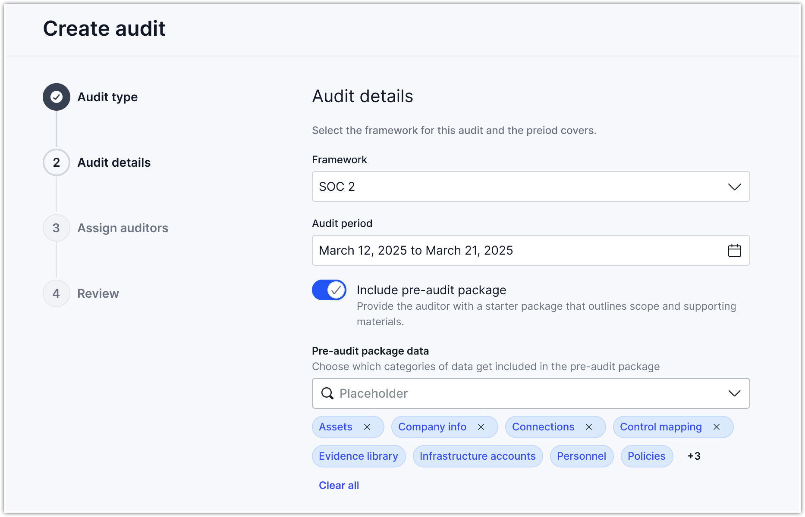
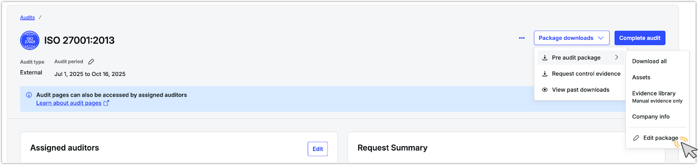

# Pre-audit evidence packages in Drata (New Experience)

Source: https://help.drata.com/en/articles/14324952-pre-audit-evidence-packages-in-drata-new-experience
Collection: The Auditor Experience
Updated: 2026-03-30
Fetched: 2026-11-22

## Article text

## Overview

A pre-audit evidence package is a curated set of information you share with your auditor. It helps auditors understand your environment, scope, and controls in advance, which can streamline the audit process.

In Drata, you can now:

- Decide **whether** to send a pre-audit package at all.
- Control **which evidence categories** are included, such as **Control Mapping, Connections, Vendors, Assets, Evidence Library (manual only), Infrastructure Access, and more.**
   

This approach gives you precise, least-privilege control over what you share, while ensuring your evidence is intentional, relevant, and well organized.

## Why pre-audit evidence control matters

Pre-audit evidence is often an auditor’s first detailed view of your compliance program. Controlling this package helps you present only what is relevant, accurate, and appropriate for the audit.

With strong control over your pre-audit evidence, you can:

- Avoid sharing sensitive or out-of-scope information
- Reduce noise so auditors can focus on relevant systems, vendors, assets, and controls
- Demonstrate a mature, well-governed compliance program that follows least-privilege and need-to-know principles

### What auditors expect

Most auditors expect enough pre-audit information to understand your environment. The goal is to provide a clear, structured overview, without overwhelming them with unnecessary detail.

Typically, auditors expect to:

- Understand your environment, including key systems, connections, infrastructure, and in-scope vendors
- Review your control design, including how controls map to frameworks and requirements
- Validate coverage to confirm that relevant systems, data flows, and third parties are included for the audit period
- Plan sampling and testing by identifying which systems, users, and timeframes to assess during fieldwork

Auditors generally do not need every artifact or log in advance. Instead, they look for a structured overview and representative evidence that enables efficient and focused fieldwork.

---

## Manage a pre-audit evidence package when creating an audit

Follow these steps to configure a pre-audit evidence package during audit creation.

1. **Create the audit**: Start a new audit.
2. **Configure the pre-audit package:** In the pre-audit package section, choose whether to include a package.
   - **Include pre-audit package = ON**
      - Generates and shares a pre-audit package
      - If you turn the pre-audit package ON when creating an audit, you cannot turn it off for the audit.
      - You will be able to change which categories are included.
   - **Include pre-audit package = OFF**
      - Does not create or share a pre-audit package.
      - Category options are not available
3. **Select evidence categories:**
   - If the pre-audit package is turned on, select the categories you want to include:
      - **Assets**: Inventory of company assets and their attributes
      - **Company info**: Company profile and identifiers
      - **Control mapping**: Relationships between Drata controls and framework requirements
      - **Evidence library (manual only)**: Repository of manually uploaded evidence
      - **Infrastructure accounts**: Infrastructure provider accounts and associated user access across environments
      - **Personnel**: Personnel roster and employment details
      - **Policies**: Company policies that support compliance and governance
      - **Vendors**: Third-party vendors used by the organization
      - **Version control accounts**: Version control provider accounts and member access
      - **Public documents and contacts**: Public-facing policies, terms, support pages, and contact information
4. **Finish audit creation**

Complete the audit creation process. Drata generates the pre-audit package based on your selected categories.

**▸ *Suggestion Only: When to include a category Table***

| **Category** | **Include when your data looks like this** | **Clean up before including** |
|---|---|---|
| **Control mapping** | - Mappings from your controls to in-scope frameworks (for example, SOC 2, ISO 27001) - Clear control descriptions and objectives | - Draft or deprecated controls - Internal notes not intended for auditors |
| **Connections** | - In-scope integrations relevant to the audit (for example, identity providers, HRIS, ticketing, logging) - Connections that support automated tests or evidence collection | - Experimental, unused, or legacy connections not used during the audit period - Systems that are out of scope |
| **Vendors** | - Third parties that handle in-scope data or critical services (for example, hosting, logging, email delivery) - Vendors included in the framework or auditor-defined scope | - Marketing tools and low-risk utilities with no in-scope data - Vendors no longer used during the audit period |
| **Assets** | - Production and other in-scope assets (for example, application servers, databases, core services) | - Developer or lab environments unless explicitly in scope - Retired or decommissioned assets |
| **Evidence library (manual only)** | - Final, approved policies and procedures - Screenshots or exports within the audit period | - Drafts, obsolete versions, or duplicate artifacts - Internal brainstorming documents or tickets not intended for auditors |
| **Infrastructure access** | - High-level summaries of privileged access for in-scope environments (for example, production access) - Evidence showing how access is granted, reviewed, and revoked | - Credentials, secrets, or sensitive operational details - Access records unrelated to in-scope environments |
| **Version controls** | - Repositories, workflows, and evidence supporting SDLC and change management for in-scope services | - Repositories not related to in-scope products or services - Experimental or internal-only repositories unrelated to the audit |

---

## Manage a pre-audit evidence package after an audit is created

When the package is ON at creation, you can always edit categories and download.

When it is OFF at creation, an Admin must enable it before it can be configured or downloaded.

### Edit a pre-audit evidence package

Follow these steps to update a pre-audit evidence package after an audit is created.

1. **Open the audit**: Go to the audit you want to update.
2. **Edit the pre-audit package**: Select Package downloads > Pre-audit package > Edit package.
   
3. **Update your selections:** Modify the categories included in the package as needed.
4. Save your changes to update the package.

### If you can’t access the pre-audit package

If the Package** downloads** option is not available, a pre-audit package was not enabled when the audit was created.

An admin must enable it before you can edit or download the package:

1. Go to **Package downloads** > **Pre-audit package**
2. Select **Turn on pre-audit package**

After it is enabled, you can edit and download the package.

---

## When Drata regenerates the pre-audit package

Drata automatically updates the pre-audit package when you make certain changes to the audit.

Drata regenerates the package when you update:

- Audit attributes (for example, scope or audit period)
- Selected evidence categories

When a change is made:

- Drata automatically regenerates the pre-audit package
- Outdated versions are removed so auditors only see the most current and consistent package

### Auditor access

If your auditor is connected through the Drata Auditor API, they automatically receive updated packages as they are generated. No manual action is required to resend the package.

---

## FAQs

**Q1. Do I have to send a pre-audit package for every audit?**

**A.** No. You can turn **Include pre-audit package** OFF during audit creation if you and your auditor prefer to start directly with fieldwork.

---

**Q2. Can I turn the pre-audit package off after the audit is created?**

**A.** No. If the pre-audit package was enabled at creation time, you cannot turn it OFF later. You can still adjust which categories are included, and Drata will regenerate the package as needed.

---

**Q3. What if I decide later that I want a pre-audit package?**

**A.** If you left the pre-audit package OFF when you created the audit, an **Admin** can turn it ON later from the **Edit package** area. All categories start selected by default, the package generates immediately, and you see a confirmation message.

---

**Q4. What happens when audit details or category selections change?**

**A.** Drata automatically **regenerates** the pre-audit package and removes outdated versions, so your auditor only sees the latest version that matches your current scope and settings.

---

**Q5. Do auditors automatically see the updated package?**

**A.** If your auditor uses Drata’s Auditor API, they receive generated and regenerated pre-audit packages automatically. You do not need to send them manually.

## Images

- [image 01] ../../images/ux/audits/pre-audit-evidence-packages-in-drata-new-experience--01.png
- [image 02] ../../images/ux/audits/pre-audit-evidence-packages-in-drata-new-experience--02.png

## Related articles

- [Pre-Audit Checklist: How to Prepare for Your Audit with Drata](pre-audit-checklist-how-to-prepare-for-your-audit-with-drata.md)
- [Manually Export Evidence Data from Drata](manually-export-evidence-data-from-drata.md)
- [Using the Drata Audit Portal (New Experience)](using-the-drata-audit-portal-new-experience.md)
- [Audits page overview (New Experience)](audits-page-overview-new-experience.md)
- [Section 5: Drata for Auditors](section-5-drata-for-auditors.md)
