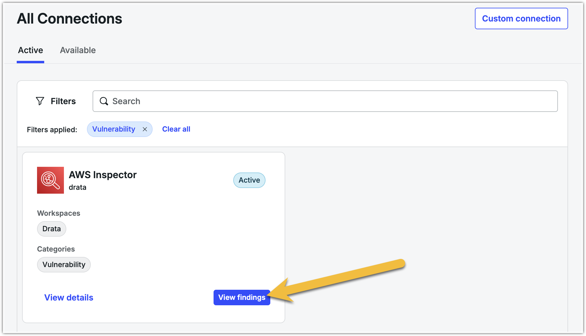

# Qualys Integration Guide

Source: https://help.drata.com/en/articles/9750514-qualys-integration-guide
Collection: Connection Support › Other Guidance
Updated: 2026-07-27
Fetched: 2026-11-22
Description: Learn how to connect Qualys to Drata to automate vulnerability monitoring and compliance evidence collection.

## Article text

The **Qualys integration** enables security and compliance teams to automatically sync vulnerability findings from Qualys into Drata. This integration supports continuous monitoring of vulnerability remediation timelines and automates evidence collection for compliance frameworks.

---

## Key Capabilities

- **Vulnerability Monitoring:** Sync vulnerability findings from Qualys into Drata
- **Compliance Evidence Collection:** Automatically collect vulnerability remediation evidence
- **SLA Monitoring:** Track vulnerability remediation timelines against compliance expectations

Drata will sync **up to 1,000 new or updated vulnerabilities daily**, ordered by severity from **Critical → Low**.

---

## Prerequisites & Data Access

### Qualys Access Requirements

- You must create a **Qualys user account** specifically for the integration within the **Vulnerability Management module**.

Recommended configuration:

| Setting | Required Value |
|---|---|
| Role | Reader |
| API Access | Enabled |
| VM Module Access | Manage VM Module |
| Asset Groups | All Asset Groups (recommended) |
| Business Unit | Assign as appropriate or leave Unassigned |
| Notifications | Disabled |
| Two-Factor Authentication | Symantec VIP disabled |

Creating a dedicated service account is recommended to maintain proper **access control**.

### Drata Role Requirements

To create or modify connections, you must have one of the following **Drata roles with write access**:

- Admin
- Workspace Manager
- DevOps Engineer

**Access Reviewers** can view the connection page but cannot create or modify connections.

---

## Step-by-Step Setup

### Step 1: Create a Qualys Integration User

1. Log in to the **Qualys Console**.
2. Navigate to the **Vulnerability Management module**.
3. Select the **Users** tab.
4. Select **New → User**.

Configure the new user:

- Enter a **First Name** and **Last Name** (for example: *API User*).
- Enter a valid **email address**.
- Set the **Role** to **Reader**.
- Enable **API Access**.
- Assign appropriate **Business Units**.
- Assign relevant **Asset Groups** (often **All Asset Groups**).
- Enable **Manage VM Module** under Permissions.
- Disable all **Notification settings**.
- Disable **Symantec VIP (2FA)**.

After creating the user:

1. Activate the account using the email invitation.
2. Log in to the account once to complete the activation process.

Expected outcome:
A dedicated Qualys user account with **API access** is created for the integration.

---

### Step 2: Enable CVSS Scoring

Drata uses CVSS scoring to monitor vulnerabilities.

1. In Qualys, go to the **Vulnerability Management module**.
2. Select **Reports → Setup**.
3. Open the **CVSS** configuration.
4. Ensure **Enable CVSS Scoring** is checked.

Expected outcome:
CVSS vulnerability scoring is enabled so vulnerability severity data can sync correctly.

---

### Step 3: Connect Qualys in Drata

1. Log in to **Drata** → go to the **Connections** page.
2. Navigate to your **Available Connections**.
3. Search for and start the **Qualys connection process**.
4. During setup you will select:
   - **Severity of vulnerabilities**
      - Choose the severity levels to sync into Drata.
      - By default: Critical, High
      - Drata can sync **up to 1,000 vulnerabilities per day**, ordered by severity.
   - **First seen on**
      - Select the earliest date for vulnerabilities that should be synced.
         Vulnerabilities detected **on or after this date** will be imported.
   - Enter the following credentials when prompted:
      - **Username:** The login name from the Qualys Users page
      - **Password:** The password associated with the integration user

Expected outcome:
Qualys successfully connects to Drata and vulnerability findings begin syncing.

---

## Viewing Vulnerability Findings

After the connection is established, you can view findings in Drata.

**From the Connections page:**

1. Navigate to **Connections**.
2. Locate the connected **Qualys card.**
3. Select **View Findings**.

You will be taken to the **Risk → Vulnerabilities** page, where Drata displays synced vulnerability findings for compliance monitoring and remediation tracking.

---

## Important Notes

- **Daily sync limit:** Drata syncs up to **1,000 new or updated vulnerabilities per day**.
- Drata shows *findings*, which are instances of *vulnerabilities* (an individual but higher-level CVE) against specific resources. This may reflect as higher finding counts in Drata vs. your Qualys dashboard.
- **Severity filtering:** You can choose which severity levels to sync during connection setup.
- **Integration user:** Using a dedicated API user ensures **auditability and prevents disruptions** to existing users.
- **CVSS requirement:** CVSS scoring must be enabled for vulnerability severity data to sync properly.

## Images

- [image 01] ../../images/ux/connections/qualys-integration-guide--01.png

## Related articles

- [Tenable Vulnerability Management Integration Guide](tenable-vulnerability-management-integration-guide.md)
- [SentinelOne Singularity Vulnerability Management (VMS) Integration Guide](sentinelone-singularity-vulnerability-management-vms-integration-guide.md)
- [Microsoft Defender Vulnerability Management Integration Guide](microsoft-defender-vulnerability-management-integration-guide.md)
- [Rapid7 InsightVM Integration Guide](rapid7-insightvm-integration-guide.md)
- [Arnica Integration Guide](arnica-integration-guide.md)
