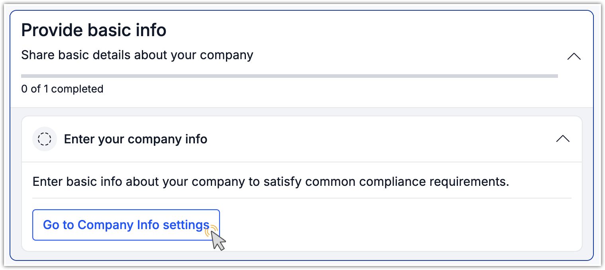

# Quick Start Guide

Source: https://help.drata.com/en/articles/13265650-quick-start-guide
Collection: Understand the Drata Platform › Quick Start
Updated: 2026-11-14
Fetched: 2026-11-22
Description: Get started with Drata by following the Quick Start guide.

## Article text

Quick Start is a guided checklist that walks you through recommended setup activities across Drata. Each activity directs you to the appropriate area of the platform, where you complete the required actions.

Quick Start helps you:

- Set up core integrations
- Enable continuous compliance for your frameworks
- Prepare personnel and policies
- Track progress as you move through setup

## Prerequisites

- Required Drata Roles: Admins.

## How Quick Start works

Quick Start is organized into sections, each containing one or more activities. Each activity reflects a best-practice step for getting started with Drata. Below is an overview of the sections in Quick Start and what you’ll accomplish in each section.

### Provide Basic Info

Enter key company information that helps auditors and monitoring tests understand your organization and compliance scope.

Select **Go to Company Info** to be redirected to the **Org info tab within the Organization Details page**, where you complete your organization details. Enter all the fields including the optional fields in order to complete this task.

### Make Connections to Power Automation

Connect the systems Drata uses to automate monitoring and evidence collection. These are one of the first connection types you need to make

| **Connection Types** | **Descriptions** |
|---|---|
| Identity | Connect your identity provider to automatically sync personnel data, track onboarding and offboarding, and support access controls. This helps ensure personnel-related controls stay accurate over time and allows employees to sign in to Drata using your existing authentication system. Learn more about [Identity providers](https://help.drata.com/en/collections/16504711-identity-idp-guidance). |
| Infrastructure | Connect your infrastructure services to automatically collect evidence related to system configuration, data storage, and security settings. This reduces the need to manually upload evidence and helps identify configuration issues that could impact compliance. Learn more about [Infrastructure providers](https://help.drata.com/en/collections/16505277-infrastructure-guidance). |
| Version control | Connect your version control system to provide evidence for software development and change management controls. This helps demonstrate how code changes are reviewed, approved, and tracked over time without manual screenshots or uploads. Learn more about [Version control providers](https://help.drata.com/en/collections/16505285-version-control-guidance). |
| Ticketing | Connect your ticketing system to automatically create and track remediation tasks when tests fail. This helps teams respond to issues more quickly and provides an audit trail showing how and when compliance gaps were addressed. Learn more about [Ticketing providers](https://help.drata.com/en/collections/16504775-ticketing-guidance). |

### Establish Continuous Compliance for Your Frameworks

Prepare your enabled frameworks for ongoing compliance by reviewing requirements, scoping applicability, and understanding mapped controls.

You will assign Drata roles to your team, review framework requirements, and review the control scopes.

#### Assign roles to your team (optional)

**Note**: You must connect your identity (IdP) connection before you can assign roles in Drata.

In this section, you can invite additional Admins and assign roles to the team members who will help manage Drata. You do not need to assign Drata roles to your entire company, only to those responsible for managing compliance in Drata. This does not apply to end users who only log in to complete onboarding tasks.

Learn more about [Drata Roles](https://help.drata.com/en/collections/16398108-role-administration).

#### Scope your framework requirements

In this section, you are redirected to the Frameworks page. This page displays a card for each framework that has been enabled in your account.

Learn more about [Frameworks](https://help.drata.com/en/collections/2997147-framework-information).

#### Review gaps and plan remediation action

In this section, you are redirected to the Control page. This page allows you to review the scope of your controls to understand where you have gaps, assign control owners, view evidence, assign approvers mark controls in and out of scope, filter on monitoring, and create new controls if desired.

Learn more about [Controls](https://help.drata.com/en/collections/16396816-controls).

**▸ ℹ️ Why review framework requirements first?**

> Framework requirements determine:
>
> - What is in scope
> - What is out of scope
> - What Drata should measure you against
>
> Controls are then evaluated against that scoped set of requirements.
>
> The sequence is intentional:
>
> 1. **Framework requirements** define what applies
> 2. **Controls** are mapped to those requirements
> 3. **Monitoring tests and evidence** evaluate those controls
> 4. **Failures, missing evidence, or incomplete controls** reveal gaps
> 5. **Actions** are taken to address those gaps

### Ensure Your Personnel Stays Compliant

Prepare personnel-related compliance workflows, including syncing personnel data, verifying employment status, and configuring internal security and training settings.

#### Set up your HRIS connection (optional)

Connecting your HRIS to Drata enables read-only access, allowing Drata to identify which personnel are in scope for your audit period and whose access must be tracked.

**Note:** Set up your identity provider connection first. Drata uses your identity provider to establish your personnel list. HRIS data is then imported to add employment details and validate that list.

#### Verify employment status of personnel

The **Personnel** page provides a centralized view of compliance status for all personnel and includes tools to manage actions such as resetting security training, sending reminders, and applying exclusions. In this activity, you’ll review the page and have the opportunity to perform some of these tasks.

To learn more about this page and its available actions, refer to the [Personnel articles](https://help.drata.com/en/collections/16396775-personnel).

#### Set up internal security settings

Select **Set up** to open the **Internal Security** tab. The Internal Security tab is under Settings > Personnel Compliance page. The Internal Security tab allows you to define how Drata collects workstation configuration evidence, manage security training, and attach visitor logs.

#### Set up background checks

Select Set up to open the Human Resources tab. The Human Resources tab is under Settings > Personnel Compliance page. In the Automation section on the Human Resources tab, you can connect a background check provider, then select the appropriate settings to define how background checks are required for your personnel.

### Set Up Your Policies

Select **Go to Policy Center** to open the Policies page, where you manage policy creation, approval, and acknowledgements. Policies play a key role in framework readiness and personnel compliance.

Learn more about [Policy Center](https://help.drata.com/en/collections/16396770-policy-center).

## Completing Quick Start

You do not need to complete every activity in a single session. You can return to Quick Start at any time and continue where you left off. Once all required activities are complete, Quick Start will show **100% completion**.

## What’s next?

After completing Quick Start, you can explore additional Drata features such as:

- Vulnerability management
- Observability integrations
- The Trust Center for sharing your security posture with customers

Quick Start is just the beginning! Drata is designed to support continuous compliance over time.

## Images

- [image 01] ../../images/ux/home/quick-start-guide--01.png

## Related articles

- [Justworks Integration Guide](justworks-integration-guide.md)
- [Information security leads overview](information-security-leads-overview.md)
- [Dashboard overview](dashboard-overview.md)
- [Drata MCP — Setup & Usage Guide](drata-mcp-setup-usage-guide.md)
- [Personnel Overview](personnel-overview.md)
