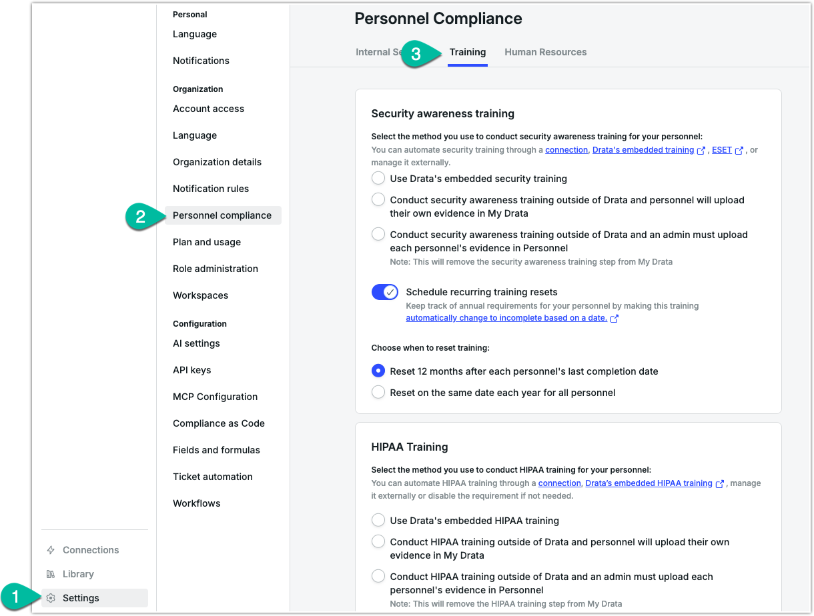

# Reset recurring personnel trainings

Source: https://help.drata.com/en/articles/13539499-reset-recurring-personnel-trainings
Collection: Understand the Drata Platform › Personnel
Updated: 2026-11-09
Fetched: 2026-11-22
Description: Reset configure recurring reset schedules. Some trainings must be completed on a recurring basis (such as Security Awareness, HIPAA, or AI Awareness) to maintain compliance and demonstrate ongoing security awareness.

## Article text

## How training resets work

Drata tracks training completion as part of personnel compliance. When a training is reset:

- The previous completion record remains visible for audit history
- The training requirement is marked as incomplete
- Related compliance checks fail until the training is completed again

You can reset trainings manually or schedule them to reset automatically on a recurring basis.

## Schedule training resets

You can schedule and configure recurring training resets from **Personnel Compliance** settings.

1. Open **Settings** page.
2. Select **Personnel Compliance**.
3. Select the **Training** tab.

From this page, you can configure how each training (Security Awareness, HIPAA, or AI Awareness) is delivered and whether it resets automatically.

1. Locate the desired training section.
2. Select the method you would like to use to conduct trainings for your personnel.
3. Enable **Schedule recurring training resets** and then choose when to reset the training.
   - **Reset 12 months after each personnel's last completion date: **Drata resets the training for each person based on when they last completed it. Personnel who completed the training more than 12 months ago are immediately reset after you save this configuration.
   - **Reset on the same date each year for all personnel: **Drata resets the training for all personnel on the selected date.

**Important note (reset based on each person's last completion date)**

Turning on recurring resets can cause some trainings to reset immediately. This happens if a person's last training completion already exceeds the selected timeframe. Once a training is reset, the person must complete it again.

## Reset training manually

You can manually reset training for all personnel or selected personnel.

1. Open **Personnel** page.
2. Select one or more people.
3. Select **More** > **Reset Security Training**, **Reset HIPAA Training**, or **Reset AI Awareness Training**.
4. Confirm the action.

The reset option that appears depends on the training you've configured in **Personnel Compliance** settings.

## What happens after a training reset

After a training is reset:

- The training displays as **Incomplete** on the Personnel page
- The training displays as **Incomplete** in My Drata onboarding
- Related compliance checks fail until the training is completed again

Personnel can complete the training again or upload evidence, depending on your **Personnel Compliance** configuration.

## Images

- [image 01] ../../images/ux/settings/reset-recurring-personnel-trainings--01.png

## Related articles

- [Huntress (Security Training) Integration Guide](huntress-security-training-integration-guide.md)
- [KnowBe4 Integration Guide](knowbe4-integration-guide.md)
- [Bulk Import Personnel Training Records (New Experience)](bulk-import-personnel-training-records-new-experience.md)
- [Personnel Overview](personnel-overview.md)
- [Organization settings: Security awareness, HIPAA, and AI training](organization-settings-security-awareness-hipaa-and-ai-training.md)
