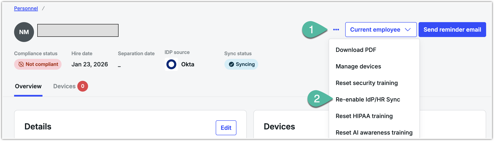
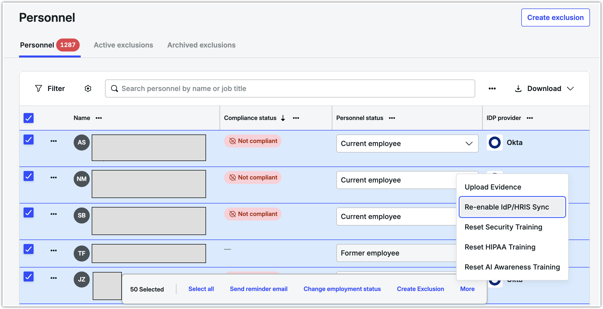

# Resume IdP and HRIS syncs for personnel

Source: https://help.drata.com/en/articles/13538815-resume-idp-and-hris-syncs-for-personnel
Collection: Understand the Drata Platform › Personnel
Updated: 2026-11-09
Fetched: 2026-11-22
Description: Use this article to resume syncing personnel details from your connected identity provider (IdP) or human resources information system (HRIS).

## Article text

## How personnel syncing works

Drata syncs personnel details from your connected IdP or HRIS to keep user information accurate and up to date. These details can include names, email addresses, employment status, and dates relevant to audits.

When you manually update certain personnel fields in Drata, Drata pauses syncing for that individual to prevent those manual changes from being overwritten. To resume automated updates, you must re-enable syncing.

### Important considerations before re-enabling syncs

Re-enabling IdP or HRIS syncing updates personnel details to match the data in your connected IdP or HRIS and overwrites any conflicting manual changes made in Drata.

For example, manually editing a hire date pauses syncing for that person. When you re-enable syncing, Drata replaces the manual value with the value from your connected system. From that point forward, personnel details continue to sync from the IdP or HRIS.

### Check whether syncing is enabled

To find personnel with syncing enabled or disabled:

1. Open **Personnel**.
2. Use the **Sync status** filter.
3. Select one of the following options:
   - **Found in HRIS/IdP** (sync enabled)
   - **Not found in HRIS/IdP** (sync disabled)

You can also sort the table by selecting the **Sync status** column header.

---

### Re-enable IdP or HRIS sync for an individual

1. Open **Personnel**.
2. Select the person whose sync you want to resume.
3. Select the ellipse and then re-enable the sync.
   
4. Confirm the action.

### Re-enable IdP or HRIS syncs in bulk

1. Open **Personnel**.
2. Select the checkbox next to one or more people.
3. Select **More** > **Re-enable IdP/HRIS sync**.

## Images

- [image 01] ../../images/ux/personnel/resume-idp-and-hris-syncs-for-personnel--01.png
- [image 02] ../../images/ux/personnel/resume-idp-and-hris-syncs-for-personnel--02.png

## Related articles

- [Connect your HRIS to Drata](connect-your-hris-to-drata.md)
- [Integrate Multiple Identity and HRIS Connections](integrate-multiple-identity-and-hris-connections.md)
- [How Drata Uses HRIS Data](how-drata-uses-hris-data.md)
- [Personnel Overview](personnel-overview.md)
- [Troubleshooting Identity Sync Issues in Drata](troubleshooting-identity-sync-issues-in-drata.md)
