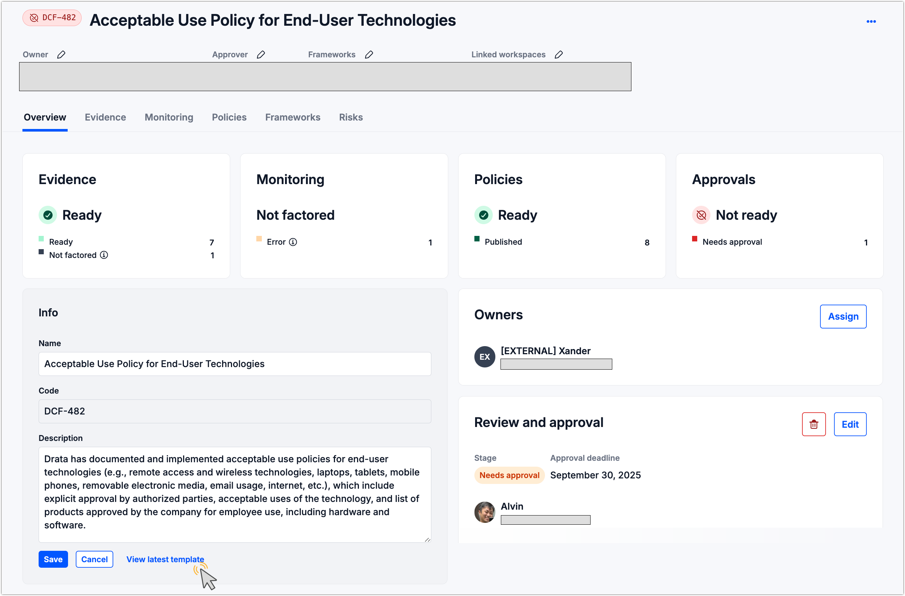
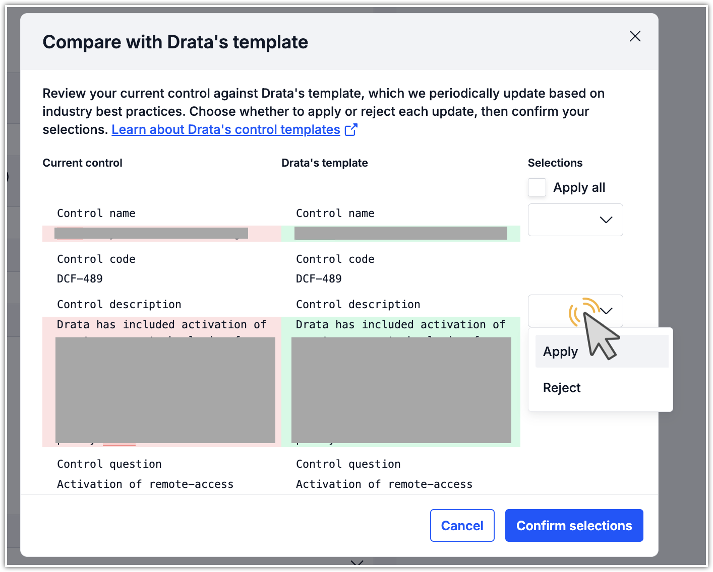

# Revert a Control to Drata's Latest DCF Template

Source: https://help.drata.com/en/articles/13382020-revert-a-control-to-drata-s-latest-dcf-template
Collection: Understand the Drata Platform › Controls
Updated: 2026-11-09
Fetched: 2026-11-22
Description: Restore a DCF control to Drata's latest published template when the language in your workspace has diverged.

## Article text

## Overview

Drata's GRC team creates and maintains all controls in the **Drata Control Framework (DCF)**. These controls are designed to help you manage compliance across multiple frameworks using consistent, up-to-date language.

Over time, the language in a DCF control in your workspace may differ from Drata's latest published template for one of two reasons:

- Your team manually edited the control to better fit your organization's needs
- Drata's GRC team updated the control to reflect changes in compliance standards or improve accuracy

This feature allows you to **compare your control against Drata's latest template and selectively revert language**, ensuring you always have access to the most current DCF guidance—without losing intentional customization.

## Prerequisites

The following roles can revert a control to Drata's latest template:

- Administrator
- Workspace Manager
- Information Security Lead
- Service Group User
- Guest Administrator

## Change to the latest DCF control template

1. On the Controls page, select any **DCF control**.
2. In the Overview tab, within the **Info section**, select the **Edit** icon.
3. Scroll down to the bottom of the section and select **View latest template**.
   
4. After selecting **View latest template**, one of the following occurs:
   - If your control already matches Drata's latest template, you'll see a message indicating that no differences were detected.
   - If differences exist, Drata shows a side-by-side comparison:
      - **Left:** Your current control language
      - **Right:** Drata's latest published template
5. When differences are detected, you can choose how to apply updates:
   - **Apply changes per field:** Accept or reject updates for individual fields
   - **Apply all:** Revert all fields to Drata's latest template at once
      

This comparison shows exactly what would change if you applied the template.

## Audit visibility

When you apply Drata's template language, an audit event is automatically created:

- **Event name:** *Drata's templated control language applied*

This provides transparency and an audit trail showing when standard control language was applied.

## When should you use this?

Revert to Drata's latest template when:

- You want to align controls with updated compliance standards
- You want to undo manual edits and return to baseline language
- You're preparing for an audit and want standardized wording
- You want to compare your custom language against Drata's recommendations

## Images

- [image 01] ../../images/ux/controls/revert-a-control-to-drata-s-latest-dcf-template--01.png
- [image 02] ../../images/ux/controls/revert-a-control-to-drata-s-latest-dcf-template--02.png

## Related articles

- [Compliance Program Migration Best Practices](compliance-program-migration-best-practices.md)
- [The Drata Control Framework & Requirement Relationship](the-drata-control-framework-requirement-relationship.md)
- [Introduction to the Drata Control Framework (DCF)](introduction-to-the-drata-control-framework-dcf.md)
- [Apply Default Mappings for Controls](apply-default-mappings-for-controls.md)
- [Drata Controls (DCFs) Training Video (New Experience)](drata-controls-dcfs-training-video-new-experience.md)
