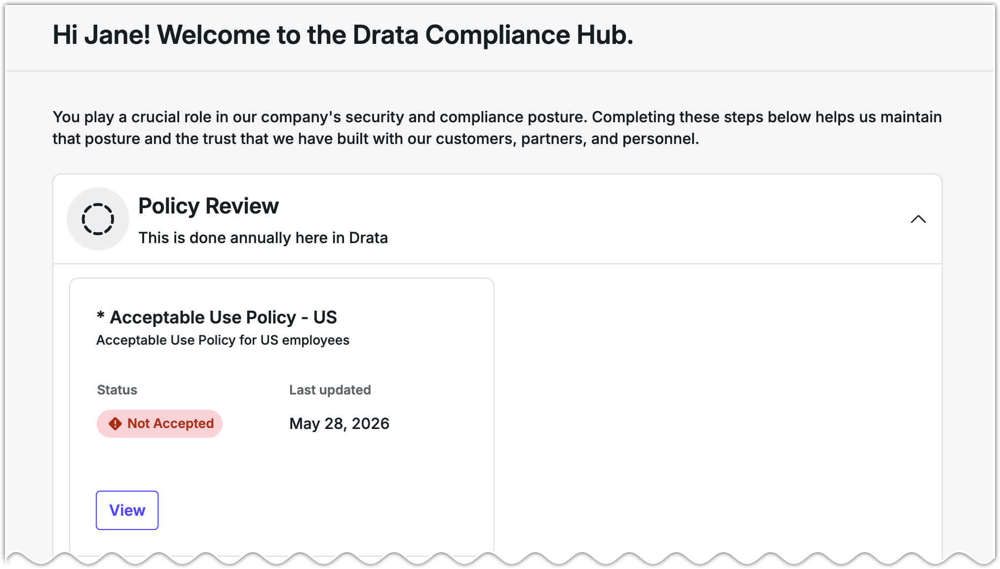
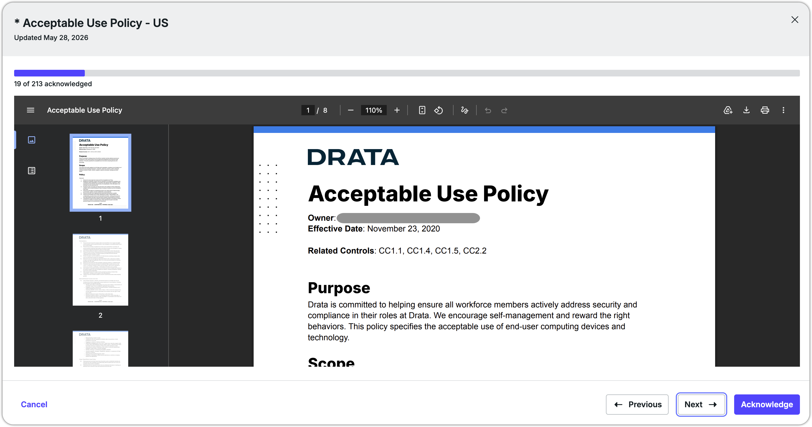

# Review and Acknowledge Company Policies

Source: https://help.drata.com/en/articles/4674033-review-and-acknowledge-company-policies
Collection: Personnel Management › Employee Onboarding
Updated: 2026-11-14
Fetched: 2026-11-22
Description: Acknowledge policies as an employee or contractor

## Article text

It's important that all personnel review and acknowledge company policies during onboarding, and then again on an annual basis, unless changes are made to those policies earlier. The review and acknowledgment of company policies is streamlined in Drata.

## Review and Acknowledge Company Policies

1. Log in to Drata using your Google or Office 365 account.

2. From the **My Drata page**, locate the **Policy Review **task and click on it.

3. A list of your company's policies will appear. Select **View **for the policy you would like to acknowledge.

4. Review the policy carefully, and when you are ready click the **Acknowledge Policy** button at the bottom of the slide-out panel.

5. Select the **Next **to move onto the next policy.

Repeat steps 4–5 until you've reviewed and acknowledged all policies.

## Images

- [image 01] ../../images/ux/personnel/review-and-acknowledge-company-policies--01.png
- [image 02] ../../images/ux/personnel/review-and-acknowledge-company-policies--02.png

## Related articles

- [Test: Policies are Acknowledged](test-policies-are-acknowledged.md)
- [Test 45: Employees Acknowledge the Acceptable Use Policy](test-45-employees-acknowledge-the-acceptable-use-policy.md)
- [Test 49: Contractors Acknowledge the Acceptable Use Policy](test-49-contractors-acknowledge-the-acceptable-use-policy.md)
- [Assigning Policies to Specific Groups](assigning-policies-to-specific-groups.md)
- [Bulk Import Policy Acknowledgments](bulk-import-policy-acknowledgments.md)
