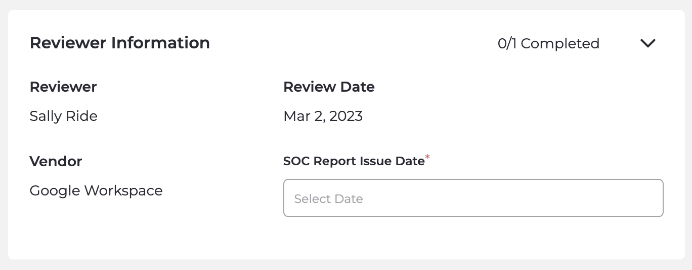
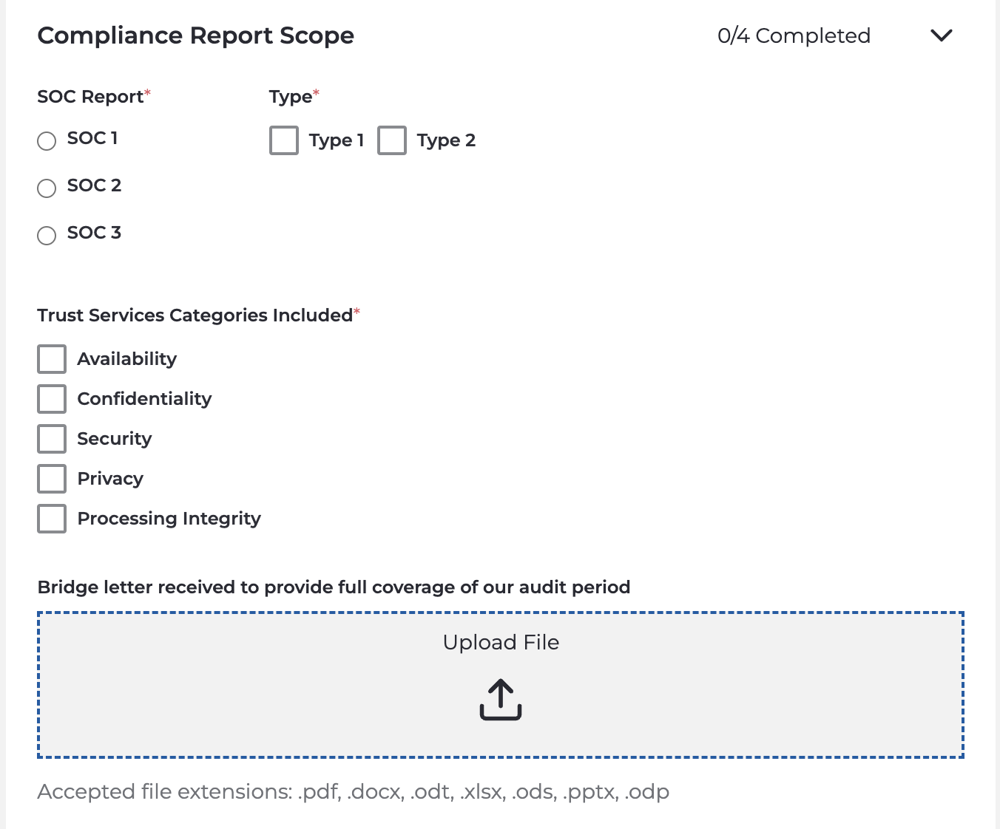
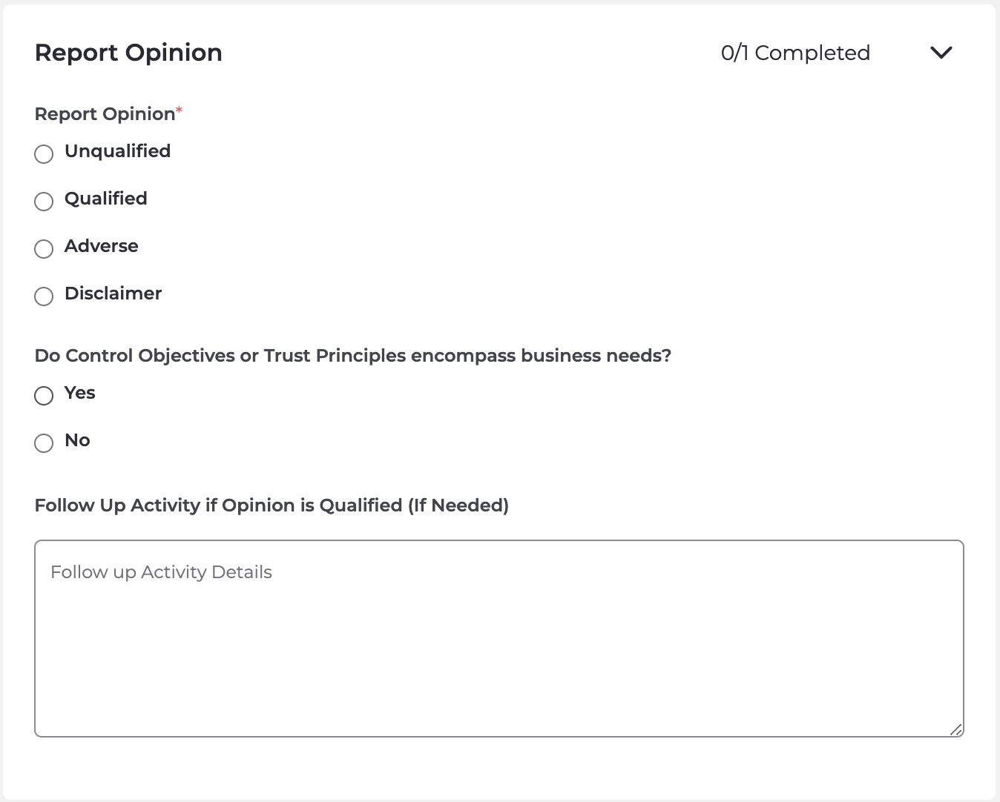
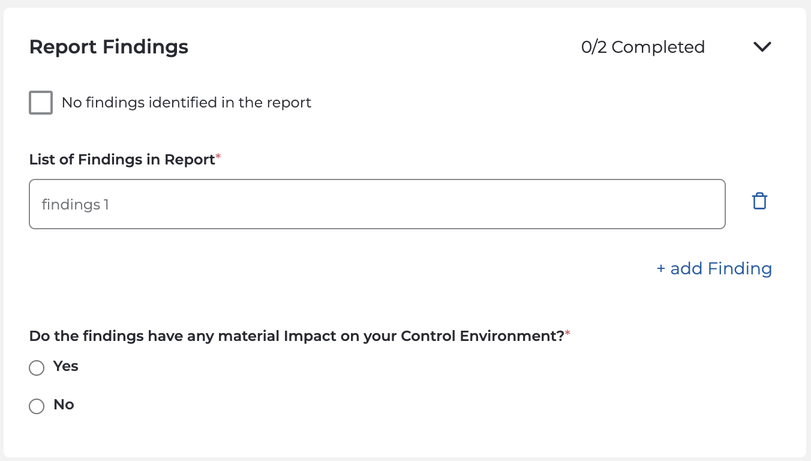
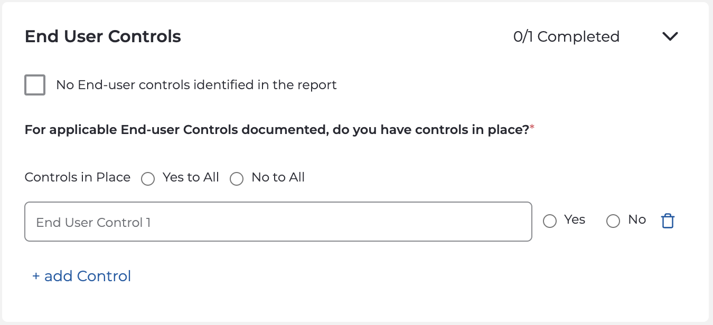
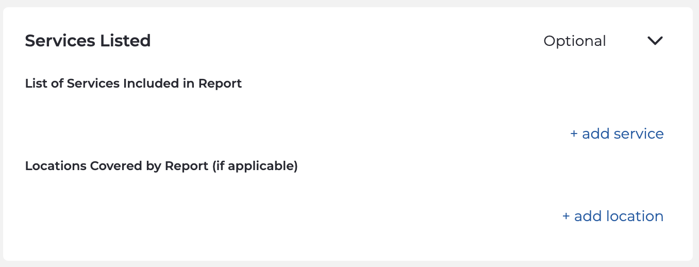
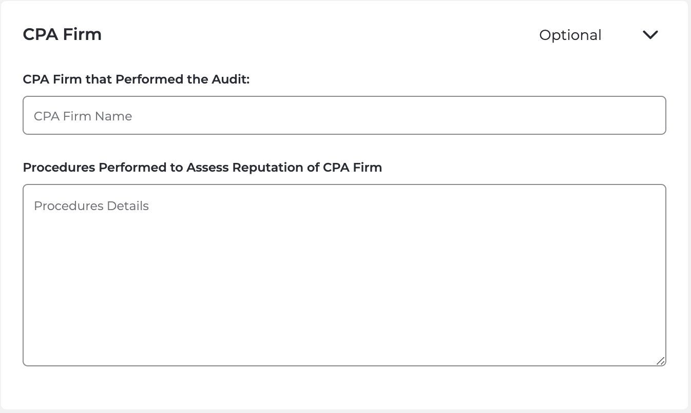
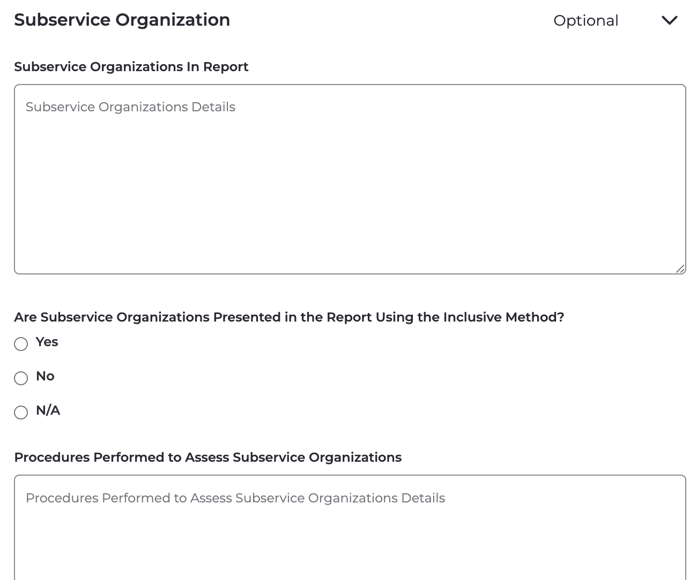

# Reviewing Your Vendors' SOC 2 Reports Using Drata

Source: https://help.drata.com/en/articles/7065036-reviewing-your-vendors-soc-2-reports-using-drata
Collection: Framework Information › SOC 2 2017
Updated: 2026-11-14
Fetched: 2026-11-22

## Article text

**Background**

For the vendors that are in scope for your SOC 2 report and have a high impact on your business (i.e. key vendors), it is advised that you obtain those vendors SOC 2 reports. Not only should you obtain a report, but for any key vendors that you determine to be ‘high risk’, you must also review the report. This article serves as guidance on how to appropriately fill out each section of the SOC Report Review within Drata.

**Reviewer Information:**

The “SOC Report Issue Date” is the date that the SOC report was issued. This is not the "As of" date for Type 1 report or "Audit Period" for a Type 2 report, this date can be found in the service auditor’s report. The service auditor’s report can be found on the firm’s letterhead and includes the date the report was issued. The date can also be found at the bottom of either Section 1 or Section 2 (depending on the auditor). Section 1 or Section 2 will contain a signed management assertion from the management of the vendor, with a date below the signature.

**Compliance Report Scope:**

The “SOC Report” field is used to indicate which kind of SOC report is being reviewed (SOC 1, SOC 2 , or SOC 3). This can be found on the title page of the report.

The “Type” field is used to indicate the type of SOC report that is being reviewed. There are two report types, Type 1 and Type 2. This can often be found on the title page of the report, although it can sometimes be indicated further into the report in the ‘Opinion’ paragraph, found in Section 1 or Section 2 of the report. A Type 1 report will only have an opinion on the system description and design of controls. A Type 2 on the other hand will have an opinion on the system description, design of controls, and the operating effectiveness of controls.

If the report is a SOC 2 report, then the “Trust Services Categories Included” field will need to be filled in. All SOC 2 reports must cover the Security category at a minimum. You can determine which of the other categories (if any) were examined by reviewing the "Scope" paragraph within the Independent Service Auditor's Report (Section 1 or Section 2 depending on the Auditor).

The “Bridge Letter Received To Provide Full Coverage of our Audit Period” field will not be contained within the SOC report. A Bridge or Gap Letter is requested by a customer and issued by management of the vendor to cover the time period between when the vendor’s SOC report was issued and the customer’s report period end date. The purpose of a Bridge Letter is to inform the customer if any relevant changes occurred in the vendor’s control environment since the report was issued. Upload the Bridge Letter that was received in this field.

**Report Opinion:**

The Report Opinion field is where you will note the Service Auditor's opinion of the control environment. This can be found in either Section 1 or Section 2 (Depending on the Auditor) of the report, within the "Opinion" paragraph. An unqualified opinion indicates that the service auditor has determined that the description of the system is fairly and accurately presented, and controls were operating effectively throughout the specified period (for a Type 2) or designed effectively as of a given date (for a Type 1). There could be exceptions noted, but the auditor has determined that they do not result in a modified opinion. A qualified opinion indicates the service auditor has determined that the system description and most controls are fairly and accurately presented and operating effectively, but the service auditor identified some controls that failed to operate effectively. These are described by the auditor in the opinion, with details of the exceptions that resulted in the modified opinion. An adverse opinion indicates the service auditor has determined that the service organization has pervasive and material issues and they have failed to meet one or more control objectives (SOC 1) or criteria (SOC 2). These failure(s) are described in the opinion. Lastly, a disclaimer of opinion indicates that the service auditor cannot issue an opinion due to limitations in the scope of their audit.

The “Do Control Objectives or Trust Principles Encompass Business Needs” field is used to document if the SOC report meets your business needs. For example, if you use a service provider to host your infrastructure and you require 99.999% uptime, but the report does not have Control Objectives (SOC 1) or the Availability Category (Type 2) within it, the report may not meet your business needs.

The “Follow Up Activity if Opinion is Qualified” field is used to document any follow up actions you need to take, if any, if the report is qualified. For example, you may need to request additional information from the vendor to determine how the customer remediated or plans to remediate significant exceptions..

**Report Findings:**

Control exceptions will be listed in Section 4 of the report by listing “Exception Noted” or “Deficiency Noted” (for example) next to a control. If there were no exceptions listed in the report, then you can mark the “No Findings Identified in the Report” radio button.

If there are exceptions, document the findings in the “List of Findings in Report” field. If there is more than one finding in the report, click the “Add Finding” button.

For any exceptions listed, determine if they have any material impact on your control environment? As an example, if you use a vendor for hosting your infrastructure, if they had an exception in a control related to patching servers, this would affect you. But if they had an exception in their control around requiring all employees to acknowledge the code of conduct, this may not impact the service you are using. Click the appropriate radio button in the “Do the Findings Have Any Material Impact on your Control Environment”.

**End User Controls:**

End user control considerations can be found at the end of Section 3 (the system description) of the report. These can also be referred to as “complementary user entity controls”. This section will list out what controls your organization must have in place to receive the full benefit of the vendor's controls. If there are no end-user controls relevant to your organization identified in the report, please indicate that here by checking the box. If there are no end-user controls identified and you check the box, no further action will be needed within the End User Controls section.

If end user controls are documented in the report, determine if you have controls in place for all applicable end user controls. If yes, click the “Yes to All” radio button. Conversely, if you do not have controls in place for all applicable end user controls, then select “No to All’. Note that this is an optional field and if neither of these options (‘Yes to All’ and ‘No to All’) apply to you then do not select either of the options here and move on to the next step.

In this field, list out the relevant end-user controls found in the end user control considerations at the end of Section 3 of the report (select ‘+ add Control’ to add each individual end-user control). List out each end-user control noted in the report and select the ‘Yes’ button if you have a control in place for that particular end-user control. Conversely, select the ‘No’ button if you do not have a control in place for a particular end-user control.

**Services Listed:**

Services included in the report will be contained within Section 3, the System Description of the report. For the purposes of this documentation, only add the services covered by the report, which you rely on.

The list of locations covered by the report will also be contained in Section 3 of the report, in the "Overview" paragraphs. It is important here to ensure that all data center locations that you use are covered in the report. For example, if you are in AWS US-East 1, you will need to ensure that location is covered in the report.

**CPA Firm:**

The name of the Auditing Firm can be found in either Section 1 or Section 2 (Depending on the Auditor) of the report.

This field will contain the procedures you performed to determine if the audit firm was reputable such as viewing the firm’s website, Google searches, and peer review results etc.

**Subservice Organizations:**

A list of subservice organizations that the vendor uses can be found near the end of Section 3 in a section with a title such as "Use of Subservice Organizations and Complementary Subservice Organization Controls". Use the “Subservice Organizations in Report” field to list out the subservice organizations. A subservice organization is your vendor’s vendor. These subservice organizations are responsible for performing some of the control activities listed in the report. As an example, if you use a third party owned data center, that third party owned data center provider is your subservice organization because they are responsible for all controls related to restricting physical access.

This is where you’ll need to determine if subservice organizations exist in the report. If there are no identified subservice organizations listed in Section 3 of the report, check the N/A box. If the report does identify subservice organizations, then you need to determine if the inclusive method was used. If there is only one signed management assertion covering one service organization in the report, then check the "No" box. If there is more than one signed management assertion, check "Yes".

In the “Procedures Performed to Assess Subservice Organizations” field, you will list any procedures you performed to understand what the listed subservices organizations are, the services they provide, and how they relate to your vendor. For example, you may decide that you want to review the SOC reports of the subservice organizations, as well, depending on how critical the subservice organization is to your vendor.

**Conclusion**

It is a SOC 2 requirement that you read, consider, and assess your high risk vendors' SOC reports on an annual basis to ensure you have considered their impact on your own compliance. This is not a one time activity and it is required to conduct these reviews for all high risk vendors on an annual basis (at least once every year) in order to be SOC 2 compliant.

## Images

- [image 01] ../../images/ux/vendors/reviewing-your-vendors-soc-2-reports-using-drata--01.png
- [image 02] ../../images/ux/vendors/reviewing-your-vendors-soc-2-reports-using-drata--02.png
- [image 03] ../../images/ux/vendors/reviewing-your-vendors-soc-2-reports-using-drata--03.png
- [image 04] ../../images/ux/vendors/reviewing-your-vendors-soc-2-reports-using-drata--04.png
- [image 05] ../../images/ux/vendors/reviewing-your-vendors-soc-2-reports-using-drata--05.png
- [image 06] ../../images/ux/vendors/reviewing-your-vendors-soc-2-reports-using-drata--06.png
- [image 07] ../../images/ux/vendors/reviewing-your-vendors-soc-2-reports-using-drata--07.png
- [image 08] ../../images/ux/vendors/reviewing-your-vendors-soc-2-reports-using-drata--08.png

## Related articles

- [How to Determine Key Vendors to include in Drata?](how-to-determine-key-vendors-to-include-in-drata.md)
- [SOC 2 System Description](soc-2-system-description.md)
- [SOC 2 Checklist](soc-2-checklist.md)
- [What Is a SOC 2 Bridge Letter? [+ Template]](what-is-a-soc-2-bridge-letter-template.md)
- [Hosted Technology Vendors: What to Collect and How Drata Can Help](hosted-technology-vendors-what-to-collect-and-how-drata-can-help.md)
