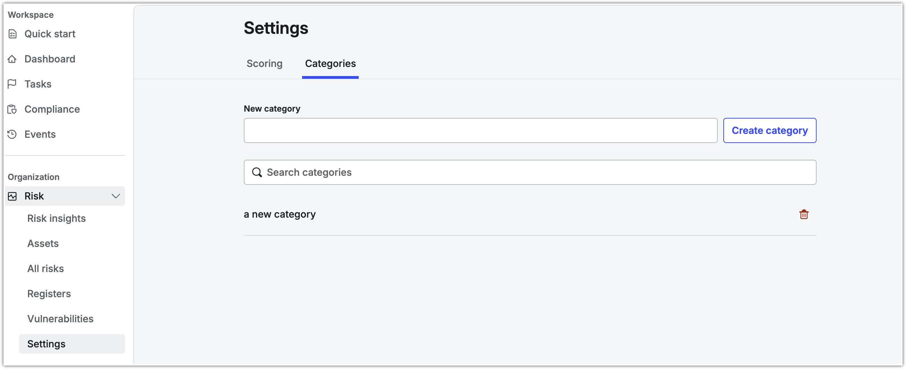
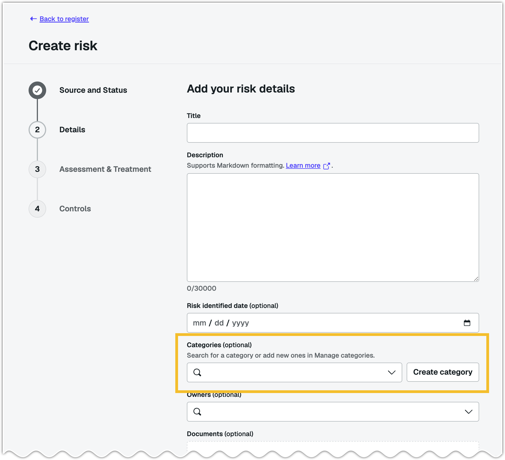

# Risk categories in Drata

Source: https://help.drata.com/en/articles/14358614-risk-categories-in-drata
Collection: Understand the Drata Platform › Risk
Updated: 2026-11-09
Fetched: 2026-11-22
Description: Risk categories in Drata help you organize, filter, and report on risks in your Risk Register.

## Article text

Risk categories serve a few key purposes:

- **Organization and filtering: **
   - Categories let you label and group risks so you can filter them in the **Risk Register**.
   - For example, in **Risk** › **All risks**, you can filter by category to see only risks of a certain type.
- **Insights and dashboards:**
   - Once applied, categories become a filter in **Risk** › **Risk Insights**, so you can view aggregate risk data by category.
- **Custom use cases:**
   - You can create categories for anything meaningful to your organization.
   - For example, you might add a category called `Exception` to track active risk exceptions at a dashboard level.

Drata also includes out-of-the-box categories (for example, Access Control, Asset Management, Software Development, and Privacy – Data Protection) that align with common risk domains.

## Prerequisites

- Your account has **Risk Management Pro** enabled.
- You have the **Admin** or **Risk Manager** role.

---

## Manage custom risk categories

Use the **Categories** tab in Risk settings to create, search, and delete custom risk categories.

**Note:** If you don't see the **Categories** tab, check the following:

- Your account has **Risk Management Pro** enabled.
- You have the **Admin** or **Risk Manager** role.

### Open the Categories tab

1. Go to **Risk** › **Settings**.
2. Select the **Categories** tab.
3. Here you can create, delete, and search for all of your custom categories.

## Create a custom risk category

You can create a custom category directly from a risk while you add it to the Risk Register.

1. Go to **Risk** › **Registers.**
2. Select a Register and create a new risk.
3. In the risk details section, locate the Categories field.
   
4. Enter the new category name, and then select it to create and apply the category.

## Images

- [image 01] ../../images/ux/risk/risk-categories-in-drata--01.png
- [image 02] ../../images/ux/risk/risk-categories-in-drata--02.png

## Related articles

- [Understanding the Drata Risk Register](understanding-the-drata-risk-register.md)
- [Import Risk in Bulk (New Experience)](import-risk-in-bulk-new-experience.md)
- [Risk management in Drata: An overview](risk-management-in-drata-an-overview.md)
- [Manage multiple risk registers (New Experience)](manage-multiple-risk-registers-new-experience.md)
- [Manage Risk Across Workspaces](manage-risk-across-workspaces.md)
