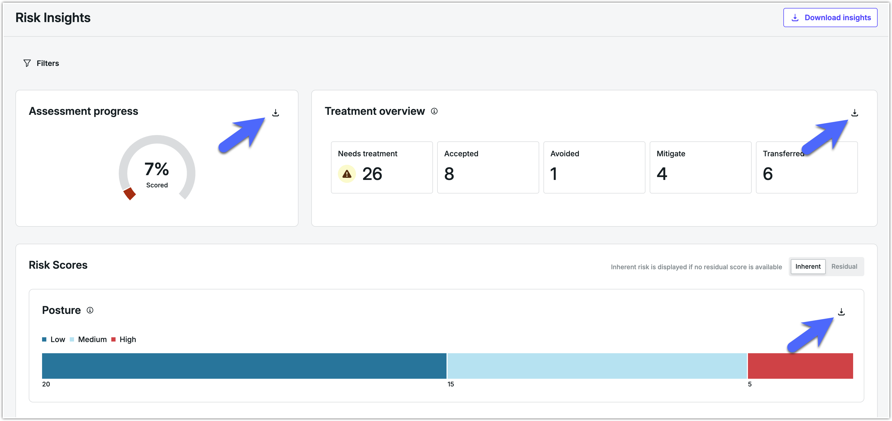
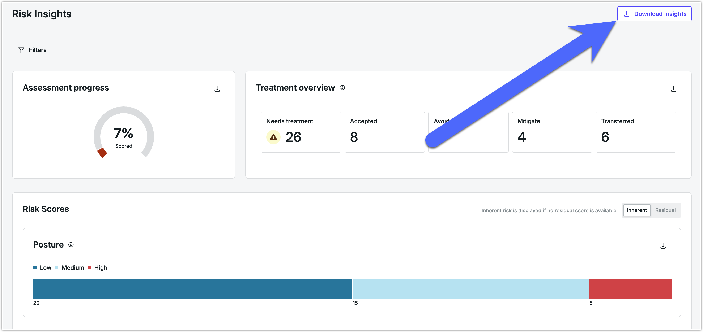

# Risk insights overview

Source: https://help.drata.com/en/articles/13764324-risk-insights-overview
Collection: Understand the Drata Platform › Risk
Updated: 2026-11-09
Fetched: 2026-11-22

## Article text

Use **Risk insights** to visualize how your risk posture is changing over time, understand where risk is concentrated, and export charts for reports and stakeholder updates.

## Access the Risk insights page

1. In the left navigation, go to **Risk**.
2. Select **Risk insights** to open the risk dashboard.

If you don't see **Risk insights**, your organization may not be using Risk Management Pro or you might not have access to the risk module. Contact your Drata admin to confirm your permissions.

---

## Filter and explore the dashboard

At the top of the page, use filters to focus the insights on the risks you care about most:

- **Category**: Show only risks in specific categories (for example, *Access Management* or *Third-party risk*).
- **Owner: **Limit charts to risks owned by specific individuals or teams.
- **Type: **Switch between **Inherent** and **Residual** scores for the **Risk posture**, **Risk heatmap**, **Category breakdown**, and **Risks over time** visualizations using the score-type dropdown.

If your account uses **multiple risk registers**, the dashboard can roll up data across all registers you have access to, or you can filter to a specific register to see insights for that slice only.

---

## Downloading visualizations

You can export charts from Risk insights for executive reports, board decks, and audit packages:

- To download a **single chart**, select the **download** icon on that visualization.
   
- To download **all charts at once**, select **Download insights** to generate a PDF containing the full dashboard snapshot with your current filters applied.
   

Exports respect any filters you've set (for example, by category, owner, or score type).

---

## Insight cards and charts

### Assessment progress

The **Assessment progress** card shows how many risks in your register have been scored versus how many are still unscored.

Use this to:

- Confirm that key risks have been assessed.
- Quickly spot when new or imported risks still need scoring before they'll appear in other charts.

---

### Treatment overview

The **Treatment overview** visualization groups risks by their assigned treatment (for example, *Accept*, *Mitigate*, *Transfer*, or *Avoid*).

- Select a count in the chart to open the **All risks** view filtered to that treatment, so you can review the underlying records and adjust plans if needed.

---

## Risk Scores

### Risk Posture (inherent vs residual)

The **Risk posture** chart groups risks by score band (for example, low, medium, high, and critical), using the score type you select in the **Risk scores** dropdown.

- Use **Inherent** to understand your baseline risk before controls and treatments.
- Use **Residual** to see how much risk remains after mitigation and investment, and to communicate how your program is performing over time.

You can:

- Hover to see counts for each score band.
- Select any colored block to open the **All risks** tab pre-filtered to risks in that band, then export a CSV from the register if you need a detailed list.

### Risks over time

The **Risks over time** line chart shows how your Residual risk posture changes across a selected time period, again based on the inherent or residual score type you choose.

Use it to:

- Track whether total high or critical risk is trending up or down.
- Show stakeholders how mitigation work has affected residual risk over the last few weeks or months.
- Export a PDF snapshot to include in periodic reports or leadership updates.

Note: Historical data for this chart is available starting from **January 3, 2024**, so you won't see data earlier than that date.

### Risk heatmap

The **Risk heatmap** shows all scored risks plotted by **Likelihood** (one axis) and **Impact** (the other), using either inherent or residual scoring based on your current score-type selection.

Use this view to:

- See whether your program is clustered around medium risks, or if you have many high-likelihood / high-impact items.
- Confirm whether mitigation work is moving risks toward lower-impact or lower-likelihood quadrants when you switch from inherent to residual.

Select any square in the heatmap to open the **All risks** tab filtered to risks that share that impact/likelihood combination.

### Category breakdown

The **Category breakdown** chart organizes categories from highest to lowest severity based on the risks they contain, then groups those risks by severity within each category.

You can:

- Scan for categories with a concentration of high or critical risks.
- Select a **category name** to open **All risks** filtered to that category.
- Select a **colored severity block** within a category to open **All risks** filtered to both that category and severity level.

This makes it easier to answer questions like "Which risk categories represent the most exposure right now?" and "Where should we focus next quarter?"

## Images

- [image 01] ../../images/ux/risk/risk-insights-overview--01.png
- [image 02] ../../images/ux/risk/risk-insights-overview--02.png

## Related articles

- [Understanding the Drata Risk Register](understanding-the-drata-risk-register.md)
- [Risk management in Drata: An overview](risk-management-in-drata-an-overview.md)
- [Assess and Manage Individual Risks](assess-and-manage-individual-risks.md)
- [Add and View Residual Risk in the Risk Register (New Experience)](add-and-view-residual-risk-in-the-risk-register-new-experience.md)
- [Risk Insights Training Video (New Experience)](risk-insights-training-video-new-experience.md)
