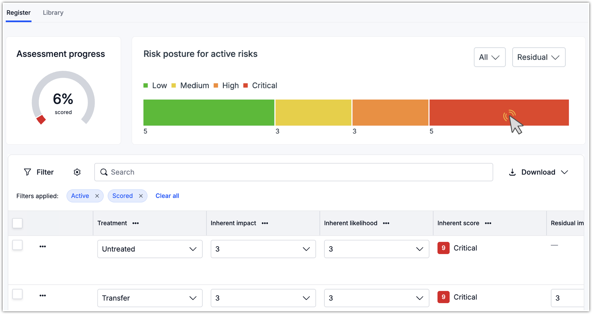
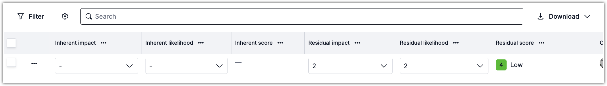
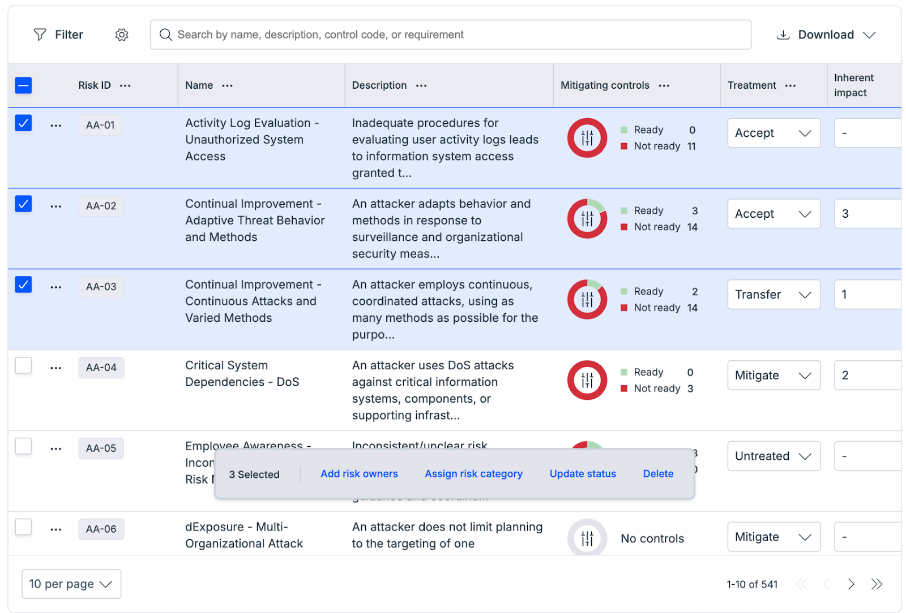

# Risk management in Drata: An overview

Source: https://help.drata.com/en/articles/13355387-risk-management-in-drata-an-overview
Collection: Understand the Drata Platform › Risk
Updated: 2026-11-09
Fetched: 2026-11-22
Description: This article provides the foundational workflow for managing your risk program within Drata.

## Article text

## Overview

Risk Management in Drata helps you identify, evaluate, and manage risks that could affect your organization. Many compliance frameworks, including **SOC 2** and **ISO 27001**, require organizations to perform risk assessments as part of an ongoing risk management program.

A risk assessment is the process of identifying and evaluating potential risks. While risk management is continuous, most organizations review and update risks on a regular cadence to reflect changes in technology, business operations, and the threat landscape.

## Prerequisite

- **Applies to the following plans: **Risk Management Standard or Risk Management Pro
   - **Note:** Some configuration options described below require Risk Management Pro.
- Only controls from frameworks you’ve purchased are pre-mapped in the module.

## Getting started

You can access **Risk Management** from the **Risk section**.

The layout may vary depending on your role and permissions, but core functionality remains the same.

## Register Tab

The **Register tab** displays your organization’s active risks, assessment progress, and Residual risk posture.

Key metrics include:

- **Assessment Progress:** The number of active risks with applied inherent scores.
- **Risk Posture:** A visualization of your organization’s current risk exposure based on inherent or residual risk scores and internal or external risk types.
   - External risks apply to **Risk Management Pro** customers only.

### Tracking risks

The **Assessment Progress** graph shows the percentage of risks that have been assessed and your Residual risk posture. A risk is considered **assessed** once it has an **inherent score**.

### Risk Posture

You can view the **Risk Posture** graph directly on the **Risk Management** page or from **Risk Insights**.

The Risk Posture graph groups risks into severity categories based on **score ranges**. Each color block represents a severity level and displays the number of risks within that range. You can select a block to view associated risks in the table below the graph.

This table displays the default colors, severity labels, and the threshold values.

| **Color** | **Severity** | **Threshold (No Customization)** |
|---|---|---|
| Green | Low risk | 1–4 |
| Yellow | Medium risk | 5–9 |
| Light orange | High risk | 10–19 |
| Orange | Critical risk | 20–25 |

**Pro feature**
With **Risk Management Pro**, you can customize the thresholds, including the threshold names and their meanings in the **Risk Settings**.

## Filters on the Register tab

- **Risk status**: This filter allows you to filter in either the active, closed, or archived status
   - **Active risks**: Risks that you are actively working to manage, treat, or mitigate the risk.
   - **Closed risks**: Risks that you have completed all the work for and are more or less "done".
   - **Archived risks**: Risks that are a historical risk. These risks you may want to continue to track for only documentation purposes because they do not pose a risk (due to non-applicable or obsolete).
- **Assessment**: Each risk without an inherent score
- **Treatment**: This filter is used to categorize risk by the treatment option selected.
- **Risks**:
   - **Needs attention**: Risks mapped to controls that are not ready will display under the "Needs Attention" filter results. This applies to both DCF and custom controls.
   - **Custom Risks**: These are risks you added to the register yourself as opposed to ones you added from Drata's risk library
   - **Internal Risks**: These are risks not attached to or pertaining to a vendor in Drata
   - **External Risks**: These are risks attached to or pertaining to a vendor in Drata

- **Risk Owners**: You may filter risks based on ownership status— whether or not an owner has been assigned.
- **Owners**: You may filter based on the assigned owner.
- **Categories**: You may filter threats based on the categories selected for the risk. These could be either pre-loaded by Drata if you copied the risk from Drata’s risk library, or added by you.

## How scoring works

In Risk Management, risks are evaluated using **impact** and **likelihood** values, which are used to calculate **risk scores**.

The table below explains how each scoring-related column is used.

| **Column Name** | **What it represents** |
|---|---|
| **Inherent impact** | How severe the consequences would be if a risk occurred **before** any treatment or controls are applied. |
| **Inherent likelihood** | How probable it is that a risk will occur **before** any treatment or controls are applied. |
| **Inherent score** | The overall severity of a risk **before** treatment, calculated as:  **Inherent impact × inherent likelihood** |
| **Residual impact** | How severe the consequences would be if a risk occurred **after** treatment or controls are applied. |
| **Residual likelihood** | How probable it is that a risk will occur **after** treatment or controls are applied. |
| **Residual score** | The remaining severity of a risk **after** mitigation, calculated as:  **Residual impact × residual likelihood** |

By default, Risk Management uses a **fixed 1–5 scoring scale** for both **Impact** and **Likelihood**:

- **1** represents the lowest level of impact or likelihood
- **5** represents the highest level of impact or likelihood

These scoring values are preset to ensure consistency across risk evaluations.

**Pro feature**

Custom scoring options are available with **Risk Management Pro**. To customize scoring, an upgrade to Risk Management Pro is required.

## Bulk actions and reports

You can manage risks in bulk by selecting multiple risks in the table and choosing an available action.

**Bulk actions include:**

- Assigning risk owners or categories
- Updating risk statuses
- Deleting multiple risks

Select **Download** to view additional export options, including risk reports, treatment plans, and CSV exports. You can also create custom risks to reflect scenarios unique to your organization.

- **Risk Assessment Report**: Requires company-specific details to be added for audit readiness (marked as <info>). Once completed, upload it to your Evidence Library in Drata.

- **CSV Downloads:**
   - **Risk Treatment**: Contains all risk treatment metadata, allowing you to track and manage treatment plans.
   - **All Risks CSV**: Exports a complete list of all data for all risks in your register.
   - **Filtered View CSV**: Exports only the risks shown in your currently applied filtered view.

To learn more, view: **[How to Manage Custom Risks](https://help.drata.com/en/articles/8490388-risk-management-custom-risk-scoring-legend)**

> 🎓 **Want to learn more?** Dive deeper into this topic and see it in action! Check out our dedicated Risks course over at the **[Drata Academy](https://academy.drata.com/risks-vendor-management)**.

## Images

- [image 01] ../../images/ux/risk/risk-management-in-drata-an-overview--01.png
- [image 02] ../../images/ux/risk/risk-management-in-drata-an-overview--02.png
- [image 03] ../../images/ux/risk/risk-management-in-drata-an-overview--03.png

## Related articles

- [Getting started with a risk assessment (Concept Guide)](getting-started-with-a-risk-assessment-concept-guide.md)
- [Understanding the Drata Risk Register](understanding-the-drata-risk-register.md)
- [Assess and Manage Individual Risks](assess-and-manage-individual-risks.md)
- [Risk insights overview](risk-insights-overview.md)
- [Risk Management Training Videos (New Experience)](risk-management-training-videos-new-experience.md)
