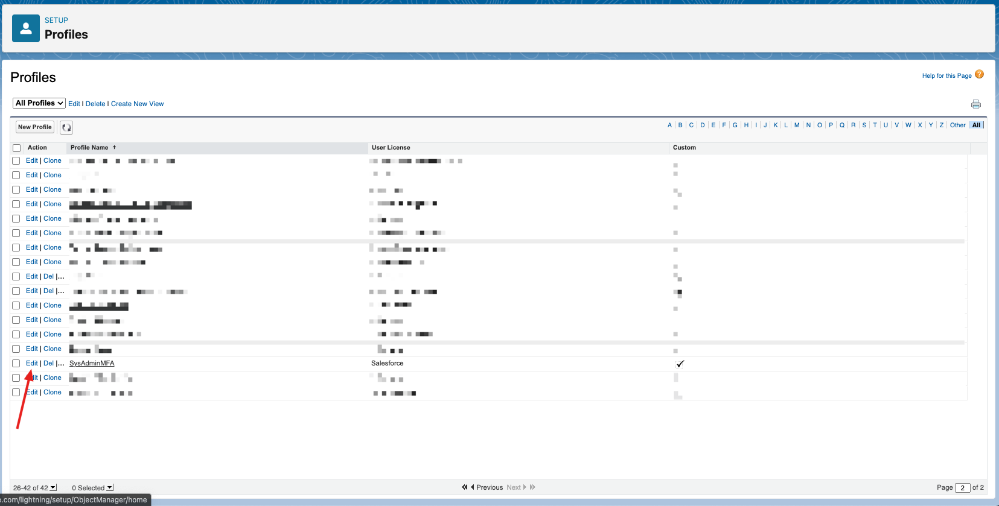
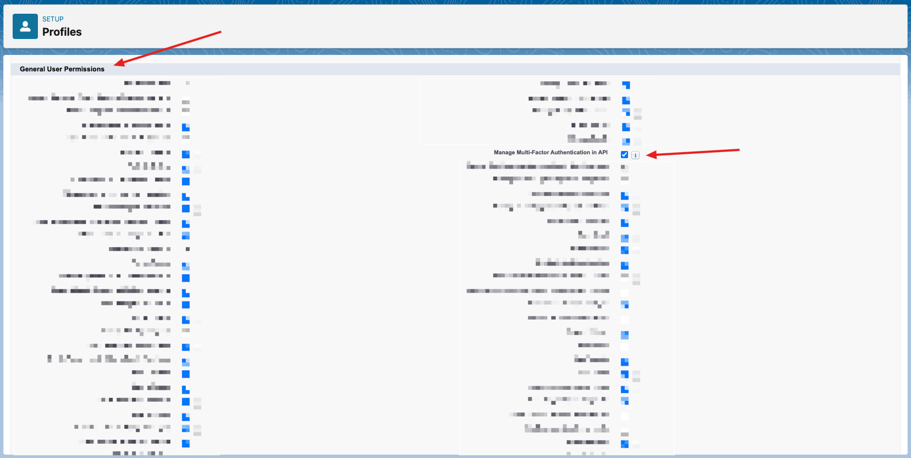
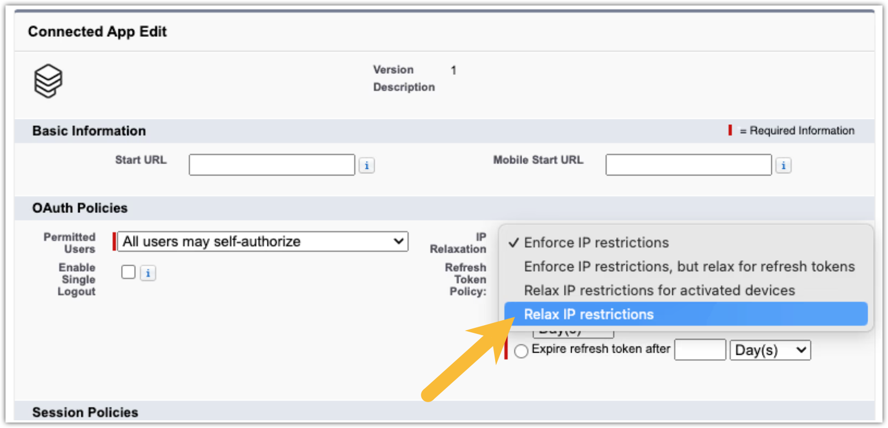

# Salesforce Integration Guide (User Access Review)

Source: https://help.drata.com/en/articles/9923104-salesforce-integration-guide-user-access-review
Collection: Connection Support › Other Guidance
Updated: 2026-10-19
Fetched: 2026-11-22

## Article text

The **Salesforce integration** enables teams to automate **User Access Reviews (UAR)** by retrieving user access and permission data from Salesforce. It connects Drata to Salesforce so your team can continuously review access, validate controls, and support compliance requirements.

This article focuses on using Salesforce with Drata for **User Access Review**.

## Prerequisites & Data Access

- Access to a Salesforce account
- Salesforce custom domain
- Salesforce user with permission to authorize API access

### Permissions & Data Table

| Permission / Data Type | Why It’s Needed | Data Accessed (Read Only) |
|---|---|---|
| User identities | Identify users for access review | User ID, first name, last name, username, email |
| Group memberships | Understand access inheritance | Salesforce groups |
| Role assignments | Review role-based access | Salesforce roles |
| Permission assignments | Evaluate granted access | Permission-related identifiers |
| Admin status | Identify privileged users | Admin flag |
| MFA status | Validate MFA enforcement | MFA enabled / disabled |
| Raw user metadata | Identify service accounts | UserType and other user object fields |

## Step-by-Step Setup

### Step 1: Retrieve Your Salesforce Custom Domain

1. Log in to Salesforce.
2. In your browser’s address bar, locate the first portion of the URL.
   It will follow this format:

```
your_custom_domain.lightning.force.com/lightning/page/home
```

Copy your custom domain. Do **not** include `https://`. The domain must end in a valid Salesforce domain (for example, `my.salesforce.com` or `lightning.force.com`)

---

### Step 2: Connect Salesforce in Drata

1. In Drata, select **Connections** from the side navigation.
2. Select the **Available connections** tab.
3. Search for **Salesforce** and select **Connect**.
4. Select **User Access Review** as the connection type.
5. Enter your Salesforce custom domain:
   - Do **not** include `https://`
   - The domain must end in a valid Salesforce domain (for example, `my.salesforce.com` or `lightning.force.com`)
6. Select **Make connection**.
7. You will be redirected to Salesforce to authenticate and authorize the connection.

**Expected outcome:**
You should see Salesforce listed as connected for User Access Review in Drata.

### Step 3: Enable MFA Visibility (Optional)

**Note:** MFA must be enabled to view MFA status in Drata.

1. Access your Salesforce account.
2. Navigate and select **Setup** in the top-right corner.
3. In the Setup Home page, under **Administration**, select **Users** and then **Profiles**. You can also type "Profiles" in the Quick Find search box.
4. Locate for the user's profile who created the Salesforce connection within Drata and select **Edit** under the **Action** column.
   
5. Go to *General User Permissions* section and look for the permission named **Manage Multi-Factor Authentication in API**. It has to be enabled to get the MFA data from the API.
6. Under the **General User Permissions **section, enable the **Manage Multi-Factor Authentication in API** permission. This allows MFA data to be retrieved through the API.
   

This permission allows Drata to retrieve MFA status through the Salesforce API.

**Expected outcome:**
Drata can retrieve MFA status for Salesforce users.

## Troubleshooting

**I see "Unable to create a connection. Please try again." when connecting** This can happen if your Salesforce org restricts the Drata connected app to specific IP ranges.

To resolve it:

1. In Salesforce, go to **Setup → App Manager**.
2. Find the Drata app and open its **Policies** tab.
3. Click **Edit**, and under **App Authorization**, set **IP Relaxation** to **Relax IP restrictions**.
   
4. Click **Save**, then return to Drata and retry the connection in Step 2.

## Additional Context: Salesforce CRM

If you have **Drata Trust Center Pro**, you can also connect Salesforce as a **CRM**. This integration is **read-only**, and Drata queries Salesforce records (such as leads or opportunities) **only when required to support document access and NDA-related checks**.

## Images

- [image 01] ../../images/integrations/salesforce/salesforce-integration-guide-user-access-review--01.png
- [image 02] ../../images/integrations/salesforce/salesforce-integration-guide-user-access-review--02.png
- [image 03] ../../images/integrations/salesforce/salesforce-integration-guide-user-access-review--03.png

## Related articles

- [GitLab Integration Guide](gitlab-integration-guide.md)
- [OneLogin Integration Guide](onelogin-integration-guide.md)
- [Okta Integration Guide (User Access Review)](okta-integration-guide-user-access-review.md)
- [CyberArk Integration Guide](cyberark-integration-guide.md)
- [Google Workspace Integration Guide (User Access Reviews)](google-workspace-integration-guide-user-access-reviews.md)
