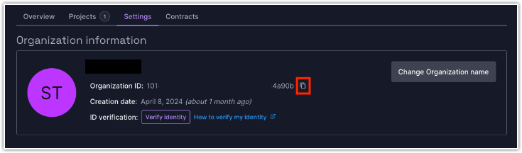

# Scaleway Integration Guide

Source: https://help.drata.com/en/articles/9769775-scaleway-integration-guide
Collection: Connection Support › Other Guidance
Updated: 2026-03-04
Fetched: 2026-11-22
Description: Learn how to connect Scaleway to Drata. This connection supports the following types: User Access Reviews (UAR).

## Article text

The **Scaleway integration** enables security and compliance teams to automate **User Access Reviews (UAR)** by syncing user and access data from Scaleway. This helps organizations review who has access to Scaleway resources and maintain accurate access records for compliance monitoring.

---

## Key Capabilities

- **User Access Review Data Sync:** Import Scaleway user and application access data into Drata
- **Access Governance:** Monitor which users and applications have access to your Scaleway organization
- **Compliance Monitoring:** Maintain visibility into system access to support audit and compliance requirements

This integration supports **User Access Review workflows**, helping demonstrate compliance with **access control policies**.

---

## Prerequisites & Data Access

### Scaleway Access Requirements

- Your **Scaleway role** must have access to **Organization Features**.
- You must retrieve your **Scaleway Organization ID**.
- You must create a **Scaleway application and API key** to authenticate the integration.
- You must create a **policy with organization feature access** for the application.

### Drata Role Requirements

- To create or modify connections, you must have one of the following **Drata roles with write access**: Admin, Workspace Manager, or DevOps Engineer
- **Access Reviewers** can view the connection page but cannot create or modify connections

---

### Permissions & Required Access

| Permission / Access | Why It’s Needed |
|---|---|
| Access to Organization features | Allows Drata to retrieve organization-level access data |
| Scaleway Organization ID | Identifies the organization being connected |
| Secret Key (API key) | Authenticates the integration with Scaleway |

---

## Step-by-Step Setup

### Step 1: Retrieve Your Scaleway Organization ID

1. Log in to your **Scaleway account**.
2. Navigate to your **Organization Dashboard**.
3. Open the **Settings** tab.
4. Locate and copy the **Organization ID**.

Expected outcome:
You have copied the **Scaleway Organization ID** required for the integration.

---

### Step 2: Create a Policy for the Application

1. Select your **profile icon** in the top-right corner.
2. Navigate to **Identity and Access Management (IAM)**.
3. Open the **Policies** tab.
4. Select **Create policy**.
5. Enter the following details:
   - **Name**
   - **Description**
   - **Principal**
6. Configure the principal:
   - **Principal type:** Select **Application**
   - **Application:** Enter or select the application name.
7. Add a rule:
   - Select **Access to Organization features**.
8. Validate the rule and create the policy.

Expected outcome:
A policy with **organization feature access** is created.

---

### Step 3: Create the Scaleway Application

1. In **IAM**, navigate to the **Applications** tab.
2. Select **Create application**.
3. Enter the following details:
   - **Application name**
   - **Description**
4. Attach the **policy created in Step 2**.
5. Select **Create application**.

Expected outcome:
A Scaleway application is created with the required policy.

---

### Step 4: Generate an API Key

1. In **IAM**, open the **API keys** tab.
2. Select **Generate API key**.
3. Configure the key with the following settings:
   - **API key bearer:** Select **An application** and choose the application created earlier.
   - **Expiration:** Select **Never**.
   - **Object Storage usage:** Select **No, skip for now**.
4. Generate the API key.
5. Copy the **Secret Key** and store it securely.

Expected outcome:
You have generated a **Secret Key** that will be used to authenticate the integration.

---

### Step 5: Connect Scaleway in Drata

1. Log in to **Drata** → go to the **Connections** page.
2. Navigate to your **Available Connections**.
3. Search for and start the **Scaleway connection process**.
4. Enter the following information when prompted:
   - **Scaleway Organization ID**
   - **Secret Key**

Expected outcome:
Scaleway is successfully connected and access data begins syncing to Drata.

---

## Important Notes

- **Authentication method:** The Scaleway integration uses an **API key (Secret Key)** tied to a Scaleway application.
- **Required policy:** The application must have a policy granting **Access to Organization features**.
- **Security best practice:** Store API keys securely and rotate them according to your organization’s security policies.
- **Network restrictions:** If your organization uses a **Web Application Firewall (WAF)**, ensure required Drata IP addresses are allowlisted so the connection can be established.

## Images

- [image 01] ../../images/integrations/scaleway/scaleway-integration-guide--01.png

## Related articles

- [Webex Integration Guide](webex-integration-guide.md)
- [Zelt Integration Guide](zelt-integration-guide.md)
- [Fivetran Integration Guide](fivetran-integration-guide.md)
- [Gong Integration Guide](gong-integration-guide.md)
- [Kameleoon Integration Guide](kameleoon-integration-guide.md)
