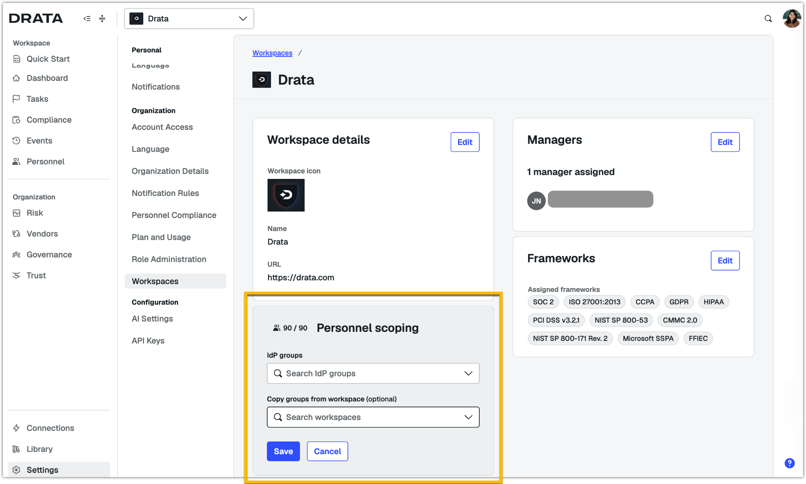
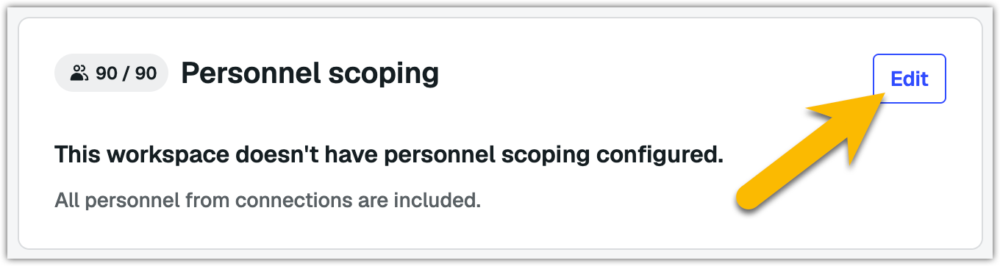
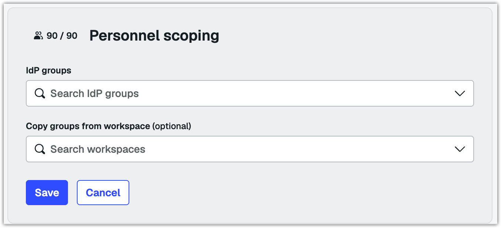
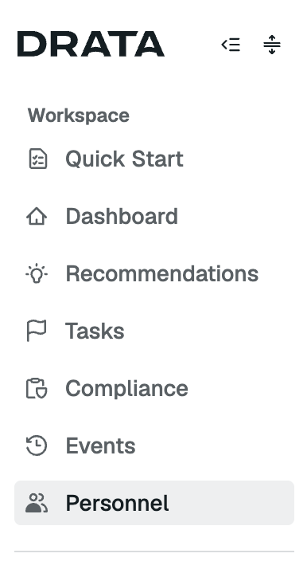
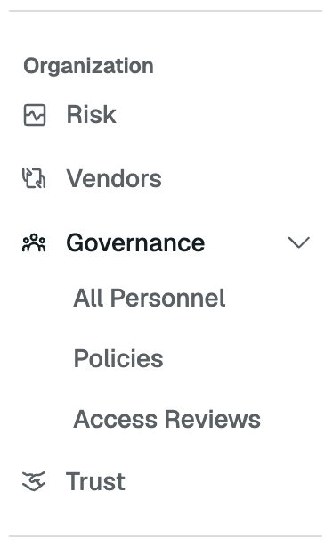

# Scope personnel to a Workspace

Source: https://help.drata.com/en/articles/16530213-scope-personnel-to-a-workspace
Collection: Getting Started › Workspaces
Updated: 2026-11-14
Fetched: 2026-11-22

## Article text

If your organization uses Workspaces in Drata — for example, to represent different business units, subsidiaries, or regional entities — you may have noticed that all personnel appear in every Workspace by default, whether or not they're actually relevant to that Workspace's compliance program.

Personnel Scoping lets you control which personnel appear in each Workspace by mapping IdP (identity provider) groups to Workspaces. Only members of the group(s) you assign to a Workspace will show up as personnel in that Workspace, so your compliance checks, audit evidence, and personnel lists reflect reality.

## Prerequisites

Make sure that:

- Workspaces are enabled for your Drata account.
- Your IdP is connected to Drata and make sure the IdP groups you want to use have synced to Drata.
- You have permission to configure personnel scoping. You must have the Administrator role, or the Workspace Manager role for the Workspace you want to configure.

## Understand Workspace personnel scoping

Workspace personnel scoping determines which personnel appear when you view a specific Workspace. It does not create duplicate personnel records or remove personnel from your Drata account.

The following rules apply:

- Workspace scoping does not delete personnel records from Drata. It only controls which personnel appear in a specific Workspace.
- You can select more than one IdP group for a Workspace.
- If no groups are selected, the Workspace shows all personnel.
- Groups with the same name from different IdP connections are treated as separate groups.
- The same IdP group can be selected for multiple Workspaces

Workspace personnel scoping is different from the following settings:

- **Out of Scope status:** Excludes a personnel record from applicable compliance tracking while preserving the record and its history.
- **Personnel exclusions:** Excludes a person from specific compliance checks when those checks do not apply to them.

## Configure personnel scoping for a Workspace

To configure personnel scoping for the first time:

1. Go to **Settings**.
2. Under **Organization**, select **Workspaces**.
3. Select the Workspace that you want to configure.
4. In the **Personnel scoping** section, select **Edit**.
   
5. Search for and select the IdP group(s) whose members should appear in the Workspace.
   

After you save, the Workspace shows only the personnel from the selected group(s).

**Important**: Before saving, confirm that you selected every IdP group whose members should be included in this Workspace. Workspace scoping changes the personnel population used for the Personnel page, Framework Readiness score, compliance checks, monitoring tests, audit sampling, and exports. If you leave out a group that should be included, those Workspace results may not reflect your complete compliance population.

You can also open personnel scoping from the Personnel page for a Workspace: select the **Workspace picker**, select the Workspace, go to **Governance > All Personnel**, and select **Configure scope**. Both entry points open the same personnel scoping dialog.

### View personnel in a Workspace

To view the personnel assigned to a Workspace:

1. Select the Workspace picker.
2. Select the Workspace that you want to review.
3. Go to** Personnel** under the **Workspace** menu.
   
4. Review the personnel list.

NOTE: To view all personnel in your organization, go to **Governance > All Personnel** under the **Organization** menu.

## Export personnel for a Workspace

You can export personnel data from the Personnel page.

When you export personnel while viewing a scoped Workspace, the export includes the personnel available in that Workspace.

To export personnel data:

1. Select the Workspace picker.
2. Select the Workspace that you want to export.
3. Go to **Governance > Personnel**.
4. Apply any filters that you want to include in the export.
5. Select the download option.
6. Select the report type that you want to download.

## Understand IdP sync and Workspace scope

Drata uses IdP group membership to determine whether a person belongs in a Workspace configured with personnel scoping.

Changes made in the IdP can take time to appear in Drata.

If the person does not appear as expected after the sync completes, verify that:

- The person is present in the connected IdP.
- The person belongs to the expected IdP group.
- The group is synced to Drata.
- The group is selected in the Workspace personnel scope.
- The person is not affected by another personnel status or record-level setting.

## Manage personnel in multiple Workspaces

A person can belong to more than one Workspace when they are a member of a selected IdP group for each Workspace.

If the same person is assigned to multiple Workspaces, Drata continues to use one personnel record for that person.

To manage a person who belongs to multiple Workspaces:

1. Select the Workspace that you want to manage.
2. Go to **Governance > Personnel**.
3. Search for the person.
4. Complete the available action in the context of the selected Workspace.

## Troubleshoot Workspace personnel scoping

### An IdP group is no longer available

If an IdP group is renamed, deleted, or no longer synced, the Workspace shows only personnel who are not assigned to any IdP group. It does not automatically show all personnel. Review the Workspace personnel scope and update it with an active IdP group as needed.

## Frequently asked questions

### Does Workspace personnel scoping delete personnel records?

No. Workspace personnel scoping changes which personnel appear in a Workspace. It does not delete personnel records.

### Does Workspace personnel scoping mark personnel as Out of Scope?

No. Workspace personnel scoping and Out of Scope status serve different purposes. Use Out of Scope status when a personnel record should be excluded from applicable compliance tracking, not simply because the person belongs to another Workspace.

### Does Workspace personnel scoping exclude personnel from compliance checks?

Workspace personnel scoping determines the personnel population associated with a Workspace, and therefore will be checked for compliance within that Workspace. Personnel exclusions determine whether a person is excluded from a specific compliance check.

## Images

- [image 01] ../../images/ux/workspaces/scope-personnel-to-a-workspace--01.png
- [image 02] ../../images/ux/workspaces/scope-personnel-to-a-workspace--02.png
- [image 03] ../../images/ux/workspaces/scope-personnel-to-a-workspace--03.png
- [image 04] ../../images/ux/workspaces/scope-personnel-to-a-workspace--04.png
- [image 05] ../../images/ux/personnel/scope-personnel-to-a-workspace--05.png

## Related articles

- [Populating and Managing Personnel Data in Drata (Concept Guide)](populating-and-managing-personnel-data-in-drata-concept-guide.md)
- [Personnel Overview](personnel-overview.md)
- [Personnel exclusions](personnel-exclusions.md)
- [Future Hire Personnel](future-hire-personnel.md)
- [Mark personnel as Out of Scope (New Experience)](mark-personnel-as-out-of-scope-new-experience.md)
