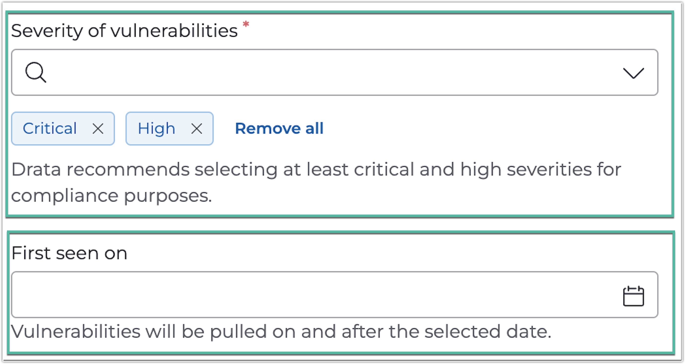

# Semgrep Integration Guide

Source: https://help.drata.com/en/articles/9750516-semgrep-integration-guide
Collection: Connection Support › Other Guidance
Updated: 2026-07-29
Fetched: 2026-11-22
Description: This article walks through the details of configuring Semgrep to connect to Drata.

## Article text

Connecting Semgrep to Drata allows for the automated, continuous monitoring of SLA due dates and evidence collection of vulnerability issues required for compliance.

## Key Capabilities

This integration automates evidence collection for the **Vulnerability Scanning** test, which is mapped to **DCF-18** by default. You can view findings by selecting the **View Findings** button after connecting or navigating directly to the **Vulnerabilities** page through the left-side navigation menu.

## Prerequisites & Data Access

- **Semgrep API token **with the following scopes enabled:
   - **Agent CI**
   - **Web API**
- Must be assigned one of the following Drata roles: **Admin, Workspace Managers, DevOps Engineer**.
- If you have the **Access Reviewer** Drata role, you can only view the Connections page.

**Note**: Drata will pull up to 1,000 new or updated vulnerabilities for each connection daily, ordered by severity from critical to low. You can select what kind of vulnerabilities will be synced based on the severity when connecting.

### Permissions & Data Table

| Permission / Scope | Why It’s Needed | Data Accessed (Read Only) |
|---|---|---|
| Semgrep API Token | Allows Drata to retrieve Semgrep vulnerability data | Vulnerability metadata |

## Step-by-Step Setup

### Step 1: Configure the Semgrep Connection

Follow these steps to generate a Semgrep API token with the correct permissions for Drata:

1. **Log in to your Semgrep account** at: [https://semgrep.dev](https://semgrep.dev)
2. In the top-right corner, select your **profile icon**, then choose **Settings**.
3. From the left-hand navigation menu, select **API Tokens**.
4. Click **Create API Token**.
5. In the token creation window:
   - Enter a **name** for the token (for example: *Drata Integration*).
   - Enable the following scopes:
      - **Agent CI**: allows Drata to access Semgrep findings generated by CI scans.
      - **Web API**: allows Drata to retrieve vulnerability metadata and scan results.
6. Click **Create Token**.
7. Copy your API token **immediately** and store it securely.
   Semgrep will not show the token again after you close the window.
8. Use this token when connecting Semgrep to Drata.

### Step 2: Configure the Semgrep Connection

1. Select **Connections** from the left-side navigation menu.
2. Go to the **Available Connections** tab and search for "Semgrep".
   - Alternatively, you can select **Vulnerability Scanning** under the **Types** section of the connections to search for the connection.
3. In the connection drawer, you can select the severity and the date of the vulnerabilities you want to sync. These selections will also be included in the test result report for visibility.
   - **Severity of vulnerabilities**: Select the severity level of the vulnerabilities that you want to sync into Drata for compliance monitoring. Critical and High are auto-selected. Drata will bring up to 1000 new vulnerabilities or updates to vulnerabilities, sorted by severity.
   - **First seen on**: Select the date when the vulnerabilities you want to sync were first created. All vulnerabilities detected on and after this date will be synced.
      
4. Select the connect button to proceed.
5. Enter the newly created web API token.

Once the connection is successfully created, you can select the **View Findings** button on the connection card or navigate to the **Vulnerabilities** page to review and manage the synced vulnerabilities for compliance monitoring.

Drata shows *findings*, which are instances of *vulnerabilities* (an individual but higher-level CVE) against specific resources. This may reflect as higher finding counts in Drata vs. your Semgrep dashboard.

## Images

- [image 01] ../../images/integrations/snyk/snyk-integration-guide--01.png

## Related articles

- [Snyk Integration Guide](snyk-integration-guide.md)
- [Tenable Vulnerability Management Integration Guide](tenable-vulnerability-management-integration-guide.md)
- [CrowdStrike Falcon Exposure Management Integration Guide](crowdstrike-falcon-exposure-management-integration-guide.md)
- [SentinelOne Singularity Vulnerability Management (VMS) Integration Guide](sentinelone-singularity-vulnerability-management-vms-integration-guide.md)
- [Rapid7 InsightVM Integration Guide](rapid7-insightvm-integration-guide.md)
