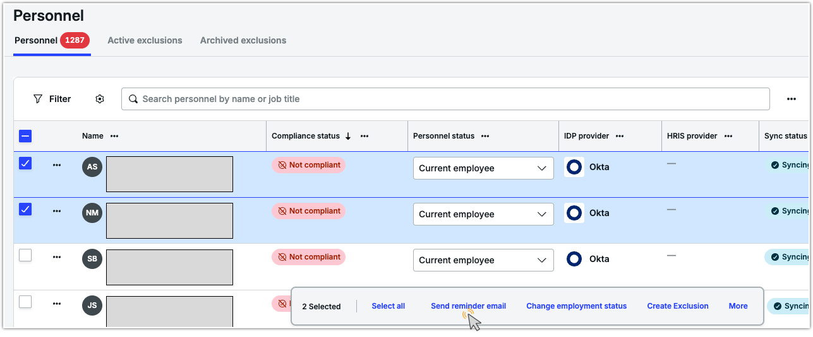
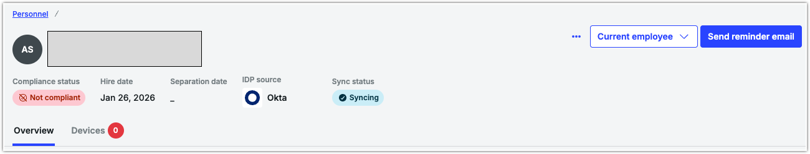

# Send reminder email to personnel

Source: https://help.drata.com/en/articles/13534745-send-reminder-email-to-personnel
Collection: Understand the Drata Platform › Personnel
Updated: 2026-11-09
Fetched: 2026-11-22
Description: Use this article to send reminders to personnel who haven’t completed required onboarding items in Drata.

## Article text

Sending reminders helps ensure required onboarding items are completed on time and keeps your organization on track for compliance. Incomplete onboarding items can delay compliance readiness and create gaps during audits. Reminders provide a simple way to prompt personnel to take action without manual follow-up.

## Send a reminder email

You can send reminder emails from the Personnel page in either of the following ways. You can only send reminder emails to personnel with incomplete required items.

**From the Personnel table**

1. Open **Personnel**.
2. Locate and select one or more people with incomplete onboarding items.
3. Select **Send reminder email**.

**From an individual personnel record**

1. Open **Personnel**.
2. Select the person with incomplete onboarding items.
3. On the person's details page, select **Send reminder email**.

Drata sends an email reminder prompting the person to complete their required onboarding items.

## Images

- [image 01] ../../images/ux/personnel/send-reminder-email-to-personnel--01.png
- [image 02] ../../images/ux/personnel/send-reminder-email-to-personnel--02.png

## Related articles

- [Populating and Managing Personnel Data in Drata (Concept Guide)](populating-and-managing-personnel-data-in-drata-concept-guide.md)
- [Create Workflow for Personnel](create-workflow-for-personnel.md)
- [Personnel Overview](personnel-overview.md)
- [Reset recurring personnel trainings](reset-recurring-personnel-trainings.md)
- [Creating an SLA for Employee Onboarding Completion](creating-an-sla-for-employee-onboarding-completion.md)
