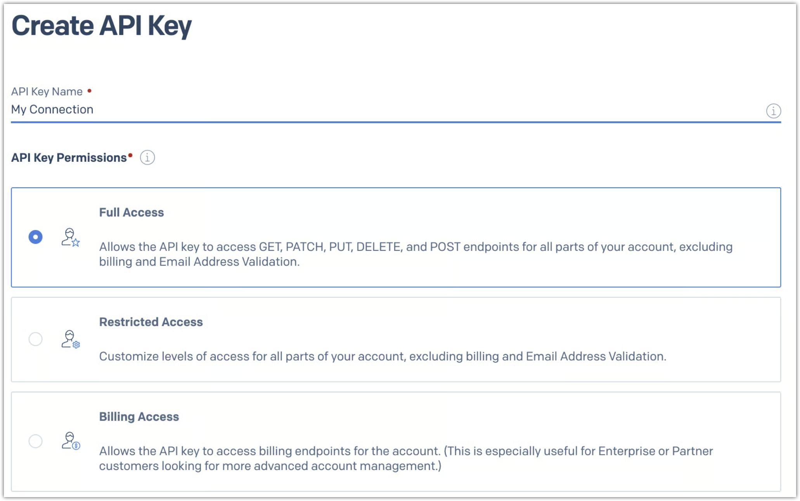

# SendGrid Integration Guide

Source: https://help.drata.com/en/articles/9794365-sendgrid-integration-guide
Collection: Connection Support › Other Guidance
Updated: 2026-06-30
Fetched: 2026-11-22

## Article text

The SendGrid integration enables security and compliance teams to review who has access to SendGrid in their organization. It connects Drata to SendGrid so your team can monitor user access and roles to support compliance and access governance requirements.

## Key Capabilities

- User access review data: Review users with access to SendGrid
- Role visibility: Monitor assigned roles within the platform
- Automated evidence collection: Sync access data into Drata for compliance reviews

This integration is used to automate tests such as user access review verification and privileged access review, helping prove compliance with access control and least privilege policies.

## Prerequisites & Data Access

- **Owner privileges** in your SendGrid account
- Ability to generate a **SendGrid API Key**
- Required Drata Role with Write access: Admin, Workspace Managers, DevOps Engineer
- Access Reviewers (Access Reviewers can only Read the connection page they can’t make changes)

### Permissions & Data Table

| Permission/Scope | Why It’s Needed |
|---|---|
| SendGrid API Key | Allows Drata to authenticate and retrieve SendGrid user access information |

## Step-by-Step Setup

### Step 1: Generate a SendGrid API Key

1. Log in to **SendGrid**.
2. Navigate to **Settings**.
3. Select **API Keys**.
4. Select **Create API Key**.
5. Enter the API Key Name and select **Full Access** under *API Key Permissions*.
   
6. Create the API key.
7. Copy and securely store the API key.

Expected outcome: You have a SendGrid API key required to authenticate the integration.

### Step 2: Connect SendGrid in Drata

1. Log in to **Drata** → go to the **Connections** page.
2. Navigate to your **Available Connections**.
3. Search for and start the **SendGrid** connection process.
4. Enter your **SendGrid API Key** when prompted.

Expected outcome:
SendGrid is successfully connected and user access data begins syncing to Drata.

## Important Notes

- This integration is used for **User Access Review** and focuses on reviewing users and roles within SendGrid.
- Ensure the API key is generated from **Settings → API Keys → Create API Key** in SendGrid.
- If your organization uses a **Web Application Firewall (WAF)**, ensure required IP addresses are allowlisted for the integration.

## Images

- [image 01] ../../images/integrations/sendgrid/sendgrid-integration-guide--01.png

## Related articles

- [Ashby Integration Guide](ashby-integration-guide.md)
- [Salesloft Integration Guide](salesloft-integration-guide.md)
- [Aircall Integration Guide](aircall-integration-guide.md)
- [Articulate Integration Guide](articulate-integration-guide.md)
- [Dropbox Sign Integration Guide](dropbox-sign-integration-guide.md)
