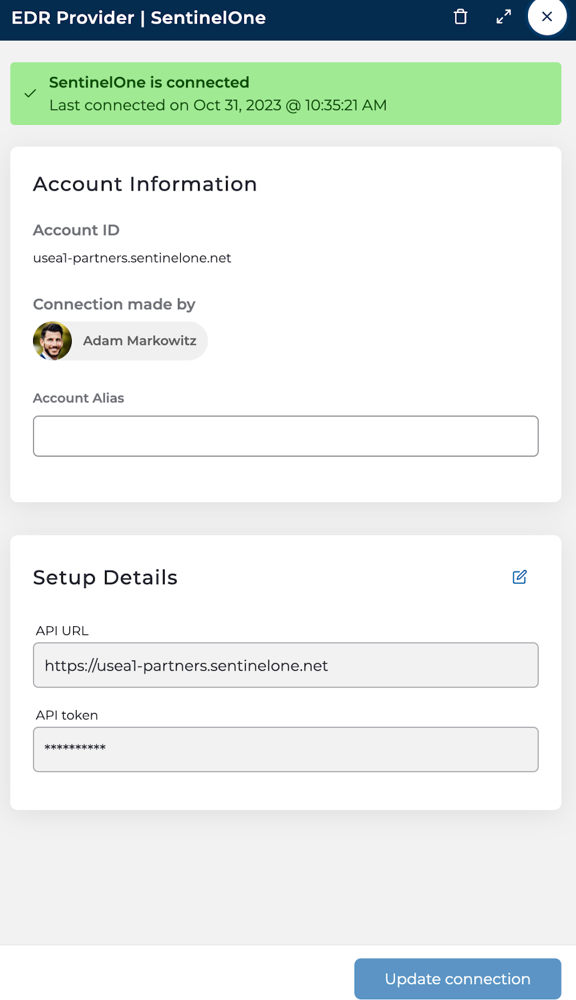
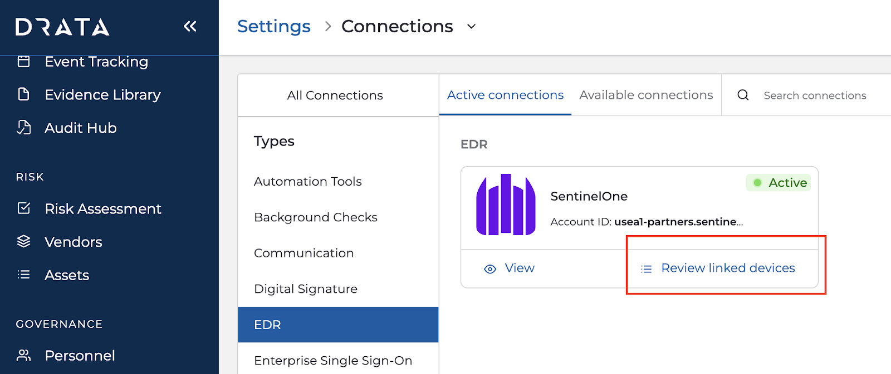
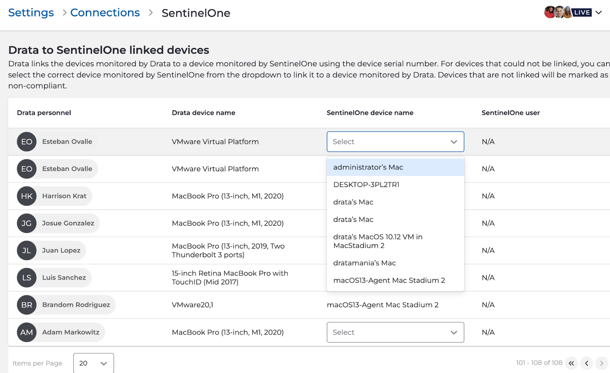
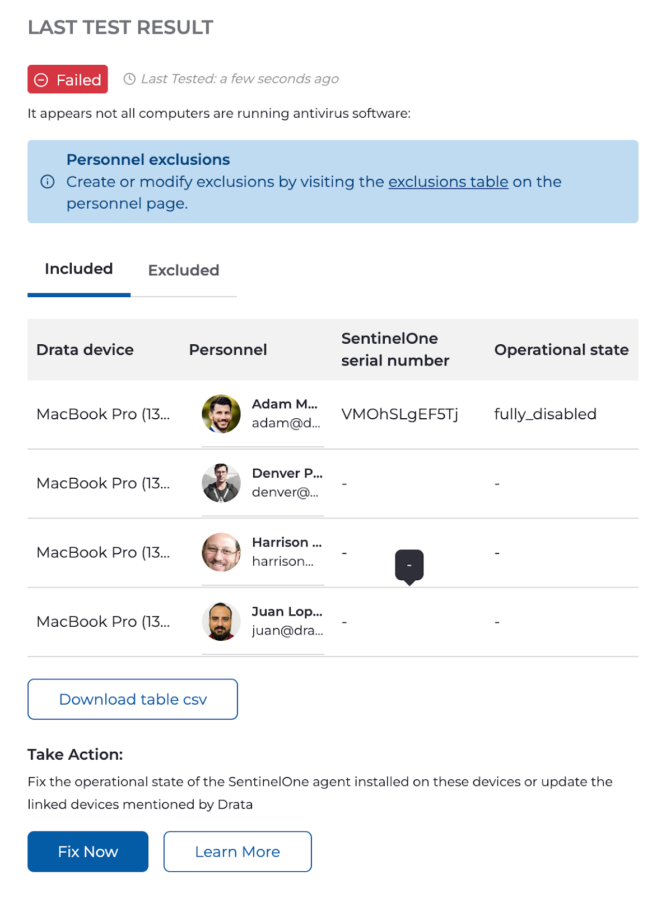
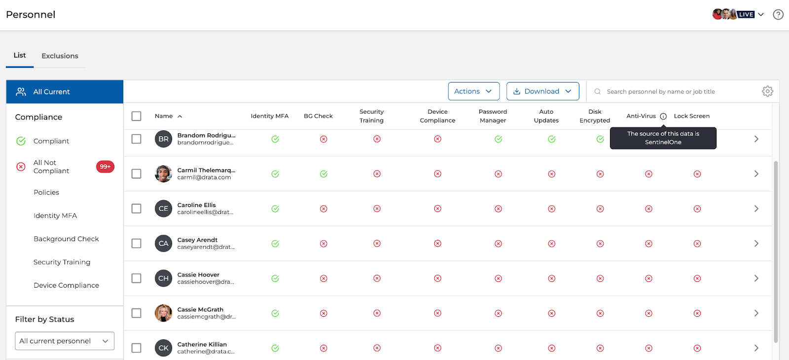
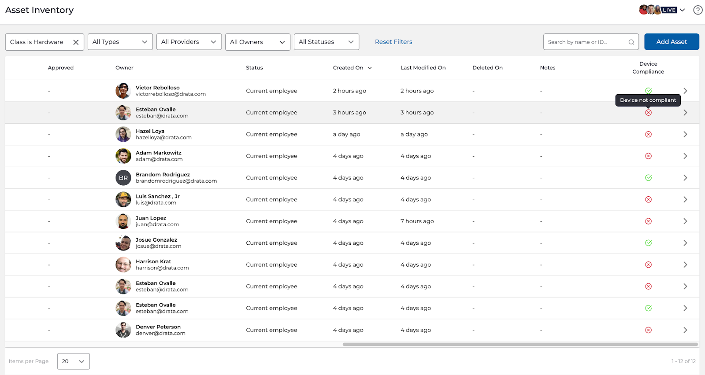

# SentinelOne (EDR) Integration Guide

Source: https://help.drata.com/en/articles/8348773-sentinelone-edr-integration-guide
Collection: Connection Support › Other Guidance
Updated: 2026-08-17
Fetched: 2026-11-22
Description: This article covers how to connect SentinelOne EDR to Drata.

## Article text

The **SentinelOne (EDR) integration** enables **Security and IT teams** to automate the collection of anti-virus and device health evidence from SentinelOne within Drata. It connects Drata to your organization’s **SentinelOne instance**, allowing continuous monitoring of endpoint protection status across managed devices.

## Key Capabilities

- **Automated endpoint protection evidence:** Syncs SentinelOne device data to confirm anti-virus coverage.
- **Device compliance visibility:** Displays SentinelOne device health and operational state within Drata.
- **Seamless integration with existing device sources:** Correlates SentinelOne agents with devices from the Drata Agent or MDM integrations.

## Prerequisites & Data Access

- Must have valid **SentinelOne credentials**, including the **Service Account URL** and **API Token**.
   - To create API Token
      1. In SentinelOne, first create a **Service User** by navigating to **User Management** under the **Settings console**.
      2. Then, go to **Token Management** under the **Notifications and Data Forwarding** section to generate an API token.
      3. When generating the token, ensure the service user is selected.
      4. This user and token will be used in the Drata connection setup.
- SentinelOne devices must have serial numbers matching those sourced from Drata Agent or MDM integrations.
- SentinelOne must already be running on all in-scope devices.

Additional notes:

- Drata's current integration does not treat SentinelOne as a full source of device data, in the same way as the Drata Agent or one of our MDM connections. You must first sync device data through the Drata Agent or an MDM as normal. These sources will sync device serial numbers. SentinelOne must be running on those devices AND the SentinelOne serial numbers must match the agent- or MDM-sourced serial numbers.
- Drata will only provide SentinelOne evidence for devices that map to a SentinelOne agent/device using the device serial number. Drata also allows the admin to manually map a SentinelOne device to a Drata device for completeness. Any Drata device that does not have a linked SentinelOne device will fail the compliance test for anti-malware software detection (Test 64).

You will need your SentinelOne credentials to be able to connect to your SentinelOne account from Drata. The next section will explain how to get those.

### Permissions & Data Table

| **Permission/Scope** | **Why It’s Needed** | **Data Accessed (Read Only)** |
|---|---|---|
| Endpoints: View | Required to retrieve device agent data | Device serial numbers, agent version, operational state |
| Console Users: View | Used for device-to-user mapping | SentinelOne user and device ownership data |
| Service Account URL | Identifies your organization’s SentinelOne tenant | Tenant endpoint for API connection |
| API Token | Authenticates Drata’s connection to SentinelOne | Device status and configuration data |

## Step-by-Step Setup

### Step 1: Enable the SentinelOne Connection

1. In Drata, navigate to **Connections → Available Connections**.
2. Search for **SentinelOne** under the **EDR** category.
3. Click **Connect** to open the setup drawer.
4. Enter the following details:
   - **Service Account URL:** The URL for your SentinelOne instance (ensure it’s specific to your organization if managed by an MSSP).
      - For MSSP-managed instances, ensure the service account URL corresponds to your organization's specific tenant and not a generic MSSP login URL. This is critical to eliminate potential authorization issues during setup.
      - To learn how to create a SentinelOne service account, go to **[Creating Service Users](https://community.sentinelone.com/s/article/000005291).** The following list is the minimum permissions for the service account:
         - Endpoints: View
         - Console Users: View
   - **API Token:** Generated from your SentinelOne service account.
5. Click **Save & Test Connection** to complete setup.

### Step 2: Verify Connection and Map Devices

1. Once connected, the **SentinelOne connection card** will display a **Review linked devices** button.
2. Click **Review linked devices** to view all SentinelOne agents mapped to Drata devices via matching serial numbers.
   
3. For unmatched devices, manually select and link a SentinelOne device to the corresponding Drata record.
4. Optionally, export the list of linked or failed devices as a `.CSV` file.

On clicking this button, a page will appear showing the SentinelOne devices that are linked to the Drata device by matching the device serial number. Wherever the serial number did not match, you are able to manually select a SentinelOne device to be linked to a Drata device. This step is optional.

You will observe the following changes once the SentinelOne connection is enabled:

- Test 64 will automatically get enabled, if it was disabled. It will start testing for SentinelOne agent running in the correct state on all Drata devices. If the test fails, you will see a list of all failed devices along with the information on why the device failed.
   1. **SentinelOne agent not found**: The column ‘SentinelOne Serial number’ will be blank if there is no SentinelOne device linked to a Drata device. This means that no SentinelOne agent was found on this Drata device.
   2. **SentinelOne agent’s operational state is not functional**: If SentinelOne serial number exists but ‘Operational state’ value is anything but ‘na’, then that means the SentinelOne agent is not running in the right state on this device. Learn more about the SentinelOne ‘Operational state’ [here](https://community.sentinelone.com/s/article/000005285) (Needs SentinelOne log in). There is an option to download the list of failed devices as a .CSV file from Test 64. To learn more about how to fix failed devices for test 64, review [this article](test-64-malware-detection-software-installed.md). You may exclude devices from this test by simply excluding the Personnel to whom the device belongs or unlinking the device.

### Personnel page

The ‘Device compliance’ column on the Personnel page will be calculated based on the anti-virus information from SentinelOne.

### Asset page

Asset page will now also start showing the same ‘Device compliance’ column. It will be blank for all classes except the class type ‘Hardware’. Similar to the Personnel page, the ‘Device compliance’ will be calculated based on the anti-virus information from SentinelOne. You can view the SentinelOne anti-virus details like SentinelOne agent version number, device health status, SentinelOne operational state and SentinelOne user in the Asset drawer by clicking on any hardware asset.

## Disable the SentinelOne connection

Deleting the SentinelOne connection on the Connections page will revert all the changes mentioned in the above section.

- Test 64 - Test 64 will still be enabled. It will revert back to either the Drata agent or an MDM integration testing for an anti-virus software as detailed [here](test-64-malware-detection-software-installed.md).
- Personnel page - The ‘Device compliance’ column will be calculated based on the anti-virus information obtained by the Drata agent or an MDM integration.
- Asset page - Asset page will continue to show the new ‘Device compliance’ column for hardware class type. Similar to the Personnel page, it will show ‘Device compliance’ column results based on the anti-virus information obtained by the Drata agent or an MDM integration.

### Additional Information

- If you are [manually uploading](test-64-malware-detection-software-installed.md#:~:text=Code%20of%20Conduct.-,Alternatively,-%3A) evidence for anti-virus from the Personnel page, it will override the anti-virus result from the SentinelOne.
- Currently, the SentinelOne data is imported into Drata once every 24 hours.

## Images

- [image 01] ../../images/integrations/sentinelone/sentinelone-edr-integration-guide--01.png
- [image 02] ../../images/ux/connections/sentinelone-edr-integration-guide--02.png
- [image 03] ../../images/ux/connections/sentinelone-edr-integration-guide--03.png
- [image 04] ../../images/ux/monitoring/sentinelone-edr-integration-guide--04.png
- [image 05] ../../images/ux/personnel/sentinelone-edr-integration-guide--05.png
- [image 06] ../../images/ux/assets/sentinelone-edr-integration-guide--06.png

## Related articles

- [Kandji (now Iru) Integration Guide (MDM)](kandji-now-iru-integration-guide-mdm.md)
- [JumpCloud Integration Guide (MDM)](jumpcloud-integration-guide-mdm.md)
- [Hexnode UEM (Windows) Integration Guide](hexnode-uem-windows-integration-guide.md)
- [CrowdStrike Integration Guide](crowdstrike-integration-guide.md)
- [Microsoft Intune Integration guide](microsoft-intune-integration-guide.md)
