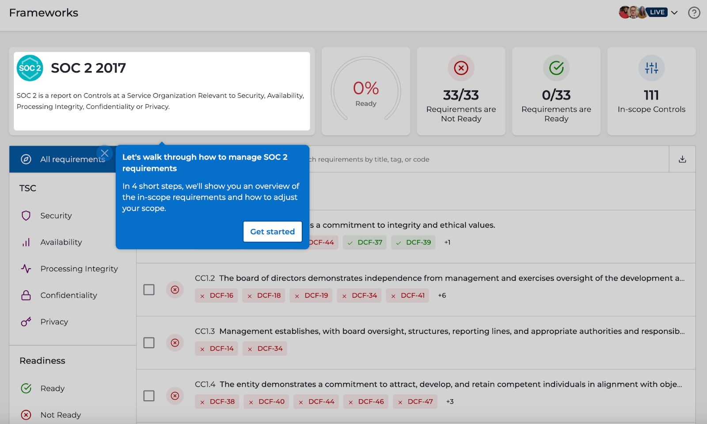

# Set SOC 2 Trust Service Criteria to Security Only

Source: https://help.drata.com/en/articles/8892480-set-soc-2-trust-service-criteria-to-security-only
Collection: Framework Information › SOC 2 2017
Updated: 2026-11-14
Fetched: 2026-11-22

## Article text

When trying to achieve attestation in regard to SOC 2, customers generally only need to adhere to a portion of all TSCs, specifically those that fall under Security. Drata wants customers to essentially manage less, so going forward, new customers will have their SOC 2 frameworks scoped only to the **Security TSC **in terms of in-scope requirements. This allows customers to satisfy less requirements and mapped controls that are needed for attestation.

Learn more about [Trust Service Criteria](soc-2-trust-services-categories-overview.md).

## BEFORE DIVING IN

- You must have an Admin, Workspace Manager, or an Information security lead role in Drata.
- You must be a new customer or an existing workspace customer that configures a new workspace and enables the SOC 2 framework.
- Even though SOC 2 has been scoped to only a single TSC, it’s important to consult with your auditor to ensure you are meeting all of your specific compliance needs.

## HERE’S HOW

For new customers who have purchased SOC 2, users will now navigate to the frameworks page and frameworks requirements page, and notice a few changes. They will see that **Controls Mapped** has become **In-scope Controls, **which calculates the total in-scope controls needed to satisfy SOC 2 and any active framework.

When a user lands on the SOC 2 Requirements page for the first time, they will notice that all requirements that are marked in-scope fall under the **Security TSC** only. All other requirements under other TSC will be marked out-of-scope by default. Should you need to mark other TSC in-scope, you can do so from the **Out of Scope** view in the Requirements table.

## SOC 2 Onboarding

New users landing on the SOC 2 Requirements page for the first time, will also receive an onboarding experience that guides them through the current default scope in more detail.

## Images

- [image 01] ../../images/ux/frameworks/set-soc-2-trust-service-criteria-to-security-only--01.png

## Related articles

- [SOC 2: All controls](soc-2-all-controls.md)
- [SOC 2 Trust Services Categories Overview](soc-2-trust-services-categories-overview.md)
- [Framework Requirements](framework-requirements.md)
- [SOC 2 Checklist](soc-2-checklist.md)
- [Pre-Audit Checklist: How to Prepare for Your Audit with Drata](pre-audit-checklist-how-to-prepare-for-your-audit-with-drata.md)
