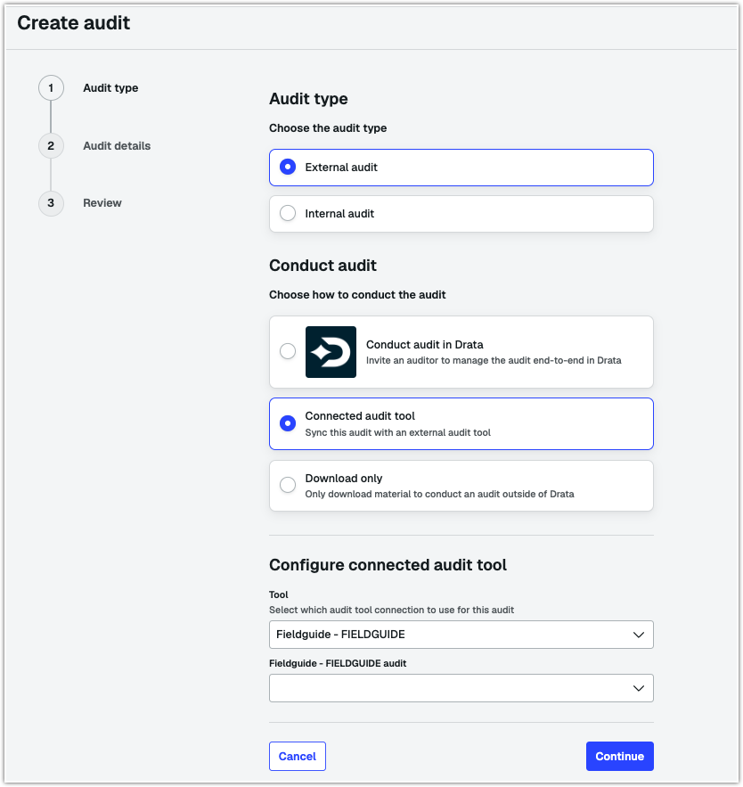
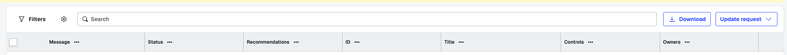
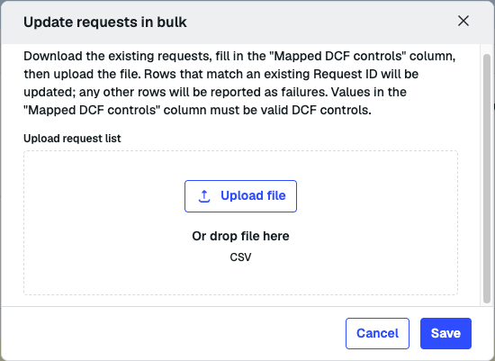

# Set up the Drata + Fieldguide integration in Audit Hub

Source: https://help.drata.com/en/articles/15436000-set-up-the-drata-fieldguide-integration-in-audit-hub
Collection: The Auditor Experience
Updated: 2026-11-03
Fetched: 2026-11-22

## Article text

## Overview

Use this article to create a Fieldguide connection in Drata and link that connection to a connected audit in Audit Hub.

This setup flow applies to the new first-party Fieldguide integration in Audit Hub.

## Prerequisite

Before you start, make sure that:

- your auditor has invited you to Fieldguide so you can access the correct engagement there.
- you can sign in to Fieldguide and generate an API token to use in Drata.
- you have access to **Settings > Connections** in Drata.

Treat your API token like a credential. Store and share it securely.

**Additional notes:**

- You can't link an audit to Fieldguide after the audit has already been created. The Fieldguide connection must be selected as part of setting up a new audit. If you've already created an audit that needs to be linked, create a new audit and follow the setup steps in this guide.
- Each **Fieldguide engagement** should only be linked to a **single Audithub card**.
   If you notice that multiple connected audits have been created for the same engagement, please contact your **Account Manager** and our **Support team**.

## Step 0: Auditor sets up the engagement in Fieldguide

Before you can connect Drata to Fieldguide, your audit firm must complete this step on their end:

- The auditor adds your organization as a customer/company in Fieldguide.
- The auditor creates the audit (engagement) in Fieldguide for this specific engagement.

Confirm with your auditor that both of these are done before starting Step 1.

## Step 1: Generate your Fieldguide API token

After your auditor invites you to Fieldguide, sign in to your Fieldguide instance and navigate to **My Profile > API Tokens > Create API Token**.

Select the checkboxes for all of the required scopes below, then click **Generate Token**:

- `engagements:read`
- `engagements:write`
- `comments:write`
- `comments:read`
- `companies:read`
- `engagements.files:write`
- `engagements.files:read`
- `files:read`
- `requests.files:write`
- `requests.files:read`
- `requests:write`
- `requests:read`
- `users:read`
- `webhooks:write`
- `webhooks:read`

You will paste this token into Drata whenyou create the Fieldguide connection.

## Step 2: Create the Fieldguide connection in Drata

In Drata, go to **Settings > Connections** and create a new Fieldguide connection.

Complete the following fields:

- **Audit Firm Name** — enter a name that identifies this audit firm's connection. When naming the connection, use the auditor or audit firm name as the alias so it is easy to identify later.
- **Auditor Domain** — enter your audit firm's domain.
- **API Key** — paste the API token you generated in Step 1.

Save and test the connection.

If you work with multiple auditors or audit firms that use Fieldguide, create a separate Fieldguide connection for each one. This makes it easier to choose the correct connection later when you create connected audits.

After the connection is created, Drata shows a connection health status such as **Connected**, **Disconnected**, or **Error**.

## Step 3: Create a connected audit

1. Go to **Compliance > Audits > Create audit** and select **External Audit** as the audit type.
2. Under **Conduct Audit**, select **Connected Audit Tool**.
3. Scroll down to the **Configure connected audit tool **section and select the desired drop down.
   - **Tool**: choose the Fieldguide connection you created.
   - **Audit firm name (This name may change depending on the firm name)**: Select the specific audit/engagement your auditor already created and named in Fieldguide. Wait for this list to load if it doesn't appear immediately.

If no Fieldguide connection exists yet, you must create one in **Settings > Connections** before you can create a connected audit.

## Step 4: Finish audit setup

After you select the Fieldguide engagement, continue through the rest of the audit setup flow. For connected audits:

- the standard **Assign auditors** step is skipped.
- assigned auditors are synced from the linked Fieldguide engagement when the audit is created.
- the audit period is pulled from Fieldguide and becomes read-only in Drata for that connected audit.

On the review step, you should see the connected audit tool and the selected Fieldguide engagement before you create the audit.

## Step 5: Confirm that the audit is connected

After the audit is created:

- the audit shows Fieldguide as the connected audit tool.
- the audit header shows the linked engagement and connection health.
- requests from the linked Fieldguide engagement begin appearing in Audit Hub.

## Step 6: Map requests to DCFs/controls

Once requests come in, they will need to mapped to controls in order for evidence to be associated with the requests. Once evidence is associated or uploaded, requests can be flipped to Prepared and sent to auditors via the integration.

There are two ways to associate controls with requests:

1. Use Drata’s AI mapping feature
   1. refer to the help article [Map audit requests to DCF controls with AI](map-audit-requests-to-dcf-controls-with-ai.md) (specifically the section labeled **Review recommendations for a FieldGuide-connected audit**)
2. Manually update/upload a mapped list

If you choose the second option, perform the following steps:

1. Download the request list from the active Fieldguide connected audit using the **Download** button.
   
2. This will generate a spreadsheet with 5 columns (id, request id, title, description, and mapped dcf controls).
3. Update only the last column based upon any prior mappings you/your auditors may have performed of requests to DCF and save the spreadsheet.
4. Upload the spreadsheet back into Drata using the **Update Request > Update Request in Bulk option. **

## Troubleshooting

### I do not see Connected audit tool in the audit wizard

Make sure a Fieldguide connection already exists in **Settings > Connections**. If no audit-tool connection is configured, the connected audit option is unavailable in the wizard.

### My Fieldguide connection shows Disconnected or Error

Re-test the connection and update the Fieldguide token if needed. Connected audits surface the connection health so you know when sync may be interrupted.

### I do not see requests in the connected audit yet

Confirm that you selected the correct Fieldguide engagement and that requests already exist in that engagement.

## Related articles

- [Work in a Fieldguide-connected audit in Audit Hub](work-in-a-fieldguide-connected-audit-in-audit-hub.md)

## Images

- [image 01] ../../images/integrations/fieldguide/set-up-the-drata-fieldguide-integration-in-audit-hub--01.png
- [image 02] ../../images/ux/audits/set-up-the-drata-fieldguide-integration-in-audit-hub--02.png
- [image 03] ../../images/ux/audits/set-up-the-drata-fieldguide-integration-in-audit-hub--03.png

## Related articles

- [Understanding the Drata + Fieldguide Integration](understanding-the-drata-fieldguide-integration.md)
- [Pre-Audit Checklist: How to Prepare for Your Audit with Drata](pre-audit-checklist-how-to-prepare-for-your-audit-with-drata.md)
- [Work in a Fieldguide-connected audit in Audit Hub](work-in-a-fieldguide-connected-audit-in-audit-hub.md)
- [What auditors need to do for the Drata + Fieldguide integration](what-auditors-need-to-do-for-the-drata-fieldguide-integration.md)
- [Map audit requests to DCF controls with AI](map-audit-requests-to-dcf-controls-with-ai.md)
