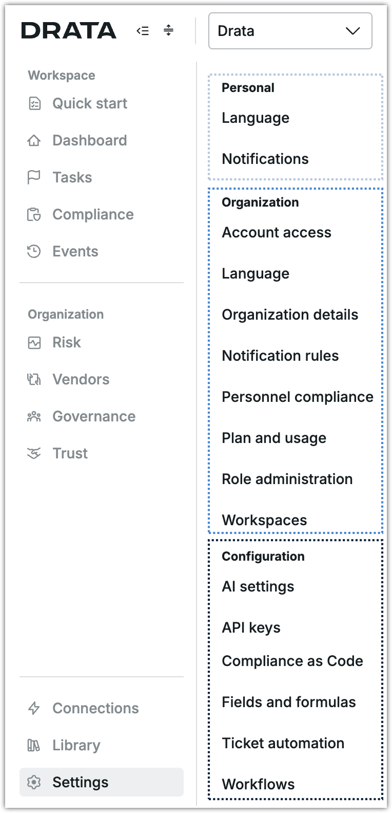

# Settings Page

Source: https://help.drata.com/en/articles/13563975-settings-page
Collection: Settings
Updated: 2026-11-09
Fetched: 2026-11-22
Description: Overview of the Settings page and available configuration options.

## Article text

The Settings page is part of Drata’s unified experience, providing consistent configuration and predictable workflows across personal and organization settings.

Use Settings to:

- Customize your **personal experience** in Drata
- Configure **organization-wide behavior** that impacts audits, automation, and access
- Manage **roles, workspaces, and compliance configuration**

This article provides a **high-level overview** of what you can manage in each section.

## How to access Settings

From anywhere in Drata, select **Settings** in the main navigation. The Settings page is organized into **three sections**:

- **Personal**: Settings that apply only to you
- **Organization**: Company-wide settings that affect audits and access
- **Configuration**: Advanced automation and platform behavior

---

## Personal settings

Personal settings control **your individual experience** in Drata.

| **Setting** | **Purpose** |
|---|---|
| Language | Set your personal display language in Drata.  **Note:** All roles can change their language as needed. This only changes your personal Drata experience. |
| Notifications | Control which email reminders you receive and how often. |

---

## Organization settings

Organization settings apply **across your company** and define how Drata behaves during audits. These settings typically require **Admin or elevated roles**.

**⚠️ Note:** Many organization settings directly affect audit readiness, evidence generation, and access control. Changes should be made intentionally and by users with the appropriate role.

| **Setting** | **Purpose** |
|---|---|
| Account access | Grant or revoke temporary access for Drata Support. |
| Language | Set the default language for the organization. **Note:** Only Admins can set a company default language. This sets the default language for all personnel using Drata by default. |
| Organization details | Manage company name, domain, and identifying information.  This page contains **Org Info and Key personnel tab.** |
| Notification rules | Configure organization-wide notification behavior. |
| Personnel compliance | Manage HR-related compliance requirements   This page contains **Internal Security, Training, and Human Resources tab.** |
| Plan and usage | View subscription details, enabled features, and usage metrics. |
| Role administration | Define and manage user roles and permissions. |
| Workspaces | Configure workspace structure and user access (if enabled).  Note: You can add your workspace managers within this page. |

---

## Configuration settings

Configuration settings control **automation and advanced platform behavior**.

| **Setting** | **Purpose** |
|---|---|
| AI settings | Enable and manage AI-powered features across Drata. |
| API keys | Create and manage API keys for integrations and custom workflows. |
| Fields and formulas | Create custom fields and calculated values for reporting and automation. |
| Ticket automation | Automatically generate tickets from compliance activity. |
| Workflows | Automate multi-step task and approval flows. |

[Back to navigation overview](https://help.drata.com/en/articles/13680507-navigation-changes-where-did-everything-go)

## Images

- [image 01] ../../images/ux/settings/settings-page--01.png

## Related articles

- [Role Administration & RBAC](role-administration-rbac.md)
- [Organization settings: Human Resources Settings (New Experience)](organization-settings-human-resources-settings-new-experience.md)
- [Roles and permissions overview (New Experience)](roles-and-permissions-overview-new-experience.md)
- [Admins overview](admins-overview.md)
- [Scope personnel to a Workspace](scope-personnel-to-a-workspace.md)
