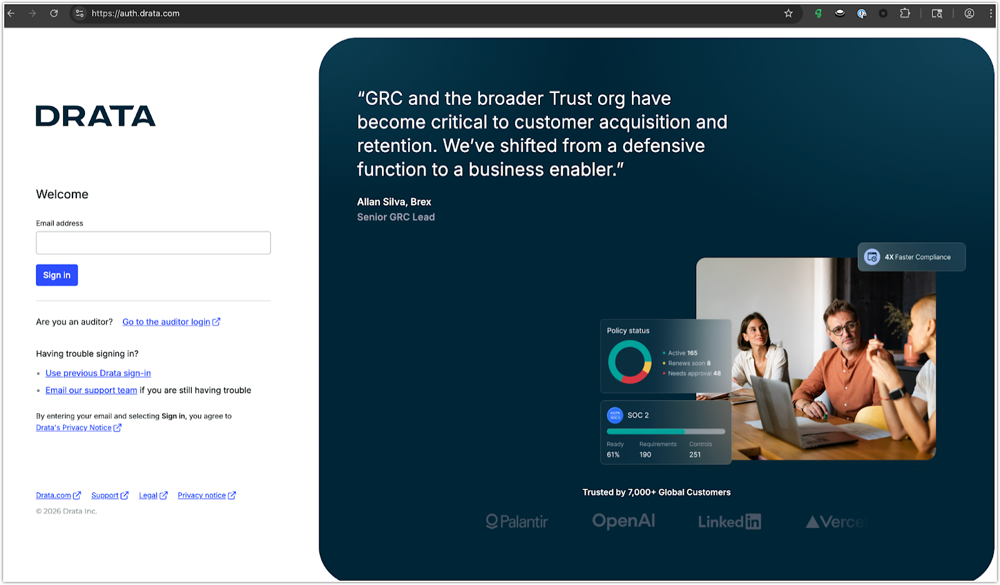

# Signing In to Drata (New Experience)

Source: https://help.drata.com/en/articles/13801611-signing-in-to-drata-new-experience
Collection: Getting Started › Helpful Resources
Updated: 2026-11-10
Fetched: 2026-11-22

## Article text

We are evolving the way you log into Drata to improve security, ensure account verification and simplify the experience for those who have multiple accounts. Depending on your role and number of accounts, your login experience may look a little different. Use the guide below to see what’s changing for you.

## Login without SSO

Prerequisites

- An active Drata account
- Access to your work email inbox

## Sign in with a verification code

1. Go to [https://auth.drata.com](https://auth.drata.com/).
   
2. Enter your work email address and select Continue.
3. Drata sends a one-time verification code to that address.
4. Open the email and copy the verification code.
5. Return to the login page, paste or type the code, then select Continue.
6. If you belong to more than one organization or have an account in multiple regions, choose the correct account from the selector.
7. You’ll be redirected to the Drata application.

### If you don’t receive the verification code

- Check your spam/junk folder.
- Confirm that you entered the correct work email address (no typos, aliases, or personal email).
- If the email still doesn’t arrive, ask your IT or security team to:
   - Allowlist Drata email domains and IP addresses.
   - Confirm that your mailbox is not blocking automated emails from Drata.
- If the problem persists, contact your internal Drata admin or Drata Support.

## Login with SSO Configured

Prerequisites

1. SSO must be configured for your organization.
2. You must have an active account in your organization’s IdP.

### Sign in with SSO (Single Tenant)

*For users whose organizations require SSO to access Drata and admins who manage or support SSO-based access.*

Sign in to Drata using your organization’s single sign-on (SSO) provider. Use this method if your company requires authentication through an identity provider (IdP) such as Okta, Microsoft, Google, or another SAML-based provider.

1. Go to [auth.drata.com](http://auth.drata.com/).
2. Enter your work email address and select Continue.
3. If SSO is enabled for your domain, Drata will:
   - Redirect you to your IdP (for example, Google, Microsoft, Okta, or OneLogin), or
   - Show you one or more SSO options (for example, Continue with Google).
4. Complete any sign-in and multi-factor authentication (MFA) steps required by your IdP.
5. After successful authentication, Drata sends you back to the login service to confirm your identity.
6. If you have access to more than one organization or workspace, choose the correct account from the selector.
7. You’ll be redirected into Drata.

### Sign in with SSO (Multi-tenant)

*For users with access to multiple tenants, verify their email address before signing in with SSO.*

1. Go to [auth.drata.com](http://auth.drata.com/).
2. Enter your work email address and select Continue.
3. Drata sends a one-time verification code to that address.
4. Open the email and copy the verification code.
5. Return to the login page, paste or type the code, then select Continue.
6. Choose the correct account from the selector.
7. If SSO is enabled for that account, Drata will:
   - Redirect you to your IdP (for example, Google, Microsoft, Okta, or OneLogin), or
   - Show you one or more SSO options if you have multiple IdPs configured.
8. Complete any sign-in and multi-factor authentication (MFA) steps required by your IdP.
9. You’ll be redirected into Drata.

## Log In to My Drata (Employee Login)

With the release of the new experience, Employees only have access to the new Drata Experience.

1. **Login to My Drata:** Select the login link provided in your email invitation
2. **Sign In:** Enter your email and securely log in using your company’s Single Sign-On (SSO) or by using your work email and a secure one-time authentication code.
3. **Explore My Drata:** You will automatically land in the** New My Drata Experience**.

## Frequently Asked Questions (FAQ)

## What should I do if I’m not in the IdP group mapped to Drata?

- Ask your IdP admin to add you to the correct group and retry logging in.

## What if my identity profile is missing?

- Contact your Drata Admin to recreate or relink your identity profile and ensure your email is correctly configured.

**I authenticated via email rather than SSO. Is this an issue?**

No, both authentication methods are fully supported and secure. While Single Sign-On (SSO) is often preferred for streamlined access and reduced re-authentication, using your email and a unique verification code is a valid alternative.

## Basic troubleshooting steps

## Common Causes of Authentication Code Issues

1. **Google OAuth Login**
   - If your login redirects you to sign in with Google (OAuth), you will not receive an email authentication code. Complete the login on the Google authentication page instead.
2. **Identity Provider (IdP) Group-Based Syncing**
   - If your organization uses an IdP integration (e.g., Microsoft 365) with group-based syncing, ensure you are a member of the specific user group mapped to Drata. If not, Drata may block the login flow.
3. **Deleted or Unlinked Identity Profile**
   - Authentication code delivery can fail if the identity profile linked to your user account has been deleted or unlinked.
4. **User Marked as 'Former Employee'**
   - If your Drata profile is marked as "Former Employee" due to your status in the IdP, you will not receive authentication codes.
5. **User Not Added to the Tenant**
   - If your user has not been added to the tenant, you will not receive authentication emails. Additional admins cannot be added until the primary admin accepts their invite.

If you are not receiving your one-time password (OTP) when trying to sign in to Drata, start with the basic checks below. These steps can help rule out common email delivery and browser-related issues.

- Check your spam or junk folder for an email from [no-reply@drata.com](mailto:no-reply@drata.com). This is a common first step when expected Drata emails do not appear in the inbox.
- Confirm that [no-reply@drata.com](mailto:no-reply@drata.com) is not blocked, blacklisted, or being filtered by your email system. If your company uses email security tooling, your IT team may need to allowlist this sender.
- Try signing in from an incognito or private browser window. This can help rule out cached sessions, browser extensions, or stored cookies that may interfere with the sign-in flow.
- If you are connected to a VPN, disconnect from it temporarily and try again. In some cases, network routing or security settings can interfere with login or email delivery.

**If you still do not receive the OTP**

If the OTP still does not arrive after completing the steps above, contact your internal IT or email administrator to verify that messages from [no-reply@drata.com](mailto:no-reply@drata.com) are not being quarantined or blocked.

## Advanced Troubleshooting

- Capture a HAR file while reproducing the issue for further analysis:
   - Open your browser’s developer tools (F12 or Ctrl+Shift+I on Windows/Linux, Cmd+Option+I on macOS).
   - Go to the Network tab and enable “Preserve log.”
   - Request a new authentication code to reproduce the issue.
   - Save the HAR file and share it with support for analysis.

## Images

- [image 01] ../../images/ux/other/signing-in-to-drata-new-experience--01.png

## Related articles

- [Single Sign-On Connection](single-sign-on-connection.md)
- [Populating and Managing Personnel Data in Drata (Concept Guide)](populating-and-managing-personnel-data-in-drata-concept-guide.md)
- [Okta Integration Guide (Identity Management Provider)](okta-integration-guide-identity-management-provider.md)
- [Access Drata as an auditor (New Experience)](access-drata-as-an-auditor-new-experience.md)
- [Troubleshooting Login Issues: Browser, Cache & Session Problems](troubleshooting-login-issues-browser-cache-session-problems.md)
