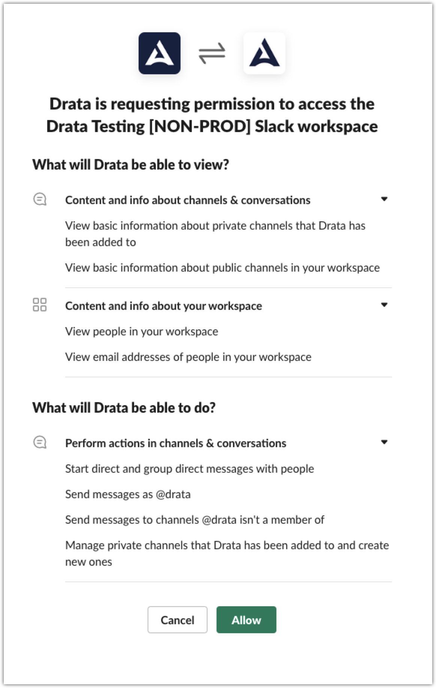

# Slack Integration Guide (Communication and UAR)

Source: https://help.drata.com/en/articles/6425963-slack-integration-guide-communication-and-uar
Collection: Connection Support › Other Guidance
Updated: 2026-08-05
Fetched: 2026-11-22
Description: This article covers connecting and configuring Slack for company notifications.

## Article text

Connecting Slack allows you to notify channels about Not Ready Controls as well as personnel with pending compliance actions.

**Note**: Learn more about Drata's Privacy Notice at [https://drata.com/privacy](https://drata.com/privacy).

## Key Capabilities

### Communication

- **Notification delivery:** Sends Drata compliance notifications (e.g., Not Ready Controls, pending tasks) to supported communication channels.
- **Channel integration:** Allows organizations to select which channels receive Drata alerts.
- **Read-only workspace access:** Uses limited permissions required only to post messages; Drata does not read conversations or workspace content.

### User Access Review (optional)

- **Access retrieval**: Retrieves users and assigned roles from connected systems.
- **Review enablement**: Makes this access data available for review in Drata’s Access Reviews feature.
- **Account mapping support**: Allows external accounts to be mapped to Drata personnel for accurate review and tracking.

## Prerequisites & Data Access

- You must have permission to **install apps** in your Slack workspace.
   - Slack Workspace Owners determines app approvals. If the Drata app is restricted in your Slack workspace, a Workspace Owner must approve or install the app before you can connect it in Drata.
- Must be assigned one of the following Drata roles: **Admin, Workspace Managers, DevOps Engineer**.
- If you have the **Access Reviewer** Drata role, you can only view the Connections page.
- Drata can only connect to one Slack workspace.

To learn about Slack app permissions, go to [Add apps to your Slack workspace](https://slack.com/help/articles/202035138-Add-apps-to-your-Slack-workspace) or [Manage app approvals](https://slack.com/help/articles/222386767-Manage-app-approval-for-your-workspace).

### Permissions & Data Table

| Permission / Scope | Why It’s Needed | Data Accessed (Read Only) |
|---|---|---|
| App installation | Allows Drata to connect to Slack and post notifications | Channel identifiers (only for authorized channels) |
| Post messages | Enables Drata to deliver compliance alerts to Slack | Ability to post messages only |
| Basic user identity *(UAR only)* | Allows Slack to serve as a user access review source | User name, email, and Slack user ID |

Drata’s Slack app requires **read-only access** to:

- Channel identifiers (to post notifications)
- User identifiers (if UAR is enabled)

Drata does **not** access or read Slack messages, channel history, or workspace content.

## Step-by-Step Setup

### Step 1: Prepare Slack workspace permissions

Ensure your Slack Workspace Owner allows app installations or has approved the Drata Slack app.

**Expected outcome:** You have the necessary Slack permissions to install the Drata app.

### Step 2: Start the Slack app installation

1. In Drata, go to **Connections → Available Connections**
2. Select **Slack**, then choose **Connect**
3. Drata redirects you to Slack to install the app
   - If you belong to multiple Slack workspaces, select the appropriate one.
4. Review the permissions requested by the Drata Slack app.
5. Select **Allow** to complete OAuth installation.
   

**Expected outcome:Expected outcome:** Slack confirms the app installation and redirects you back to Drata.

### Step 3: Enable Slack functions in Drata

Upon returning to Drata:

- **Communication** is automatically enabled (required)
- Optional: Enable **User Access Review** to sync Slack users for access reviews. (This option is not available unless Communication is already connected.)

**Expected outcome:** Slack appears as a connected integration, and UAR (if enabled) begins syncing user identities.

## Add Channels

To learn how to add, delete, or edit your Slack notifications, go to [Company Settings: Notifications](https://help.drata.com/en/articles/10643531-company-settings-notifications).

## Partner Offers & Discounts

Drata has a direct partnership and discounted pricing for **new and first time Business+ customers of Slack**. Orgs with 200 employees or less get 25% off their first 12 months of Slack Business+ by visiting [https://slack.com/promo/partner?remote_promo=c0346445](https://slack.com/promo/partner?remote_promo=c0346445).

Check out [more partner offers and discounts](https://drata.com/partner/find/tech-directory?collections=partner-discountoffers,partner-offers-discounts-pod).

## Images

- [image 01] ../../images/integrations/slack/slack-integration-guide-communication-and-uar--01.png

## Related articles

- [Microsoft Teams Integration Guide](microsoft-teams-integration-guide.md)
- [Segment Integration Guide](segment-integration-guide.md)
- [Intercom Integration Guide](intercom-integration-guide.md)
- [Lattice Integration Guide](lattice-integration-guide.md)
- [Ironclad Integration Guide (UAR)](ironclad-integration-guide-uar.md)
