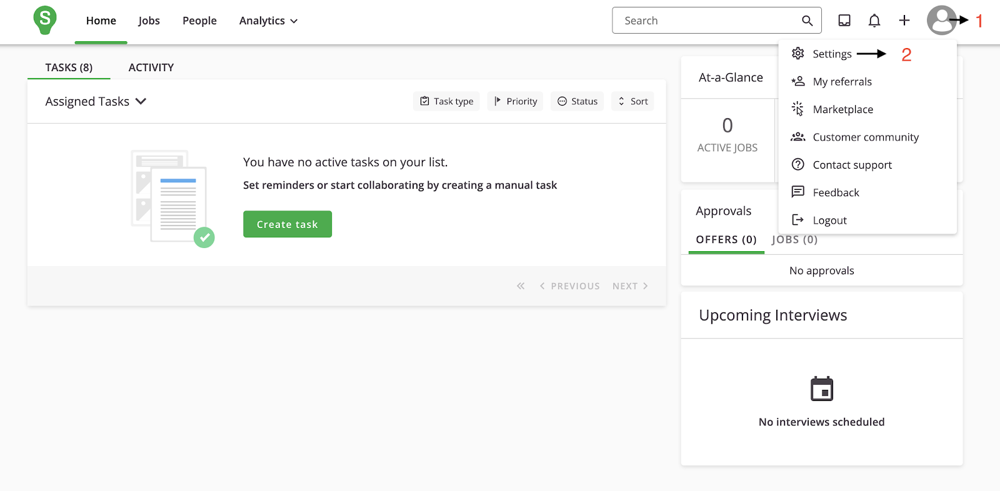
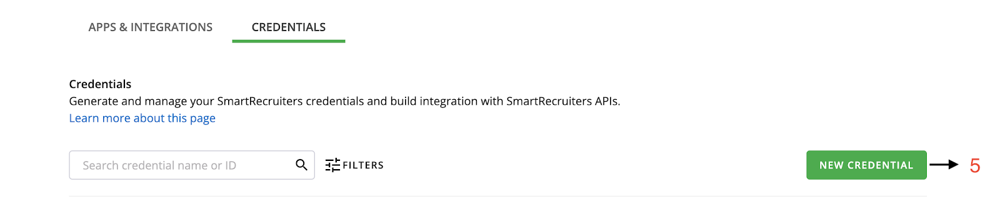
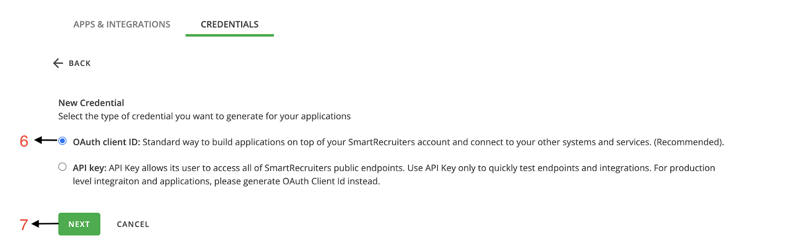

# SmartRecruiters Integration Guide

Source: https://help.drata.com/en/articles/9236583-smartrecruiters-integration-guide
Collection: Connection Support › Other Guidance
Updated: 2026-08-17
Fetched: 2026-11-22

## Article text

The **SmartRecruiters integration** enables security and compliance teams to automate **User Access Reviews (UAR)** by syncing user account and role data directly from SmartRecruiters. This helps organizations review which users have access to SmartRecruiters and maintain visibility into assigned permissions for compliance monitoring.

---

## Key Capabilities

- **User Access Monitoring:** Retrieve SmartRecruiters user accounts for access review workflows
- **Role Visibility:** Monitor roles assigned to users within SmartRecruiters
- **Compliance Monitoring:** Maintain visibility into system access to support audit readiness

This integration supports **User Access Review workflows**, helping demonstrate compliance with **access control policies**.

---

## Prerequisites & Data Access

### SmartRecruiters Access Requirements

- You must have **Admin privileges** in your **SmartRecruiters account**.
- You must create an **OAuth Client ID and Client Secret** for the integration.

### Drata Role Requirements

- To create or modify connections, you must have one of the following **Drata roles with write access**: Admin, Workspace Manager, or DevOps Engineer
- **Access Reviewers** can view the connection page but cannot create or modify connections

---

### Permissions & Data Table

| Permission / Access | Why It’s Needed |
|---|---|
| Client ID | Identifies the SmartRecruiters application |
| Client Secret | Authenticates the integration with SmartRecruiters |

---

## Step-by-Step Setup

### Step 1: Generate OAuth Client Credentials

1. On the **Home** page, select your **Account avatar **and **Settings**.
   
2. On the **Settings** page, select **Apps & Integrations **under **Administrations **section.
3. On the **Apps & Integrations** page, select the **CREDENTIALS** tab.
4. On the **CREDENTIALS** page, select **NEW CREDENTIALS **button.
   
5. Under **New Credential** section, select **OAuth client ID **then **NEXT **button**.**
   
6. On **OAuth client ID **page, enter the required **Fields** and select **Scope**, then **GENERATE** button at the bottom of the page.
7. Copy your Client ID and Client Secret by clicking Clipboard.

---

### Step 2: Connect SmartRecruiters in Drata

1. Log in to **Drata** → go to the **Connections** page.
2. Navigate to your **Available Connections**.
3. Search for and start the **SmartRecruiters connection process**.
4. Enter the following information when prompted:
   - **Client ID**
   - **Client Secret**

Expected outcome:
SmartRecruiters is successfully connected and user access data begins syncing to Drata.

---

## Important Notes

- **Authentication method:** The SmartRecruiters integration uses **OAuth credentials**.
- **Credential security:** Store the Client ID and Client Secret securely and rotate them according to your organization’s security policies.
- **Network restrictions:** If your organization uses a **Web Application Firewall (WAF)**, ensure required Drata IP addresses are allowlisted so the connection can be established.

## Images

- [image 01] ../../images/integrations/smartrecruiters/smartrecruiters-integration-guide--01.png
- [image 02] ../../images/integrations/smartrecruiters/smartrecruiters-integration-guide--02.png
- [image 03] ../../images/integrations/smartrecruiters/smartrecruiters-integration-guide--03.png

## Related articles

- [Greenhouse Integration Guide](greenhouse-integration-guide.md)
- [Webex Integration Guide](webex-integration-guide.md)
- [RingCentral Integration Guide](ringcentral-integration-guide.md)
- [Smartsheet Integration Guide](smartsheet-integration-guide.md)
- [Box Integration Guide](box-integration-guide.md)
