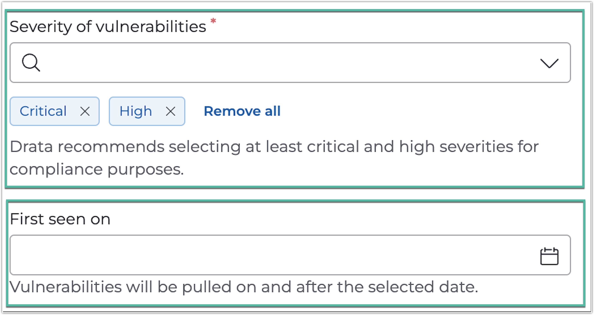

# Snyk Integration Guide

Source: https://help.drata.com/en/articles/9750513-snyk-integration-guide
Collection: Connection Support › Other Guidance
Updated: 2026-07-29
Fetched: 2026-11-22
Description: This article walks through the details of configuring Snyk to connect to Drata.

## Article text

Connecting Snyk to Drata allows for the automated, continuous monitoring of SLA due dates and evidence collection of vulnerability issues required for compliance.

## Key Capabilities

- **Automated vulnerability ingestion: **Sync new or updated Snyk vulnerabilities into Drata for continuous compliance tracking.
- **SLA due date monitoring: **Keep track of vulnerability remediation deadlines aligned to your compliance requirements.
- **Evidence automation for vulnerability scanning: **Fulfills the Vulnerability Scanning test (**DCF-18** by default) by collecting evidence directly from Snyk.
   - You can view findings by selecting the **View Findings** button after connecting or navigating directly to the **Vulnerabilities** page through the left-side navigation menu.

## Prerequisites & Data Access

- **Snyk Enterprise requirement: **Only **Snyk Enterprise** customers can connect to Drata due to a Snyk API accessibility limitation.
- **Daily sync limitations: **Drata retrieves **up to 1,000 new or updated vulnerabilities per day**, ordered by severity from **Critical** to **Low**.
- Must be assigned one of the following Drata roles: **Admin, Workspace Managers, DevOps Engineer**.
- If you have the **Access Reviewer** role, you can only view the Connections page.

## Step-by-Step Setup

### Step 1: Start the Snyk Connection

1. In Drata, select **Connections** from the left-side navigation menu.
2. Go to the **Available Connections** tab and search for **“Snyk”**.
   - Alternatively, navigate to the **Vulnerability Scanning** category under the *Types* filter.
3. In the connection drawer, you can select the severity and the date of the vulnerabilities you want to sync. These selections will also be included in the test result report for visibility.
   - **Severity of vulnerabilities**: Select the severity level of the vulnerabilities that you want to sync into Drata for compliance monitoring. Critical and High are auto-selected. Drata will bring up to 1000 new vulnerabilities or updates to vulnerabilities, sorted by severity.
   - **First seen on**: Select the date when the vulnerabilities you want to sync were first created. All vulnerabilities detected on and after this date will be synced.
      
4. Select the connect button to proceed.
5. Authorize and complete the OAuth process for authentication. Drata uses Leen as an API integration partner to integrate with Snyk.

Once the connection is successfully created, you can select the **View Findings** button on the connection card or navigate to the **Vulnerabilities** page to review and manage the synced vulnerabilities for compliance monitoring.

Drata shows *findings*, which are instances of *vulnerabilities* (an individual but higher-level CVE) against specific resources. This may reflect as higher finding counts in Drata vs. your Snyk dashboard.

## Images

- [image 01] ../../images/integrations/snyk/snyk-integration-guide--01.png

## Related articles

- [Tenable Vulnerability Management Integration Guide](tenable-vulnerability-management-integration-guide.md)
- [Semgrep Integration Guide](semgrep-integration-guide.md)
- [SentinelOne Singularity Vulnerability Management (VMS) Integration Guide](sentinelone-singularity-vulnerability-management-vms-integration-guide.md)
- [Microsoft Defender Vulnerability Management Integration Guide](microsoft-defender-vulnerability-management-integration-guide.md)
- [Rapid7 InsightVM Integration Guide](rapid7-insightvm-integration-guide.md)
