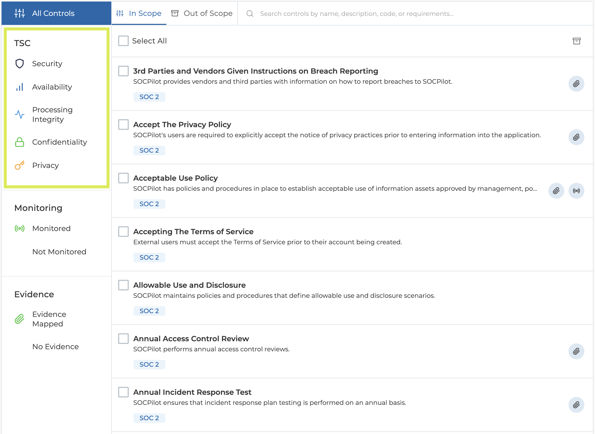
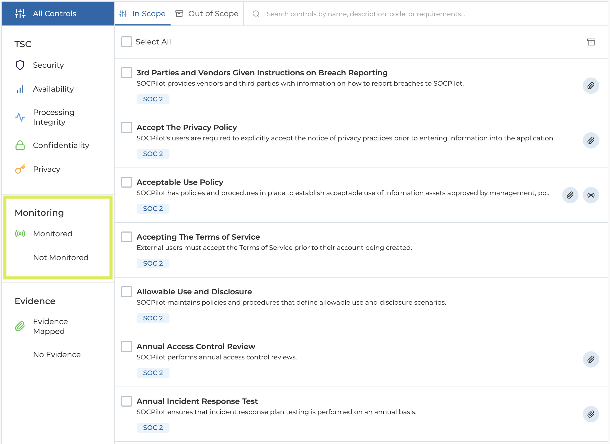
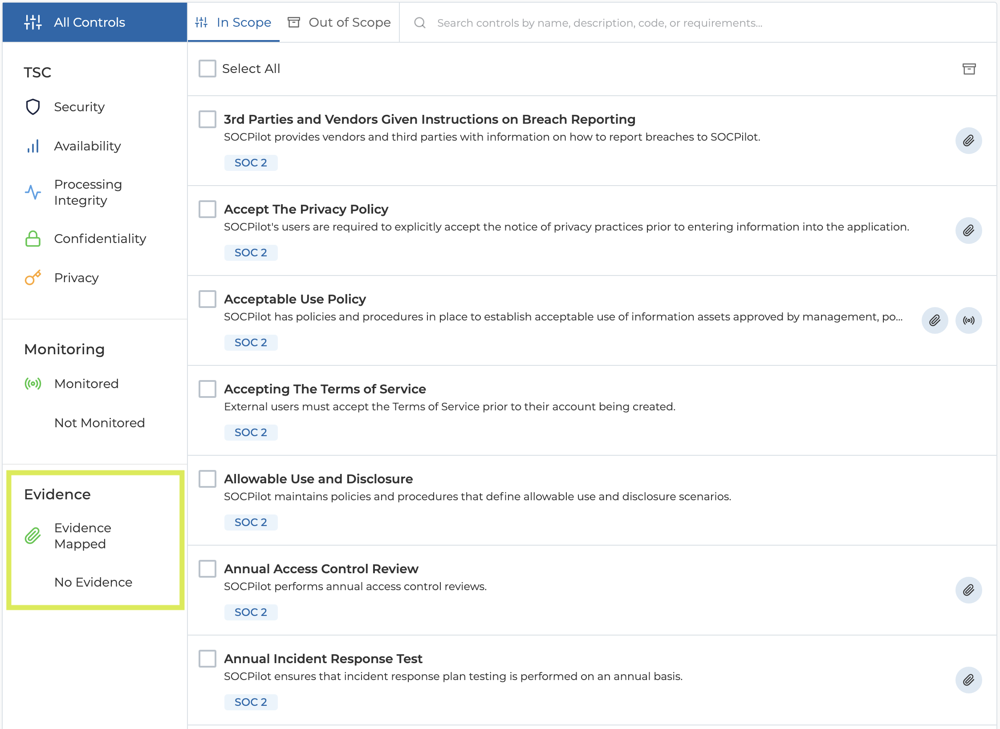

# SOC 2: All controls

Source: https://help.drata.com/en/articles/5329618-soc-2-all-controls
Collection: Framework Information › SOC 2 2017
Updated: 2026-08-05
Fetched: 2026-11-22
Description: Templated controls pre-mapped to SOC 2 criteria spanning all 5 TSCs

## Article text

**HERE'S WHY**

In preparation for your SOC 2 audit, you will put controls in place that map back to the SOC 2 criteria in order to demonstrate your company's security posture. This page allows you to link evidence directly to those controls in order to demonstrate  accordance with the framework.

Successfully managing SOC 2 compliance involves carefully gathering and presenting evidence, uploading critical documents, and mapping controls to specific criteria. Drata enables organizations to streamline these processes by linking evidence directly to relevant controls to maintain compliance effectively.

**BEFORE DIVING IN**

Only account administrators or information security leads have access to this section within Drata.

**HERE'S HOW/ LEARN MORE**

On the SOC 2 framework page, you will note on the left column the ability to navigate to a specific Trust Service Criterion (TSC). If you select a particular TSC, you will see all of the controls mapped to that specific TSC. For controls such as DCF-46 and DCF-557, ensure they are manually linked to associate them with the relevant SOC 2 requirements. This process ensures proper alignment within the framework and adherence to compliance objectives.

You should consult with your auditor to determine the TSC to include in your audit. Security is the only required TSC, however many opt to include additional TSC based on the needs and structure of their company.

If you opt not to include certain controls, you can mark them 'Out of Scope'. Follow [this guide](marking-requirements-in-and-out-of-scope.md) to learn how. To confirm updated controls like DCF 2.0, navigate to the "Frameworks" or "Controls" page in your dashboard and verify the total number of controls displayed matches the expected count. This step is key for validating updates to compliance standards.

On this page, you also have the ability to filter to those controls that have evidence continuously monitored within Drata via our Autopilot technology. [View this guide](monitoring-overview.md) for more information on continuous automated monitoring within Drata.

Finally, you can filter to those [controls that have evidence mapped](https://help.drata.com/en/articles/5329709-linking-evidence-to-controls) to them and those that don't yet have evidence connected. Examples of evidence include control attestation records, internal meeting notes, or ticketing system logs that document activity and acknowledgments related to the controls. Additionally, ensure that your SOC 2 System Description is uploaded to the evidence library for auditor review, along with the finalized audit report in your Trust Center to demonstrate compliance publicly.

## Additional Resources

For advanced details on connecting controls and managing settings, visit Drata's [Control Details](https://help.drata.com/en/articles/5330111-control-details). For specific Trust Services Criteria, you can upload targeted evidence:

- **CC7.1 – Risk Mitigation:** Include SAST/DAST scan results to show vulnerability controls.
- **CC7.2 – Change Detection:** Upload scan logs, remediation tickets, and alert records for threat monitoring.
- **CC6.6 – Logical Access Security (optional):** Add evidence for detection and resolution of access vulnerabilities.

## Images

- [image 01] ../../images/ux/frameworks/soc-2-all-controls--01.png
- [image 02] ../../images/ux/frameworks/soc-2-all-controls--02.png
- [image 03] ../../images/ux/frameworks/soc-2-all-controls--03.png

## Related articles

- [SOC 2 Checklist](soc-2-checklist.md)
- [Example Evidence for Not Monitored Controls (SOC 2)](example-evidence-for-not-monitored-controls-soc-2.md)
- [What Is a SOC 2 Bridge Letter? [+ Template]](what-is-a-soc-2-bridge-letter-template.md)
- [The Drata Control Framework & Requirement Relationship](the-drata-control-framework-requirement-relationship.md)
- [Pre-Audit Checklist: How to Prepare for Your Audit with Drata](pre-audit-checklist-how-to-prepare-for-your-audit-with-drata.md)
