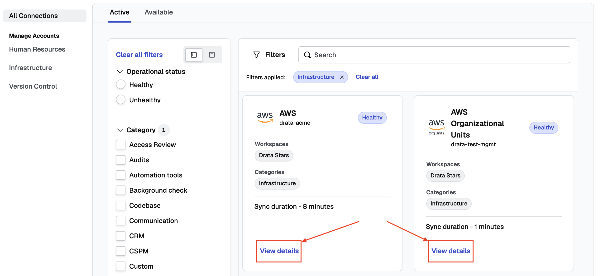
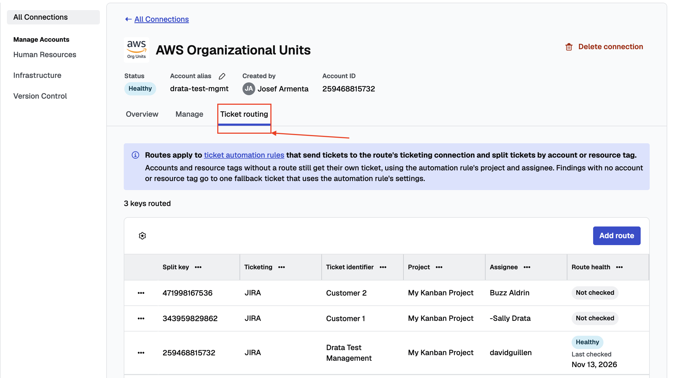
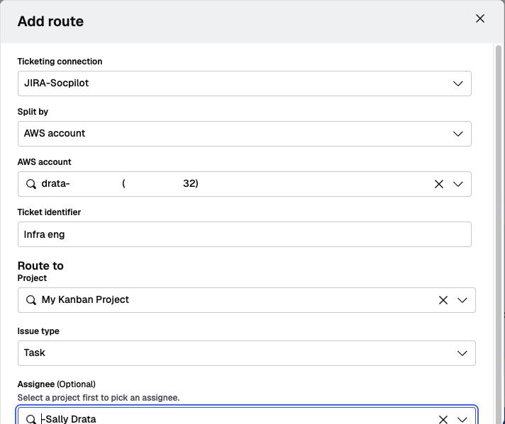
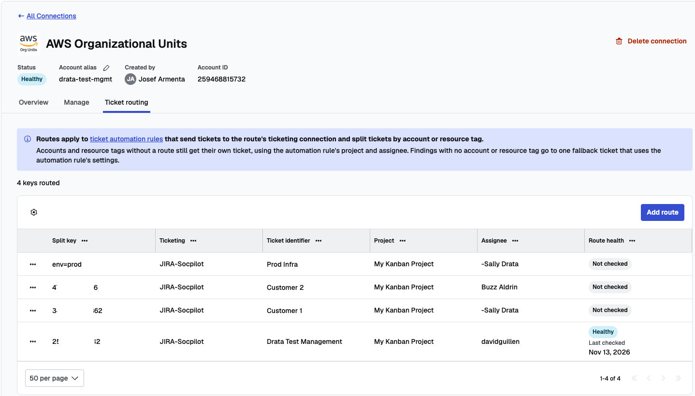
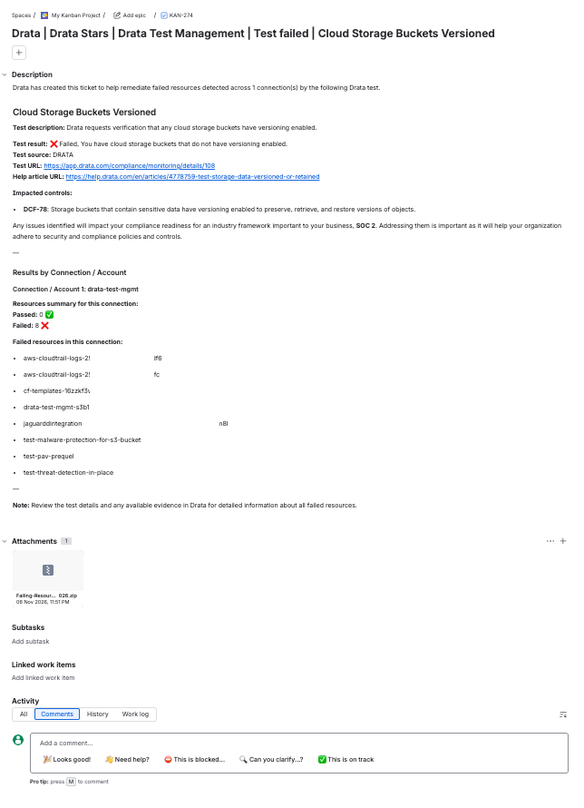

# Split Ticket Routing - Private Beta

Source: https://help.drata.com/en/articles/18532193-split-ticket-routing-private-beta
Collection: Connection Support › Ticketing Guidance
Updated: 2026-11-21
Fetched: 2026-11-22
Description: Use the combination of ticket automation rules and new AWS split routing to create monitoring test tickets for the team that owns each AWS account.

## Article text

## Overview

> *Split Ticket Routing is currently in private beta for select customers. Drata will announce when this feature is generally available.*

Split Ticket Routing lets Drata create a separate Jira ticket for each AWS account or common resource tag that has failing resources, and assign each ticket to that account's or resource's owner. Instead of one ticket that bundles every test's findings, each owning team gets a ticket with only its own failing resources.

Use Split Ticket Routing when you need to:

- Send findings from each AWS sub-account in an AWS Org Units connection to the team that owns it
- Remove the single point of failure created when one person triages every ticket for your organization
- Give each team a scoped list of failing resources it can act on right away

## Key Capabilities

- **Create routes to split tickets by AWS account ID or resource tag. **Create tickets for just the findings your teams need to remediate, based on your business structure.
- **One ticket per routing key.** When a test fails, Drata creates one ticket for each mapped account or resource tag that has failing resources. Accounts with no failing resources don't get a ticket.
- **Owner and project per account.** Choose the Jira assignee and Jira project for each account or resource. The assignee is picked from your Jira users and doesn't need to be a Drata user.
- **Scoped CSV attachments.** Each ticket's findings CSV includes only the failing resources for that account.
- **Friendly names in ticket titles.** Give each route a label, such as "Payments prod", that clearly identifies which team should own the ticket.
- **Nothing gets lost.** Failing resources that don't match a mapping go on one bundled ticket, assigned to the rule's assignee and project, just like today.
- **No change until you opt in.** Rules work exactly as they do today until you add the first route to the connection.

## Limitations

- **AWS and Jira only.** Other connection types that support tests that produce findings and other ticketing providers aren't supported yet.
- **Splitting applies to every route on the connection.** There's no per-route setting to opt out. Delete a route to stop its operation.
- **Some tests don't report an account.** The **Root Infrastructure Account Unused** (124) and **CSPM (Excessive privileges assigned (208), External exposure for cloud resources (209), and Encryption in transit (210))** monitoring tests never include an AWS account ID, so their failing resources always go on the unmapped ticket.
- **Ticket contents aren't refreshed.** A split ticket's description and CSV reflect the findings when the ticket was created. New failures for that route appear on the next ticket after the current one is done.
   - Each route is processed independently. If the next test run produces findings matching a route that had no open ticket (e.g. a new AWS account/OU shows up), a new ticket is created for that route, scoped to only those findings, with the ticket identifier (route label) in the title.

## Before You Begin

- You need an active **AWS**,** AWS Organizational Units (OU)**, or **AWS GovCloud** connection in Drata. Mappings are set on that connection's "**Ticket routing**" tab.
- You need a connected **Jira** integration with write access granted and at least one Jira automation rule for monitoring tests. See Drata's [Jira ticket automation help article](ticket-automation-jira-only-new-experience.md).
- Know the **AWS account ID** or **resource tag** for each sub-account you want to route, and the Jira user and project that should receive its tickets.
- The Jira owner must be a user who can be assigned issues in the selected Jira project. They don't need a Drata account.
- Split Ticket Routing supports **AWS** and **Jira** only. Other cloud providers and ticketing tools aren't supported yet.

> 💡 **Tip:** The Administrator and DevOps Engineer roles can set up split routing and create ticket monitoring rules in your workspace. If you don't see the **Ticket routing** tab on your AWS connection, ask an Admin to verify your role and permissions.

> 💡 **Important:** Routing is set per AWS connection, not per ticket automation rule. As soon as you add the first split route, **every** Jira automation rule that uses that ticketing connection starts splitting tickets. You can't turn splitting on for one rule and off for another on the same connection.

## How to Set Up Split Ticket Routing

### Step 1: Open the Ticket routing tab

Go to **Connections** and click **View details** to open your active **AWS**, **AWS OU**, or **AWS GovCloud** connection. Select the **Ticket routing** tab.

### Step 2: Add a mapping

Click **Add route** and fill in the following:

1. **Ticketing connection.** If multiple Jira connections with write access are active, select the Jira connection your automation rules use. Otherwise this field will not appear.
2. **Split by. **Select** AWS account** or **Resource tag.**
   1. If choosing AWS account, select the account ID in the **AWS account** field.
   2. If choosing Resource tag, provide the **Tag key** (case sensitive) and **Tag value**. This value can be blank if it is also blank on your AWS resources.
3. **Ticket identifier.** Provide user-friendly text that identifies what value has been used to split data into this route's tickets. This value will show in your ticket's title field.
4. **Project.** Select the Jira project where tickets for this route should be created.
5. **Issue type.** Select the type of Jira ticket to create.
6. **Assignee (optional).** Select the Jira user who should own tickets for this route.

If you leave **Assignee** blank, tickets for that account use the automation rule's assignee.

### Step 3: Repeat for each route

Add a mapping for every AWS account or resource tag you want to route. You don't need to map every account or resource. Failing resources from unmapped accounts go on one bundled ticket, assigned to the automation rule's assignee and project.

### Step 4: Wait for the next ticket sync

There's nothing to change on your [Jira automation rules](ticket-automation-jira-only-new-experience.md). On the next scheduled ticket sync, Drata creates one ticket per mapped account or resource that has findings for each failing test.

> 💡 **Tip:** If a test already has an open bundled ticket when you add your first mappings, that ticket stays open. Drata opens new split tickets alongside it. Close the old bundled ticket in Jira once the split tickets are created to avoid duplicate work.

## How Tickets Are Split and Assigned

On each scheduled ticket sync, Drata groups each failing test's findings by AWS account or resource tag and creates one ticket per group:

1. **Group the findings.** Each failing resource is matched to a mapping by its AWS account ID or resource tag value.
2. **Catch the leftovers.** Resources that match no mapping, or that don't report an account or resource tag, go into one bundled "unmapped" ticket.
3. **Create one ticket per group.** Each group with failing resources gets its own ticket. Groups with no failing resources don't get a ticket.
4. **Route each ticket.** Each ticket goes to the assignee and project set on its mapping, or to the automation rule's defaults if none are set.

### Ticket assignment

| **Situation** | **Assignee** | **Project** |
|---|---|---|
| Account is routed, with an assignee and project | The mapping's assignee | The route's project |
| Account is routed, but assignee is blank | The rule's assignee (if blank on the route) | The route's project |
| Account isn't routed, or the finding has no account | The rule's assignee | The rule's project |
| No assignee on the route or the rule | Unassigned | The route's or rule's project |
| No routes on the connection | The rule's assignee | The rule's project |

### What's in each split ticket

- **Title:** includes the route's ticket identifier, or its account ID if there's no provided identifier.
- **Description:**
   - any user-provided content when the ticket automation rule was built
   - the monitoring test's own description
   - test result - failed or error
   - test result description
   - controls and frameworks impacted
   - total findings count, for both passed and failed
   - per-connection passed and failed resources, as well as connection info (filtered by exclusions)
   - monitoring test URL
   - help article URL
- **Attachment:** a findings CSV with only that route's failing resources.

### Duplicate handling

Drata tracks one open ticket per ticketing connection, per test, per account or resource route, plus one for findings that match no route.

While a route's ticket is open, Drata doesn't create another one for that route, and new findings aren't added to the open ticket. Once the ticket is done, the next failure for that route opens a new ticket.

Automation rules sharing a ticketing connection reuse each other's open tickets for the same test and route rather than creating duplicates. Rules only produce separate tickets when they cover different tests or routes.

If routing can't be applied (for example, an open ticket created before routes were configured still exists), Drata falls back to a single ticket for the whole test.

### Example

A connection has two routes: account `111111111111` labeled "Payments prod" (assignee: Priya) and account `222222222222` labeled "Data platform" (assignee: Sam). The automation rule's assignee is Alex. When the test **Cloud Storage Buckets Versioned** fails with resources in three accounts, Drata creates:

| **Ticket** | **Contains** | **Assigned to** |
|---|---|---|
| Drata \| <workspace name> \| Payments prod \| Test failed \| Cloud Storage Buckets Versioned | Failing resources in `111111111111` | Priya |
| Drata \| <workspace name> \| Data platform \| Test failed \| Cloud Storage Buckets Versioned | Failing resources in `222222222222` | Sam |
| Drata \| <workspace name> \| Test failed \| Cloud Storage Buckets Versioned | Failing resources in `333333333333`, plus any without an account | Alex |

### Route Deletion

Click the three-dot icon to the left of a route's row to delete it.

When a route is deleted, existing tickets remain untouched. Tickets remain attached to the monitoring test. If other routes remain active, findings under the deleted route now fall to the unmapped group and will produce a new ticket. If no other routes remain active, Drata checks if the old ticket is still open. If it is, no new ticket is created unless and until that ticket is closed; otherwise the rule will produce its usual single ticket for the test.

## Mapping Field Reference

| **Field** | **Required** | **Format** | **Description** |
|---|---|---|---|
| **Split by** (Key type) | Yes | Dropdown | **AWS account** or **Resource tag** |
| **Key value**, when AWS account is the key type | Yes | 12-digit AWS account ID | The account whose failing resources get their own ticket. Each value can be mapped once per connection. |
| **Key value**, when Resource tag is the key type | Yes | **Tag key** and **Tag value** are Text, each up to 191 characters | The resource tag key and value whose failing resources get their own ticket. Each key-value pair can be mapped once per connection. |
| **Label** | Yes | Text, up to 191 characters | Friendly name shown in ticket titles instead of the account ID. |
| **Project** | Yes | Dropdown of Jira projects | Jira project for this account's tickets. Falls back to the rule's project when blank. |
| **Assignee** | No | Dropdown of Jira users | Jira owner for this account's tickets. Doesn't need a Drata account. Falls back to the rule's assignee when blank. |

## Frequently Asked Questions

- **Do I need to change my Jira automation rules?** No. Rules keep their assignee and project, which are used as the fallback for unrouted findings. Splitting starts automatically once the connection has routes.
- **What happens to accounts I don't route?** Their failing resources go on one bundled ticket, assigned to the rule's assignee and project, so nothing is lost.
- **What happens if I add a route while a ticket is still open?** Existing open tickets aren't moved. A resource can briefly appear on both its old open ticket and a new split ticket. The overlap clears once the old ticket is closed.
- **Does the assignee need a Drata account?** No. Pick any Jira user who can be assigned issues in the target project.

## Troubleshooting

- **I added routes, but tickets are still bundled.** Tickets are created on the scheduled ticket sync, not immediately. Also check that the route's ticketing connection matches the one your automation rule uses, and that the failing test has resources in a routed account.
- **A ticket was created but is unassigned.** Neither the route nor the automation rule has an assignee. Add an assignee to the mapping, or set one on the rule.
- **A ticket went to the rule's assignee instead of the route's assignee.** The failing resources may come from an unrouted account, or from a test that doesn't report an account ID. Check the account IDs in the attached CSV against your routes.
- **A new failure didn't create a ticket.** An open ticket already exists for that test and account. Drata won't create another until that ticket is done. If you closed it in Jira, wait for the next Drata ticket sync so the closure is picked up.

## Images

- [image 01] ../../images/ux/connections/split-ticket-routing-private-beta--01.png
- [image 02] ../../images/ux/connections/split-ticket-routing-private-beta--02.png
- [image 03] ../../images/ux/connections/split-ticket-routing-private-beta--03.png
- [image 04] ../../images/ux/connections/split-ticket-routing-private-beta--04.png
- [image 05] ../../images/integrations/jira/split-ticket-routing-private-beta--05.png

## Related articles

- [Test 105: Threat Detection in Place](test-105-threat-detection-in-place.md)
- [AWS Integration Guide (Infrastructure, User Access Review)](aws-integration-guide-infrastructure-user-access-review.md)
- [Filter and search tests in Monitoring (New Experience)](filter-and-search-tests-in-monitoring-new-experience.md)
- [Ticket Automation (Jira-only) (New experience)](ticket-automation-jira-only-new-experience.md)
- [Create and Manage Workspace Tickets](create-and-manage-workspace-tickets.md)
