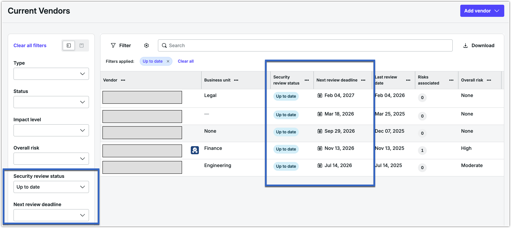
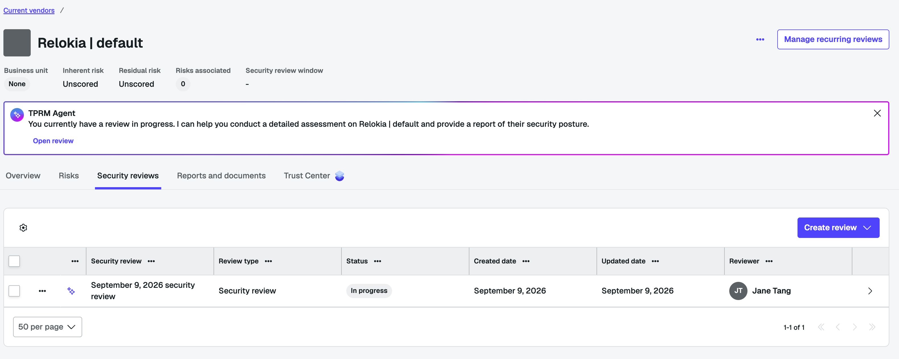
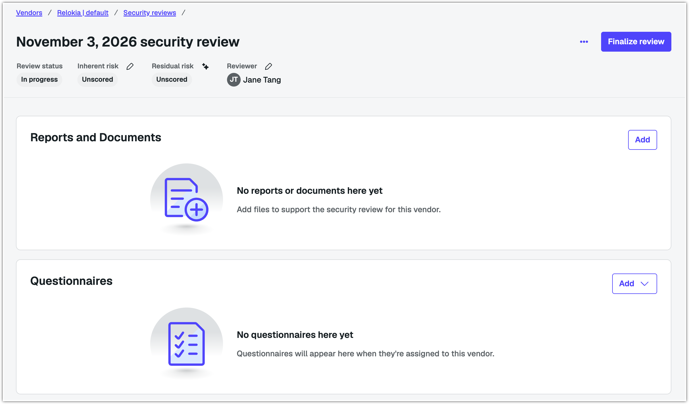
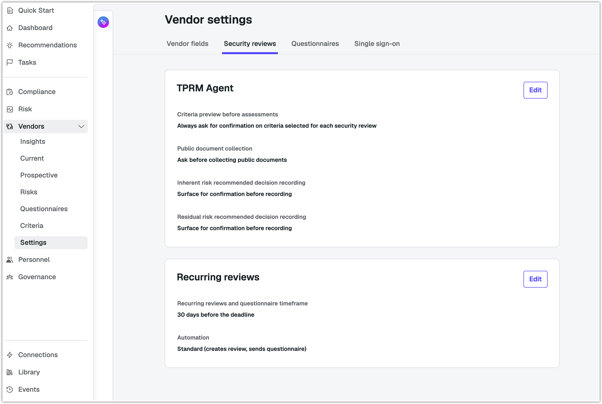
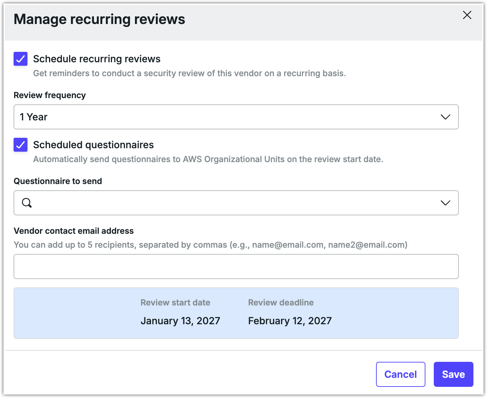
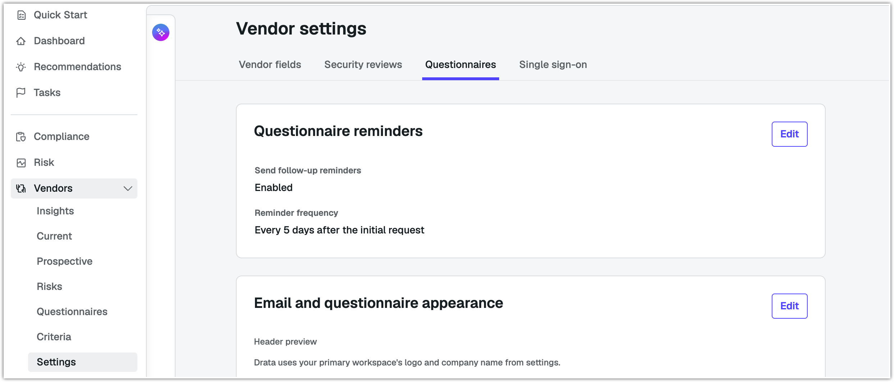

# Start and manage security reviews for your vendors

Source: https://help.drata.com/en/articles/13557334-start-and-manage-security-reviews-for-your-vendors
Collection: Understand the Drata Platform › Vendors
Updated: 2026-11-09
Fetched: 2026-11-22

## Article text

Security reviews allow you to evaluate, document, and track a vendor's security posture over time. Reviews live on the vendor profile and can include questionnaires, SOC reports, uploaded evidence, and a final security decision.

Use security reviews to:

- Assess vendors during onboarding
- Perform recurring security reviews
- Track review status and deadlines
- Maintain audit-ready review documentation

---

## Security review statuses

On the **Current vendors** page, the table includes two key columns that help you track review health across vendors:

- **Security review status**
- **Next review deadline**

You can filter vendors using either column.

 (links to https://downloads.intercomcdn.com/i/o/am69aeco/2057795179/2c9008fca1cf2d1278927b682b6a/image.png?expires=1780056000&signature=c6e2756868efff96d014fcd71de47b0a3d2d8a3e474225b4d19e0ebff7d76e25&req=diAiEc53mIBYUPMW3nq%2BgTdLcphmPO26aPmuXsqAMSX%2B7hPj7LYGoJMyZ3Uk%0AWhZmhZAmqulTdsAGkFetMX2etHY%3D%0A)

---

### Security review status definitions

| Status | Description | Recurring reviews |
|---|---|---|
| **Up to date** | The vendor completed a review within 90 days of the most recent deadline | Enabled |
| **Needs review** | The review window has started and no review is in progress | Enabled |
| **In progress** | A security review is currently underway | Enabled or disabled |
| **Completed** | A review is complete and recurring reviews are not enabled | Disabled |
| **No past reviews** | The vendor has never completed a review | Enabled or disabled |

---

### Next review deadline indicators

| Indicator | Description |
|---|---|
| **Due soon** | The review deadline is within 7 days |
| **Overdue** | The review deadline has passed |
| **Deadline not set** | Recurring reviews are not enabled |

---

## Where security reviews live

To manage security reviews:

1. Select **Vendors**.
2. Open **Current vendors** or **Prospective vendors**.
3. Select a vendor.
4. Open the **Security reviews** tab.

Each vendor profile contains a full history of completed and in-progress reviews.

---

## Start a security review

To begin a new review:

1. Select **Vendors**.
2. Open **Current vendors** or **Prospective vendors**.
3. Select a vendor.
4. Open the **Security reviews** tab.
5. Select **Create review**.
6. Choose one of the following:
   - **Security review**
   - **SOC report review**
   - **Upload review report**

---

### Option 1: Create a security review

A security review allows you to collect evidence and document your assessment.

During a security review, you can:

- Upload files (such as SOC 2 reports)
- Send questionnaires through Drata
- Upload questionnaire responses received outside Drata
- View AI summaries (if enabled)

After reviewing the vendor's documentation and questionnaire responses, select a final decision based on your organization's risk and onboarding requirements:

- **Pending**: Select this if the review is still in progress or you are waiting on additional information, documentation, or responses from the vendor.
- **Approved**: Select this if the vendor meets your security and compliance requirements and no further action is needed before onboarding.
- **Approved with conditions**: Select this if the vendor is acceptable to move forward, but requires follow-up actions (such as remediation, contract clauses, or additional controls) before full approval.
- **Rejected**: Select this if the vendor does not meet your organization's security requirements or presents an unacceptable level of risk.

Add notes to document the reason for your decision, including any required follow-up actions or conditions.

After completion, you can:

- View the review summary
- Download the review package
- Re-open the review if updates are required

---

### Option 2: SOC report reviews

SOC report reviews are used to formally review and document SOC reports. To start a SOC report review:

1. Select **Create review → SOC report review**.
2. Complete each section using the SOC report as reference.
3. Save and close if needed.
4. Select **Finish review** when complete.

**Note:** You cannot start a new SOC report review until the current one is completed or deleted.

---

### Option 3: Upload a completed review report

If a review was completed outside Drata:

1. Select **Create review → SOC report review**.
2. Select **Upload review report**.
3. Upload the completed document.

The uploaded report is stored with the vendor's review history for audit purposes.

---

## Schedule recurring reviews

Recurring reviews help ensure vendors are reviewed on a regular cadence.

### Configure global recurring review settings

1. Go to **Vendors > Settings > Security reviews tab. **
2. Scroll down to the **Recurring reviews** section.
3. Set how many days before the deadline the review window should open.
   - Default: **30 days**

Scheduled questionnaires are sent automatically on the review window start date.

---

## Enable recurring reviews for a vendor

1. Open **Vendors → Current vendors**.
2. Select a vendor.
3. Select **Manage recurring reviews**.
4. Enable **Schedule recurring reviews** to get reminders to conduct a security review of this vendor on a recurring basis.
5. Set the review frequency.
6. Enable **Scheduled questionnaires** (optional).
7. Select the questionnaires to send and the vendor contact email.
8. Review the start date and deadline.

 (links to https://downloads.intercomcdn.com/i/o/am69aeco/2058381028/72a357af741f35a061c7e82f85ae/image.png?expires=1780056000&signature=1a424dd8b18dacb05b666bb8ee4182dcfe234cf0d9ae67baa47291cf75b7d3b2&req=diAiHsp2nIFdUfMW3nq%2BgbxqvhYvvX6USH8Em2MtcSkH52FjhIfy2gRK6kW8%0A0LiuvZM1GTGGq6%2BWxwIalK8W3TM%3D%0A)

---

## Automatic deadline adjustment

To maintain a consistent review schedule, Drata may automatically adjust the next review deadline when a review is completed close to its existing due date.

If a review is completed within **90 days of the current deadline**, Drata calculates the next deadline based on the original schedule, not the date the review was completed. This prevents deadline drift and keeps recurring reviews aligned to their intended cadence.

For example:

- Original deadline: June 25
- Review completed: June 10
- Review frequency: Every 6 months
- Next deadline: December 25

Because the review was completed within 90 days of the deadline, Drata sets the next deadline to **December 25** (six months from the original deadline), not December 10. This ensures your review cycle remains consistent over time.

---

## Automated reminder emails

You can automatically remind vendors to complete questionnaires.

To configure reminders:

1. Go to **Vendors > Settings > Questionnaires tab. **
2. Scroll down to the **Questionnaire reminders** section.
   
3. Customize when and how often reminders are sent.

---

## Key distinctions to remember

- **Security reviews** are the container for decisions and evidence
- **Questionnaires** are sent *within* security reviews
- **SOC reviews** and **uploaded reports** are review types, not questionnaires

## Images

- [image 01] ../../images/ux/vendors/start-and-manage-security-reviews-for-your-vendors--01.png
- [image 02] ../../images/ux/vendors/start-and-manage-security-reviews-for-your-vendors--02.png
- [image 03] ../../images/ux/vendors/start-and-manage-security-reviews-for-your-vendors--03.png
- [image 04] ../../images/ux/vendors/start-and-manage-security-reviews-for-your-vendors--04.png
- [image 05] ../../images/ux/vendors/start-and-manage-security-reviews-for-your-vendors--05.png
- [image 06] ../../images/ux/vendors/start-and-manage-security-reviews-for-your-vendors--06.png

## Related articles

- [Add a prospective vendor](add-a-prospective-vendor.md)
- [Conducting a Security Review (Legacy)](conducting-a-security-review-legacy.md)
- [Customizing Security Review Titles](customizing-security-review-titles.md)
- [Conducting a Security Review](conducting-a-security-review.md)
- [Hosted Technology Vendors: What to Collect and How Drata Can Help](hosted-technology-vendors-what-to-collect-and-how-drata-can-help.md)
