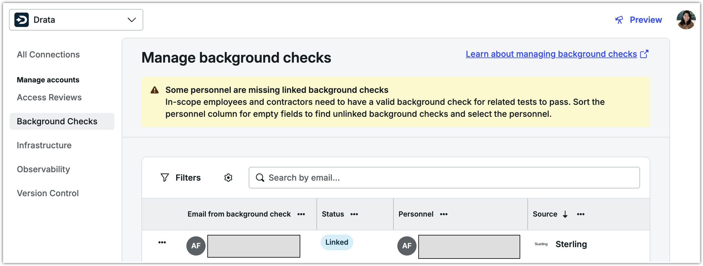

# Sterling Integration Guide

Source: https://help.drata.com/en/articles/9803828-sterling-integration-guide
Collection: Connection Support › Other Guidance
Updated: 2026-11-14
Fetched: 2026-11-22

## Article text

Sterling is a background check provider that many companies use to validate identity information. Drata supports a one-way connection that lets you upload background check results from Sterling. After upload, Drata maps the results to personnel records to support compliance tracking.

## Prerequisites & Data Access

- You must be able to **sign in to your Sterling account with the correct permissions** to **export background check reports in CSV format**.
   - Your Sterling export must include these columns
      - **Applicant email address**
      - **Order status**
      - **Full applicant name**
      - **Order completed date and time**
      Drata uses these fields to accurately map the background check to the correct person.
- Drata only consumes the data you manually upload. No direct API connection or bi-directional sync is supported.

### Permissions & Data Table

| Permission / Scope | Why It’s Needed | Data Accessed (Read Only) |
|---|---|---|
| Ability to export CSV reports from Sterling | Provides the data required for compliance mapping in Drata | Background check results and metadata |
| Optional: Report URL | Adds direct reference to original report for audit review | - URL link only (no additional data pulled) |

## Step-by-Step Setup

### Step 1: Export the Background Check CSV from Sterling

1. Sign in to Sterling using your administrator credentials.
2. Use **Find a Candidate** to locate an individual (name or ID).
3. Open the candidate’s profile.
4. In the **Screening History** section, locate the completed report.
5. Select the report icon.
6. Download the report in **CSV format**.
7. Verify the CSV includes all **required columns**.
   - **Applicant email address**
   - **Order status**
   - **Full applicant name**
   - **Order completed date and time**

**Note:** Sterling typically provides background check results one candidate at a time. If you need to upload multiple background checks to Drata, combine the individual CSV files into a single CSV before uploading. Ensure the final file contains the required columns.

### Step 2: Obtain the Sterling background check report URL (Optional)

1. Open the completed report in your browser.
2. Copy the URL from the address bar.
3. Save the link to include in Drata for reference.

Including this URL adds a reference back to the original report for auditing purposes.

### Step 3: Upload Background Check Results to Drata

1. Go to the **Connections page** in Drata.
2. Select the **Available Connections** tab.
3. Search for **Sterling**, then select **Connect**.
   - *(Optional)* Enter the **Sterling background check report URL** to store the source link in the **Personnel page**.
   - Upload your Sterling CSV file to add background check records.

Uploading this file allows Drata to track who has completed a background check and who has not.

## Verify the upload

To confirm successful upload and compliance mapping:

- Go to the **Personnel page**.
- Apply the filter: **Not Compliant > Background Check**.
- This view highlights individuals who are missing background check data based on your Sterling upload.

This helps you quickly identify and address any compliance gaps in your personnel records.

To review all uploaded records:

1. Go to the **Connections page** > **Manage background checks**
   
2. View the imported records.

Reviewing uploaded records helps you verify the data transfer was successful and complete.

### CSV Import process

Since Sterling’s API doesn't currently support direct data retrieval for background screenings, we’ve created a streamlined **CSV import process** to ensure your records stay up to date in Drata.

Follow the steps below to export your data from Sterling and sync it with your Drata account.

1. **Export your report from Sterling**
   - To get started, log in to your **Sterling Looker reporting tool** and download a CSV report of your background screenings.
2. **Prepare your CSV file**
   - For a successful upload, your CSV must include the following column headers exactly as shown:
      - **OrderID**
      - **Applicant email address**
      - **Order Status**
      - **Full Applicant Name**
      - **Order Completed Date Time**
3. **Upload to Drata**
   - Once your file is ready:
      - Navigate to the **Connections** page in Drata.
      - Open the **Sterling connection **to find the upload section.
      - Upload your CSV file.
      - **Add your Sterling Reporting URL:** Enter the link to your background check reporting page. Drata will add this link to your personnel records, allowing you to jump directly to an employee's status on the Sterling platform with a single click.

## Additional resources

- [Background Check Management](background-check-management.md)
- [Personnel Overview](https://help.drata.com/en/articles/6023041-personnel-overview)

## Images

- [image 01] ../../images/ux/connections/sterling-integration-guide--01.png

## Related articles

- [KarmaCheck Integration Guide](karmacheck-integration-guide.md)
- [Checkr Integration Guide](checkr-integration-guide.md)
- [HireRight Integration Guide](hireright-integration-guide.md)
- [Bulk Import Personnel Background Checks (New Experience)](bulk-import-personnel-background-checks-new-experience.md)
- [Zinc Integration Guide (Background Check)](zinc-integration-guide-background-check.md)
