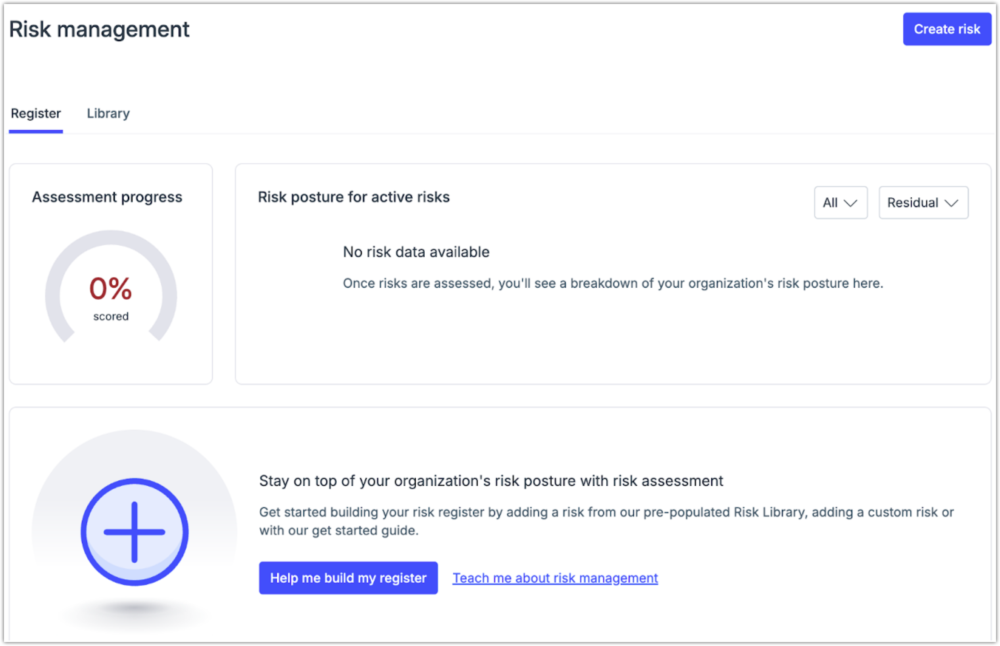

# Streamlined Risk Register Set Up

Source: https://help.drata.com/en/articles/13371754-streamlined-risk-register-set-up
Collection: Understand the Drata Platform › Risk
Updated: 2026-11-09
Fetched: 2026-11-22

## Article text

Managing organizational risk can feel daunting, but Drata makes it simple. With our **Risk Management Standard** offering, you can jumpstart your risk register in minutes by answering just seven key questions.

A risk register is the central hub for identifying, assessing, and tracking risks within your organization. It provides visibility into the severity of each risk and outlines the actions needed to mitigate them. By automating this process, Drata helps you establish a strong foundation for ongoing risk management.

**Note:** The risk register setup survey is only available in **Risk Management Standard**. It is not included in Risk Management Pro.

## Getting started

If your risk register is empty, you have two options:

1. **Learn about risk management principles** through the in-app survey.
2. **Populate your risk register automatically** by answering the guided questions.

 (links to https://downloads.intercomcdn.com/i/o/am69aeco/2079123206/b8a1f0f35dd678506b0a11953bd7/image.png)

Keep in mind:

- Once you complete the survey, the populated risks remain in your register for continuous tracking.
- If you believe you answered incorrectly, you can restart the survey—but only after deleting all existing risks. It's not recommended to regularly delete all risks in your register in order to restart the survey.
- You can always add or copy additional risks later from the **Risk Library**.

## How to launch the survey

1. Navigate to the **Risk Management page** > **Register** tab. If your register is empty, select **Help me build my register** or **Teach me about Risk Management.**
2. Answer each question about the systems, environments, and practices relevant to your business.

At the end of the survey, you'll be able to decide whether to automatically populate your register with the recommended risks.

## Survey questions

The survey asks about seven key areas that commonly introduce organizational risk:

1. **Artificial Intelligence** – Do you use your own AI systems, third-party AI systems, or both?
2. **Physical Site** – Does your organization own or operate physical office space, including leased locations?
3. **Cloud Environment** – Do you rely on platforms such as AWS, Azure, or GCP?
4. **Regulatory Requirements** – Are you required to follow standards like GDPR, ISO 27001, or HIPAA?
5. **Software Development** – Do you develop software in-house?
6. **Unsecured Devices** – Are company-issued devices used in non-secure settings (e.g., coffee shops)?
7. **Device Delivery** – Does your organization ship devices physically?

## Building and customizing your register

Based on your responses, Drata automatically generates a tailored set of risks in your register. From there, you can:

- **Add more risks** by exploring the pre-populated options in the Risk Library, or add your own custom risks that are unique to your organization.
- **Remove or close risks** if they no longer apply to your business.

This flexibility ensures your risk register always reflects the unique needs of your organization while keeping risk management efficient and actionable.

✅ **Pro Tip:** Regularly review and update your register to ensure it evolves alongside your business and compliance landscape.

## Images

- [image 01] ../../images/ux/risk/streamlined-risk-register-set-up--01.png

## Related articles

- [Getting started with a risk assessment (Concept Guide)](getting-started-with-a-risk-assessment-concept-guide.md)
- [Understanding the Drata Risk Register](understanding-the-drata-risk-register.md)
- [Manage multiple risk registers (New Experience)](manage-multiple-risk-registers-new-experience.md)
- [Organization settings: Internal Security](organization-settings-internal-security.md)
- [Risk Management Training Videos (New Experience)](risk-management-training-videos-new-experience.md)
