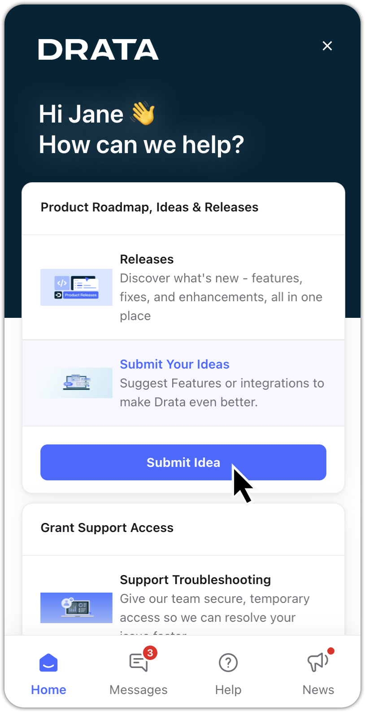

# Submitting a Feature Request

Source: https://help.drata.com/en/articles/15184119-submitting-a-feature-request
Collection: Getting Started › Helpful Resources › How to Get Support at Drata
Updated: 2026-05-20
Fetched: 2026-11-22

## Article text

Have an idea that would make Drata work better for you? We want to hear it. Drata uses **ProductBoard** to collect and prioritize feature requests directly from customers — your feedback shapes what we build next.

---

### Overview

You can submit a feature request, upvote an existing idea, or check the status of a highly requested feature through the **Drata ProductBoard portal**. The portal is accessible directly from the Intercom help widget inside your Drata account.

---

### How to Submit a Feature Request

1. Log in to your Drata account.
2. Click the **help bubble** () in the bottom-right corner of the screen to open the Intercom widget.
3. Scroll down within the widget and click **Submit Idea**.
   
4. You will be directed to the **[Drata ProductBoard portal](https://portal.productboard.com/nzc544wnizb8oemj9h4cxfk9/tabs/1-feature-ideas)**.
5. On the portal, you can:
   - **[Submit a new idea](https://portal.productboard.com/nzc544wnizb8oemj9h4cxfk9/tabs/1-feature-ideas/submit-idea)**: Click **+ Submit Idea** in the upper-right corner. Provide a title, a description of the problem you're trying to solve, and your desired outcome.
   - **View the status** of highly requested features to see what's in progress or planned.

**Note:** When submitting, the more detail you provide — including your use case and the problem you're trying to solve — the better our product team can evaluate and prioritize your request.

---

### Tips for a Strong Submission

- Describe the **problem**, not just the solution. For example: *"I need to track approval status across multiple frameworks at once, but currently I have to check each framework individually."*
- Include any **workarounds** you're currently using.
- If your team has already submitted a similar request, **upvote it** instead of submitting a duplicate — combined votes carry more weight in prioritization.

---

### What Happens After You Submit

Our product team reviews portal submissions on a regular basis. Features are prioritized based on customer demand, business impact, and strategic fit.

## Images

- [image 01] ../../images/not-product/submitting-a-feature-request--01.png
- [image 02] ../../images/ux/other/submitting-a-feature-request--02.png

## Related articles

- [Using the Drata Audit Portal (New Experience)](using-the-drata-audit-portal-new-experience.md)
- [Section 5: Drata for Auditors](section-5-drata-for-auditors.md)
- [NIST SP 800-171 Rev. 2 Self-Assessment](nist-sp-800-171-rev-2-self-assessment.md)
- [What auditors can see in Audit Portal](what-auditors-can-see-in-audit-portal.md)
- [Framework Mapping Agent: AI-Assisted Control Mapping for Custom Frameworks](framework-mapping-agent-ai-assisted-control-mapping-for-custom-frameworks.md)
