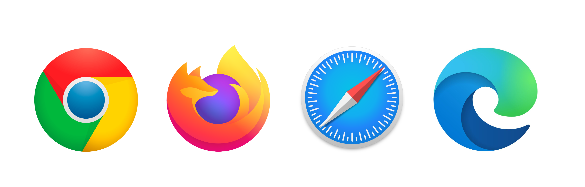

# Supported Internet Browsers

Source: https://help.drata.com/en/articles/4686267-supported-internet-browsers
Collection: Getting Started › Helpful Resources
Updated: 2026-08-05
Fetched: 2026-11-22
Description: Recommended browsers for optimal performance.

## Article text

The list of supported internet browsers:

- Google Chrome
- Mozilla Firefox
- Safari
- Edge

## Images

- [image 01] ../../images/not-product/supported-internet-browsers--01.png

## Related articles

- [How does the Drata agent work?](how-does-the-drata-agent-work.md)
- [Using the Drata Evidence Package and Manifest File](using-the-drata-evidence-package-and-manifest-file.md)
- [Microsoft Intune Integration guide](microsoft-intune-integration-guide.md)
- [Troubleshooting Login Issues: Browser, Cache & Session Problems](troubleshooting-login-issues-browser-cache-session-problems.md)
