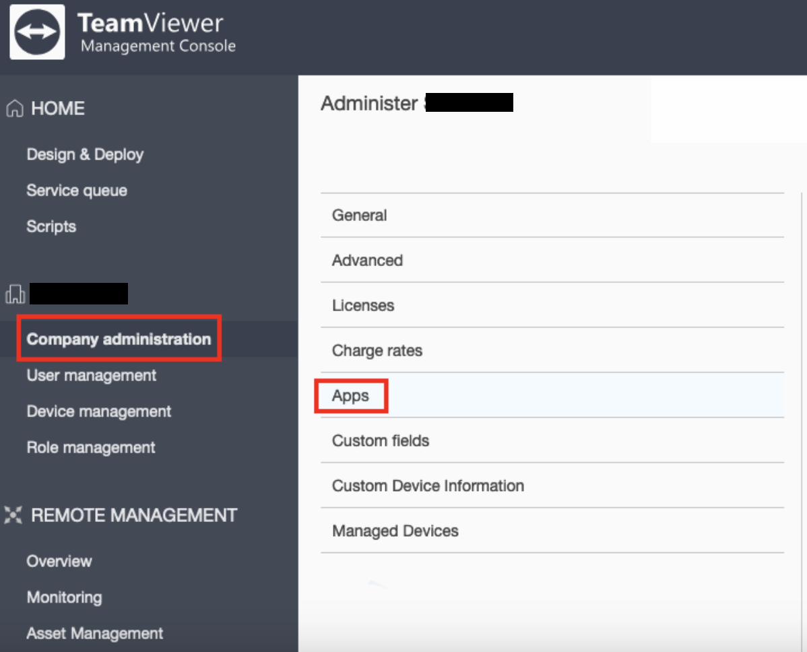

# TeamViewer (Remote) Integration Guide

Source: https://help.drata.com/en/articles/9972130-teamviewer-remote-integration-guide
Collection: Connection Support › Other Guidance
Updated: 2026-03-09
Fetched: 2026-11-22
Description: Learn how to connect TeamViewer to Drata to automate User Access Reviews by syncing user data from TeamViewer.

## Article text

The **TeamViewer integration** enables security and compliance teams to automate **User Access Reviews (UAR)** by syncing user account data directly from TeamViewer. This helps organizations review which users have access to TeamViewer and maintain accurate access records for compliance monitoring.

---

## Key Capabilities

- **User Access Monitoring:** Retrieve TeamViewer user accounts for access review workflows
- **Access Visibility:** Monitor which users have access to your TeamViewer environment
- **Compliance Monitoring:** Maintain auditable records of system access for compliance and security governance

This integration supports **User Access Review workflows**, helping organizations demonstrate compliance with **access control policies**.

---

## Prerequisites & Data Access

### TeamViewer Access Requirements

- You must have **Administrator privileges** in your **TeamViewer account**.
- You will need to create a **TeamViewer Script Token** with the following permissions:

| Permission | Access Level |
|---|---|
| User management | View users |
| Group management | Read groups |

### Drata Role Requirements

To create or modify connections, you must have one of the following **Drata roles with write access**:

- Admin
- Workspace Manager
- DevOps Engineer

Access Reviewers can view the connection page but cannot modify connection settings.

---

## Step-by-Step Setup

### Step 1: Create a TeamViewer Script Token

1. Log in to the **TeamViewer Management Console**:
   [https://login.teamviewer.com/nav/managecompany/apps](https://login.teamviewer.com/nav/managecompany/apps)
2. Navigate to **Company Administration → Apps**.
   
3. Under **Apps and Scripts accessing your company**, select **Create script token**.
4. Configure the following permissions:
   - **User management:** View users
   - **Group management:** Read groups
5. Create the token and copy the **Script Token**.

Store this token securely, as it will be required during the connection process.

**Expected outcome:**
You have generated the **TeamViewer Script Token** required for the integration.

---

### Step 2: Connect TeamViewer in Drata

1. Log in to **Drata** → go to the **Connections** page.
2. Navigate to your **Available Connections**.
3. Search for and start the **TeamViewer connection process**.
4. Enter the following information when prompted:

- **Script Token**

**Expected outcome:**
TeamViewer is successfully connected and user access data begins syncing to Drata.

---

## Important Notes

- **Authentication method:** The TeamViewer integration uses a **Script Token**.
- **Credential security:** Store the token securely according to your organization’s security policies.
- **Network restrictions:** If your organization uses a **Web Application Firewall (WAF)**, ensure required Drata IP addresses are allowlisted so the connection can be established.

## Images

- [image 01] ../../images/integrations/teamviewer/teamviewer-remote-integration-guide--01.png

## Related articles

- [Segment Integration Guide](segment-integration-guide.md)
- [Dixa Integration Guide](dixa-integration-guide.md)
- [Workable Integration Guide](workable-integration-guide.md)
- [Intercom Integration Guide](intercom-integration-guide.md)
- [Sophos Integration Guide](sophos-integration-guide.md)
