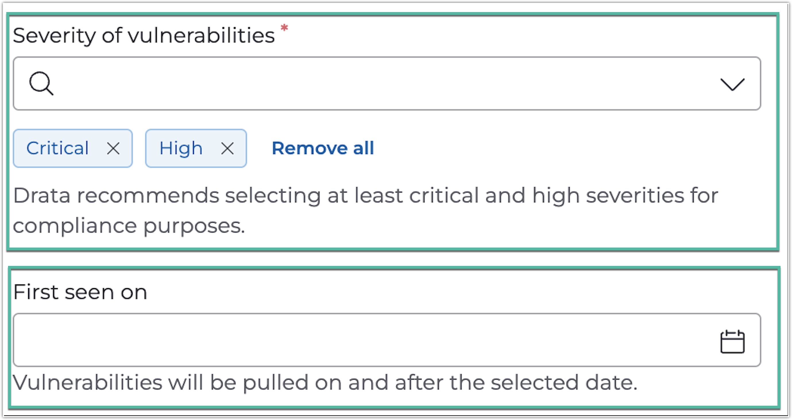

# Tenable Vulnerability Management Integration Guide

Source: https://help.drata.com/en/articles/9750515-tenable-vulnerability-management-integration-guide
Collection: Connection Support › Other Guidance
Updated: 2026-07-27
Fetched: 2026-11-22
Description: This article walks through the details of configuring Tenable Vulnerability Management to connect to Drata.

## Article text

Connecting **Tenable Vulnerability Management** to Drata enables automated, continuous monitoring of vulnerability findings for compliance. This integration supports tracking SLA due dates and automates evidence collection for vulnerability management requirements.

## Key Capabilities

- **Vulnerability ingestion**: Imports findings from supported scanning tools
- **Compliance mapping**: Supports vulnerability-management tests such as DCF-18
- **Read-only access**: Retrieves vulnerability metadata without triggering or modifying scans

This integration automates evidence collection for the **Vulnerability Scanning** test, which is mapped to **DCF-18** by default. You can view findings by selecting the **View Findings** button after connecting or navigating directly to the **Vulnerabilities** page through the left-side navigation menu.

## Prerequisites & Data Access

- A **Tenable Vulnerability Management** account
- Ability to create an **API key**
- A Tenable user **assigned a permission configuration** that allows read-only access to vulnerability data:
   - **Permissions:** Can View
   - **Objects:** All Assets

To follow least-privilege best practices, we recommend using a **Basic User** role for the Tenable user who creates the API key.

**Note:** Creating users or assigning permissions in Tenable requires **Administrator** access.

---

**⚠️ Tenable product support**
Despite being part of the broader Tenable ecosystem, **Tenable Vulnerability Management** is the only Tenable product that integrates with Drata. Ensure you are connecting Tenable Vulnerability Management, not another Tenable product, to avoid syncing issues.

---

📊 **Vulnerability sync behavior**
Drata pulls up to **1,000 new or updated vulnerabilities per connection per day**, ordered by severity from **Critical** to **Low**. You can control which vulnerabilities sync by selecting severity filters during connection.

---

### Permissions & Data Table

| Permission / Scope | Why It’s Needed | Data Accessed (Read Only) |
|---|---|---|
| Can View | Allows Drata to retrieve vulnerability findings | Vulnerability IDs, severity, status, timestamps |
| All Assets | Ensures full visibility across all scanned assets | Asset-level vulnerability associations |

Drata does **not** modify vulnerabilities, assets, or scan configurations in Tenable.

## Step-by-Step Setup

### Step 1: Verify your user account permissions

The API key inherits the permissions of the Tenable user who creates it. To ensure Drata can successfully sync vulnerability data, verify the user is assigned a permission configuration with:

- **Permissions:** Can View
- **Objects:** All Assets

To create or assign permissions:

1. (If applicable) In Tenable, create a [user](https://docs.tenable.com/vulnerability-management/Content/Settings/access-control/CreateAUserAccount.htm) or [group](https://docs.tenable.com/vulnerability-management/Content/Settings/access-control/CreateAGroup.htm) for your Tenable Vulnerability Management account.
2. In Tenable, select **Settings** from the left navigation.
3. Select **Access Control**, then open the **Permissions** tab.
4. Select **Create Permission**.
5. Enter a **Permission Name** (for example, *Drata Read-Only Access*).
6. Assign the permission to one or more **Users** or **Groups**.
7. In **Permissions**, select **Can View**.
8. In **Objects**, select **All Assets**.
9. Select **Save**.

Confirm the permission is assigned to the user who generated the API key. Learn more at **[Create and Add a Permission Configuration](https://docs.tenable.com/vulnerability-management/Content/Settings/access-control/CreateAndAddAPermission.htm#To-create-and-add-a-permission-configuration-to-a-user-or-group:)**

---

### Step 2: Create a Tenable API key

1. Log in to your **Tenable Vulnerability Management** account.
2. Select **Settings** from the left-side navigation.
3. Select **API Keys**.
4. Create a new API key and save the **Client Key** and **Secret Key**.

You will use these values to connect Tenable to Drata.

---

### Step 3: Connect Tenable Vulnerability Management in Drata

1. In Drata, select **Connections** from the left navigation.
2. Open the **Available Connections** tab.
3. Search for **Tenable Vulnerability Management** or filter by **Vulnerability Scanning**.
4. Select **Connect**.
5. When connecting the integration, you can configure:
   - **Severity:** Select which vulnerability severities to sync (Critical and High are selected by default)
   - **First seen on:** Select the earliest detection date for vulnerabilities to sync
   
6. Continue on.
7. Enter the **Client Key** and **Secret Key** from Tenable.

---

### Step 4: Validate the connection

Once the connection is successful:

- Select **View Findings** on the connection card, **or**
- Navigate to the **Vulnerabilities** page in Drata

You should now see vulnerability findings synced from Tenable for compliance monitoring.

Drata shows *findings*, which are instances of *vulnerabilities* (an individual but higher-level CVE) against specific resources. This may reflect as higher finding counts in Drata vs. your Tenable dashboard.

## Images

- [image 01] ../../images/integrations/snyk/snyk-integration-guide--01.png

## Related articles

- [Semgrep Integration Guide](semgrep-integration-guide.md)
- [CrowdStrike Falcon Exposure Management Integration Guide](crowdstrike-falcon-exposure-management-integration-guide.md)
- [SentinelOne Singularity Vulnerability Management (VMS) Integration Guide](sentinelone-singularity-vulnerability-management-vms-integration-guide.md)
- [Microsoft Defender Vulnerability Management Integration Guide](microsoft-defender-vulnerability-management-integration-guide.md)
- [Rapid7 InsightVM Integration Guide](rapid7-insightvm-integration-guide.md)
