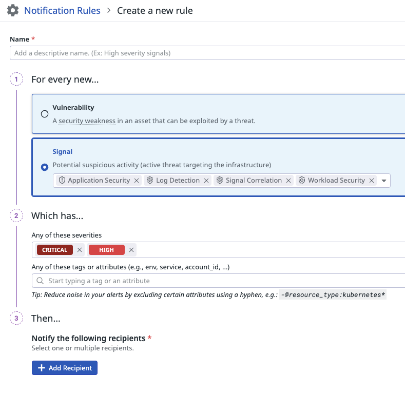

# Test 121: Logs Monitored for Suspicious Activity

Source: https://help.drata.com/en/articles/4797516-test-121-logs-monitored-for-suspicious-activity
Collection: Monitoring Test Guidance
Updated: 2026-08-05
Fetched: 2026-11-22
Description: Drata inspects the company infrastructure logs to determine that it is configured to monitor web traffic and suspicious activity.

## Article text

At the moment, this test is only supported by [Datadog connections](datadog-integration-guide.md). Make sure you have a Datadog Connection with SIEM functionality enabled.

Warning Note: This test depends on the Datadog Cloud Security Platform product, which is a paid Datadog feature. You can check if you have this feature enabled by navigating to [https://app.datadoghq.com/security/home](https://app.datadoghq.com/security/home) and verifying that you see the "Cloud SIEM" dashboard. If this product is not enabled, you should disable this test.

## How the test works

This test verifies that your [Datadog Security Notification Rules](https://app.datadoghq.com/security/configuration/notification-rules) include at least one of the four supported Signal Detection Rule types. Because this is a paid Datadog feature, you’ll need to configure it before the test can run successfully.

Drata checks for the following rule types:

- Application Security
- Log Detection
- Workload Security
- Signal Correlation

## How to pass the test

To pass the test, create at least one Notification Rule with a supported detection rule type.

1. Go to the [Notification Rules page](https://app.datadoghq.com/security/configuration/notification-rules).
2. Select **+ New Notification Rule**.
3. Enter a name for your rule.
4. In **Step 1**, select **Signal** as the rule type.
   - Choose at least one supported detection rule type.
      - By default, this test passes if you have a Notification Rule that includes at least one supported detection rule type.
5. In **Step 2**, configure severity levels and attributes.
6. In **Step 3**, add a recipient.
7. Select **Save and Activate**.

See more details in our[Datadog Connection Details](datadog-integration-guide.md#h_06eb406f58) article.

## Images

- [image 01] ../../images/integrations/datadog/test-121-logs-monitored-for-suspicious-activity--01.png

## Related articles

- [Test 112: Database CPU Monitored](test-112-database-cpu-monitored.md)
- [Test 113: Database Free Storage Space Monitored](test-113-database-free-storage-space-monitored.md)
- [Test 114: Database Read I/O Monitored](test-114-database-read-i-o-monitored.md)
- [Test 117: NoSQL Cluster Storage Utilization Monitored](test-117-nosql-cluster-storage-utilization-monitored.md)
- [Test 129: Capacity and Usage Monitoring](test-129-capacity-and-usage-monitoring.md)
