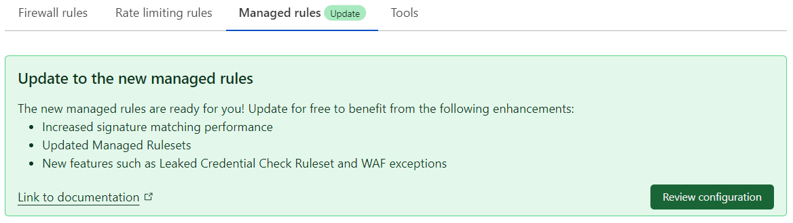
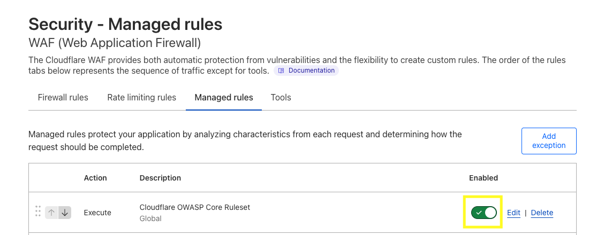

# Test 122: Web Application Firewall in Place

Source: https://help.drata.com/en/articles/4777003-test-122-web-application-firewall-in-place
Collection: Monitoring Test Guidance
Updated: 2026-08-05
Fetched: 2026-11-22
Description: Drata inspects the WAF configurations to determine if WAF is appropriately deployed and configured to appropriately block malicious traffic.

## Article text

**ASSOCIATED DRATA CONTROL**

This test is part of the **Web Application Firewall **control that ensures your company has a WAF in place to protect applications from outside threats.

**WHAT TO DO IF A TEST FAILS**

If Drata finds that WAF is either not enabled or that there are no rulesets configured the test will fail.

To remediate a failed test, you will need to enable WAF and configure the relevant rulesets for your websites.

**STEPS FOR PASSING**

To ensure a validated state when testing that a web application firewall is in place, please follow the steps listed in the table below. Once the provider steps have been completed, navigate back to Drata and execute the test.

| **Provider / Technology** | **Provider Steps** |
|---|---|
| **AWS - WAF** | Note: If there are no Web ACLS, then the test will fail. 1. Within AWS, go to the New AWS WAF service 2. Click on Web ACLs (left menu) 3. Click on the Create web ACL button    1. Enter a name    2. CloudWatch metric name: (auto fills after name) 4. Choose Resource Type (two options)    1. Cloudfront Distributions (Global)    2. Regional Resources (ALB, API Gateway, AWS AppSync) 5. Add Associated AWS Resource 6. Click Next 7. Add Rule 8. Click Next 9. Add Rule Priority 10. Click Next 11. Configure CloudWatch metrics 12. Review and Create web ACL |
| **Cloudflare** | **NOTES:** Ensure your domain is using a Pro account. Cloudflare's API does not support communicating WAF settings without this in place. **Verify that you have migrated to the new WAF Managed Ruleset. If you haven’t, follow these steps from your Cloudflare dashboard:** 1. From your dashboard, select your account and zones 2. Go to Security > WAF > Managed rules. On Pro accounts, the dashboard should show this banner:  3. In the update banner, select “Review configuration.” Note that this banner is only displayed in eligible zones. 4. Review the proposed WAF configuration rules. 5. When you are done reviewing, select “Deploy” to deploy the new WAF Managed Rules configuration. 6. Confirm at least one Managed Rule is Enabled.  ***Each zone in your account must have WAF enabled and at least one managed rule enabled*** If you are still failing this test after migrating to the new WAF Managed Ruleset, please check your API token to add new scopes and/or new domains that you may have acquired since first making the Cloudflare connection in Drata. |
| **GCP - WAF** | Enable a Cloud Armor Policy 1. Go to Network Security -> Cloud Armor 2. Click Create Policy    1. Set a name    2. Set the Default rule action: Deny    3. Set the Deny status: 403 - this will initially block all traffic    4. Add more rules to enable traffic from appropriate sources    5. Apply the policy to one or more appropriate targets (e.g. Load Balancers) if desired    6. Set Scope to be 'Global'.    7. Enable Adaptive Protection if desired 3. Click Create policy |

## Images

- [image 01] ../../images/integrations/cloudflare/test-122-web-application-firewall-in-place--01.png
- [image 02] ../../images/integrations/cloudflare/test-122-web-application-firewall-in-place--02.png

## Related articles

- [Test 4: SSL/TLS on Admin Page of Infrastructure Console](test-4-ssl-tls-on-admin-page-of-infrastructure-console.md)
- [Test 112: Database CPU Monitored](test-112-database-cpu-monitored.md)
- [Test 117: NoSQL Cluster Storage Utilization Monitored](test-117-nosql-cluster-storage-utilization-monitored.md)
- [Test 119: Firewall Default Disallows Traffic](test-119-firewall-default-disallows-traffic.md)
- [Test 105: Threat Detection in Place](test-105-threat-detection-in-place.md)
