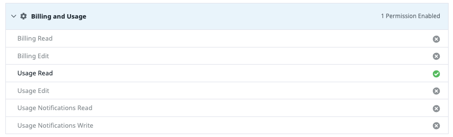

# Test 129: Capacity and Usage Monitoring

Source: https://help.drata.com/en/articles/4778868-test-129-capacity-and-usage-monitoring
Collection: Monitoring Test Guidance
Updated: 2026-08-05
Fetched: 2026-11-22
Description: Drata inspects your companies' processing capacity and usage reports to determine if processing capacity and usage is monitored.

## Article text

**ASSOCIATED DRATA CONTROL**

This test is part of the **Monitoring Processing Capacity and Usage **control that ensures your company makes use of processing capacity and usage reports to determine if processing capacity and usage is monitored.

**BEFORE DIVING IN**

This test is currently only available for [Datadog connections](datadog-integration-guide.md).

The Datadog Service Account making the connection will need to have access to the Usage Read Permission. To add this, you will need to edit either the Read Only Role or make a new Role that also has this permission, and attach it to the Drata Service Account.

**HERE'S HOW IT WORKS**
Datadog should be ingesting information from at least one infrastructure source (easily done after making an integration connection from the Datadog integration page.

You should ensure at least 1 infrastructure instance is active, running, and connected to Datadog. This can be verified by viewing the [Datadog Infrastructure List](https://app.datadoghq.com/infrastructure).

The Drata test will check that within the last 24 hours, for at least a 1 hour period, Datadog detected usage from that infrastructure. This can be viewed on the Datadog [Plan & Usage page](https://app.datadoghq.com/billing/usage).

## Images

- [image 01] ../../images/integrations/datadog/test-129-capacity-and-usage-monitoring--01.png

## Related articles

- [Test 113: Database Free Storage Space Monitored](test-113-database-free-storage-space-monitored.md)
- [Test 115: Messaging Queue Message Age Monitored](test-115-messaging-queue-message-age-monitored.md)
- [Test 117: NoSQL Cluster Storage Utilization Monitored](test-117-nosql-cluster-storage-utilization-monitored.md)
- [Test 121: Logs Monitored for Suspicious Activity](test-121-logs-monitored-for-suspicious-activity.md)
- [Datadog Integration Guide](datadog-integration-guide.md)
