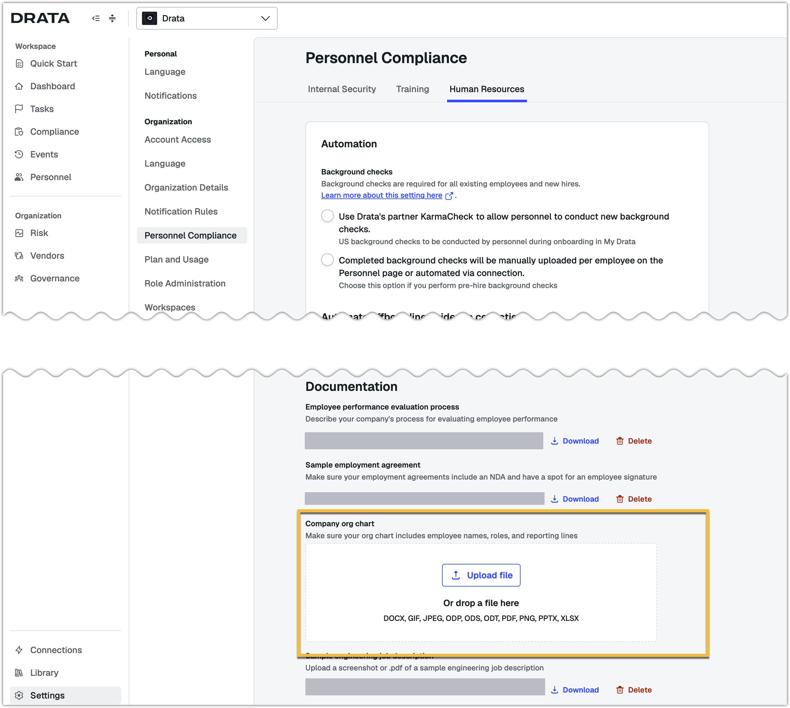

# Test 17: Maintains Organization Chart

Source: https://help.drata.com/en/articles/4776896-test-17-maintains-organization-chart
Collection: Monitoring Test Guidance
Updated: 2026-11-09
Fetched: 2026-11-22
Description: Drata inspects your company records to determine if an Organizational Chart has been uploaded within the last 12 months

## Article text

## ASSOCIATED DRATA CONTROL

This test is part of the **Organizational Chart Maintained **control that ensures your company performs an annual review of its organizational structure, reporting lines, authorities, and responsibilities in terms of information security.

## WHAT TO DO IF A TEST FAILS

If Drata finds that your Org Chart is either older than 12 months or has not been uploaded to Drata the test will fail. Drata also provides notifications when the related test fails, prompting you to update the organizational chart. You can view the most recently uploaded chart with Drata. Additionally, uploading the organizational chart to the wrong location, such as directly to a control or the Evidence Library, will also cause the test to fail. If the test is disabled, you can link the org chart URL as evidence to meet the requirement.

To remediate a failed test, you will need to ensure that your latest Org Chart has been uploaded to Drata.

## STEPS TO REMEDIATE

**New Experience**

1. Log in to Drata as an admin.
2. Go to **Settings page > Personnel Compliance page > Human Resources tab**.
3. Scroll down to Company org chart section to upload your file. If you have previously uploaded an org chart that is older than 12 months, delete the ORG chart before uploading the newer version. You can delete the ORG chart by select the trash icon.
   
4. Save your changes to ensure the new chart is properly stored.

## Images

- [image 01] ../../images/ux/settings/test-17-maintains-organization-chart--01.png

## Related articles

- [Test 16: Information Security Policy](test-16-information-security-policy.md)
- [Test 18: Risk Assessment Policy](test-18-risk-assessment-policy.md)
- [Test 128: Physical Security Policy](test-128-physical-security-policy.md)
- [Test 137: Data Classification Policy](test-137-data-classification-policy.md)
- [Test 141: Clean Desk Policy](test-141-clean-desk-policy.md)
