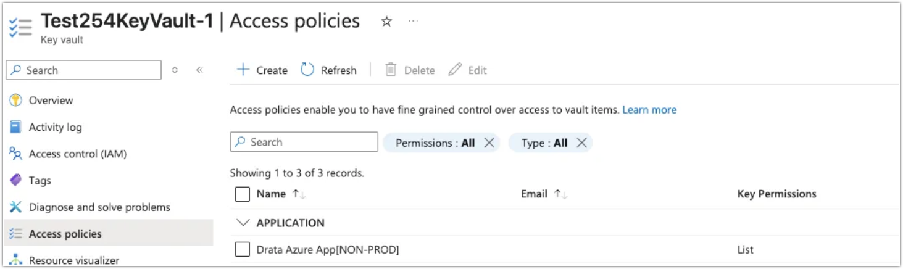

# Test 254: Azure Key Vaults Key Expiration

Source: https://help.drata.com/en/articles/12369439-test-254-azure-key-vaults-key-expiration
Collection: Monitoring Test Guidance
Updated: 2025-09-30
Fetched: 2026-11-22
Description: Drata validates that an expiration date is set for all enabled keys in Azure key vaults.

## Article text

## ASSOCIATED DRATA CONTROL

This test is part of the **Cryptographic Key Rotation **control (DCF-779) that ensures your company has implemented processes to change cryptographic keys periodically based on a defined schedule.

## WHAT TO DO IF A TEST FAILS

If Drata finds that an expiration date is not set for an enabled key in Azure key vaults, the test will fail.

## STEPS TO REMEDIATE

1. Go to **Key Vaults** in the Azure portal.
2. For each key vault, click on **Keys**.
3. In the main pane, set an appropriate **Expiration date** for any keys that are **Enabled**.
4. Repeat this for each failing key in your Azure key vaults.

### Verify the Permission Model

By default, some older vaults use the Vault access policy model instead of Azure role-based access control (RBAC).

- If your vault uses **RBAC (recommended)** → no further action is required.
- If your vault uses **Vault access policy (legacy)** → you must add an access policy so Drata can list keys and validate expiration.

**Check which model your vault is using:**

1. Navigate to the **Key Vault**.
2. In the left-hand menu, select **Access configuration**.
3. Under **Permission model**, you’ll see one of two values:
   - **Vault access policy** → the legacy/default model for older vaults.
   - **Azure role-based access control (RBAC)** → the modern, recommended model.

**If using “Vault access policy”:**

1. Go to the **Key Vault**.
2. Select **Access policies**.
3. Under **Key Permissions**, select **List**.
4. Add the **Drata Entra App** you created when setting up the Azure integration in Drata with the **Key Permission** “List”
   
5. Save the policy.

## Center for Internet Security (CIS)

This is a test that aligns with the Center for Internet Security’s (CIS) benchmarks for Microsoft Azure, providing prescriptive guidance to establish a secure baseline configuration for Azure environments. These benchmarks are developed through a global, consensus-driven process involving cybersecurity experts to help organizations strengthen their defenses against potential threats in the cloud.

## Images

- [image 01] ../../images/integrations/azure/test-254-azure-key-vaults-key-expiration--01.png

## Related articles

- [Azure Integration Guide](azure-integration-guide.md)
- [Test 270: Azure SQL Data Encryption](test-270-azure-sql-data-encryption.md)
- [Test 257: Azure PostgreSQL Database Server Log Checkpoints](test-257-azure-postgresql-database-server-log-checkpoints.md)
- [Identify and Add Missing Azure Permissions for Drata](identify-and-add-missing-azure-permissions-for-drata.md)
- [Understanding Azure Permissions and How Drata Integrates with Azure (Concept Guide)](understanding-azure-permissions-and-how-drata-integrates-with-azure-concept-guide.md)
