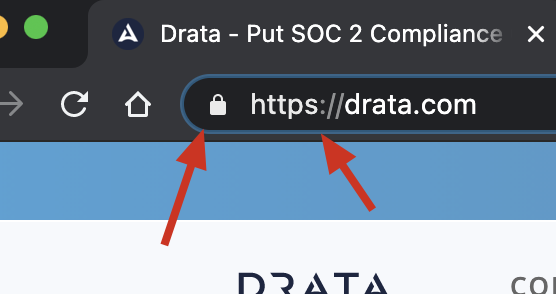

# Test 70: SSL/TLS Enforced on Company Website

Source: https://help.drata.com/en/articles/4776181-test-70-ssl-tls-enforced-on-company-website
Collection: Monitoring Test Guidance
Updated: 2026-08-05
Fetched: 2026-11-22
Description: Drata makes a request to your company website to see if it's reachable exclusively over HTTPS.

## Article text

**ASSOCIATED DRATA CONTROL**

This test is part of the **SSL/TLS Enforced **control that ensures all connections to your company web application from users are encrypted and using SSL/TLS. Drata will also check to make sure an '[http://](http://)' URL will redirect to an '[https://](https://)' URL.

**WHAT DOMAINS/URLS ARE CHECKED**

Company domain and product URL specified in Drata. The Drata company domain may not include the `http` or `https` protocol, or the `www` subdomain. This means Drata is testing the SSL certificate on that domain specifically.

**WHAT IT DOES**

Tests **non-SSL** hosts (port 80) to make sure there is a redirect to the SSL/TLS-protected url. i.e. **[http://drata.com](http://drata.com)** redirects to **[https://drata.com](https://drata.com)**

**WHY ARE WE TESTING THIS?**

To ensure that clients cannot access the website over an unencrypted connection. All data sent to/from the website should be encrypted.

**WHAT TO CHECK IF IT FAILS**

Open the **non-SSL** url in a browser, i.e. [http://drata.com](http://drata.com). You will see a lock in the browser location bar and if you click in the location bar, you will see it now says [https://drata.com](https://drata.com):

**REMEDIATION**

Add a listener on port 80 on your web server or load balancer and return a 301 redirect to port 443.

**HELPFUL RESOURCES**

- [Why is HTTP not secure?](https://www.cloudflare.com/learning/ssl/why-is-http-not-secure/)
- [What is SSL/TLS?](https://www.ssl.com/faqs/faq-what-is-ssl/)
- [Switching from HTTP to HTTPS](https://www.smashingmagazine.com/2017/06/guide-switching-http-https/)

## Images

- [image 01] ../../images/documentation/test-70-ssl-tls-enforced-on-company-website--01.png

## Related articles

- [Test 71: SSL/TLS Configuration has No Known Issues](test-71-ssl-tls-configuration-has-no-known-issues.md)
- [Test 72: SSL/TLS Certificate has Not Expired](test-72-ssl-tls-certificate-has-not-expired.md)
- [Test 4: SSL/TLS on Admin Page of Infrastructure Console](test-4-ssl-tls-on-admin-page-of-infrastructure-console.md)
- [Test 269: Azure App Service Web App Redirects HTTP Traffic to HTTPS](test-269-azure-app-service-web-app-redirects-http-traffic-to-https.md)
- [Resolve SSL/TLS Compliance Testing Issues in Drata](resolve-ssl-tls-compliance-testing-issues-in-drata.md)
