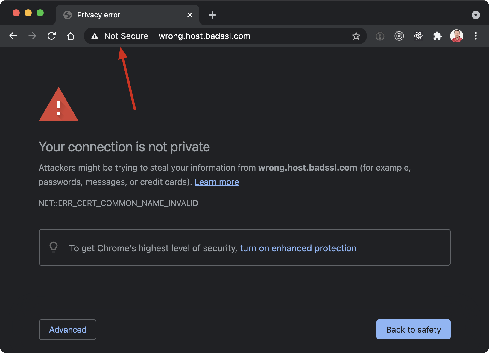

# Test 71: SSL/TLS Configuration has No Known Issues

Source: https://help.drata.com/en/articles/4776834-test-71-ssl-tls-configuration-has-no-known-issues
Collection: Monitoring Test Guidance
Updated: 2026-08-05
Fetched: 2026-11-22
Description: Drata makes a request to your company website to inspect its SSL/TLS configurations and determine if there are any known issues

## Article text

**ASSOCIATED DRATA CONTROL**

This test is part of the **SSL/TLS Enforced **control that ensures all connections to your company web application from users are encrypted and using SSL/TLS. Drata will confirm that SSL/TLS configurations are used to encrypt all data in transit with your web application.

**WHAT DOMAINS/URLS ARE CHECKED**

Company domain and product URL specified in Drata. The Drata company domain may not include the `http` or `https` protocol, or the `www` subdomain. This means Drata is testing the SSL certificate on that domain specifically.

**WHAT IT DOES**

Tests that the server rejects older SSL and TLS protocols. Also checks that the SSL/TLS certificate is valid and that the hostname on the certificate matches the domain above.

**WHY ARE WE TESTING THIS?**

Most browsers will display an error and possibly block users from visiting a site with known issues with the SSL/TLS configuration. This can lead to exposing sensitive data to an attacker.

**WHAT TO CHECK IF IT FAILS**

A modern browser will show an error in the location bar if there is an issue with the SSL/TLS connection. Open your browser with the domains/urls above and inspect the lock icon in the location bar.

**REMEDIATION**

Since this test covers a wide range of issues, remediation will be specific to each case. Common troubleshooting paths include:

- Verify if you possess and have bundled your intermediate certificates within your SSL chain
- Verify that all SSL certificates installed on your domain were actually created for that same domain
- Verify that you have [set up a redirect](test-70-ssl-tls-enforced-on-company-website.md) from port 80 (http) to port 443 (https) on your domain
   - Verify that this listener has been set up on the "raw" version of your domain, i.e. [`domain.com`](http://domain.com/) as opposed to only having a listener on [`http://domain.com`](http://domain.com/) or [`www.domain.com`](http://www.domain.com/) or [`http://www.domain.com`](http://www.domain.com/)
- Verify that you do not have any DNS rules ignoring or rejecting requests from [Drata's user agent or IP address](dratabot.md)
- Verify that your DNS and/or hosting provider do not have inconsistent or unsustained connections when receiving first requests from Drata's user agent or IP address

**HELPFUL RESOURCES**

- [Why is HTTP not secure?](https://www.cloudflare.com/learning/ssl/why-is-http-not-secure/)
- [What is SSL/TLS?](https://www.ssl.com/faqs/faq-what-is-ssl/)
- [Switching from HTTP to HTTPS](https://www.smashingmagazine.com/2017/06/guide-switching-http-https/)

## Images

- [image 01] ../../images/documentation/test-71-ssl-tls-configuration-has-no-known-issues--01.png

## Related articles

- [Test 70: SSL/TLS Enforced on Company Website](test-70-ssl-tls-enforced-on-company-website.md)
- [Test 72: SSL/TLS Certificate has Not Expired](test-72-ssl-tls-certificate-has-not-expired.md)
- [Test 4: SSL/TLS on Admin Page of Infrastructure Console](test-4-ssl-tls-on-admin-page-of-infrastructure-console.md)
- [Test 51: Independent Board of Directors](test-51-independent-board-of-directors.md)
- [Resolve SSL/TLS Compliance Testing Issues in Drata](resolve-ssl-tls-compliance-testing-issues-in-drata.md)
