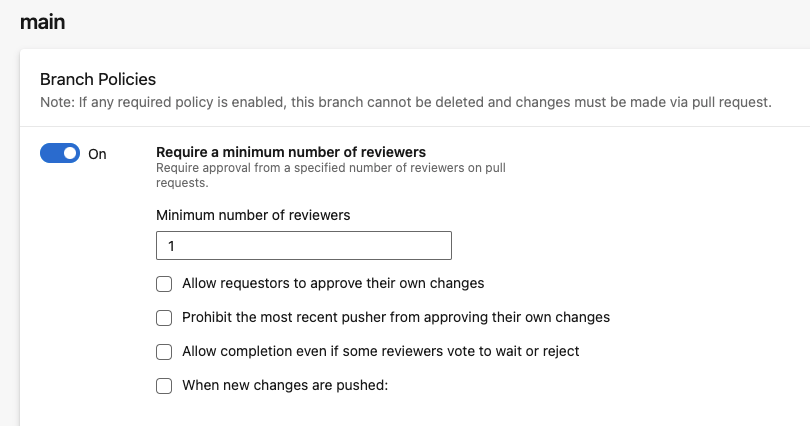
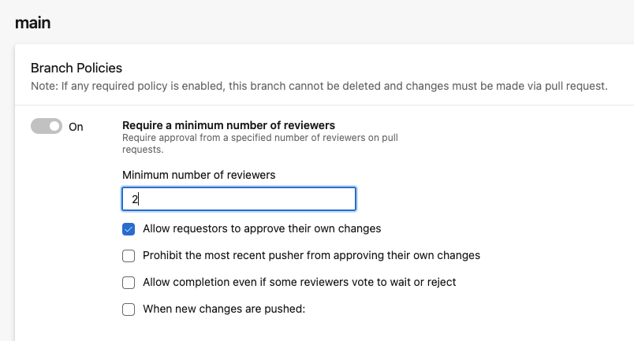
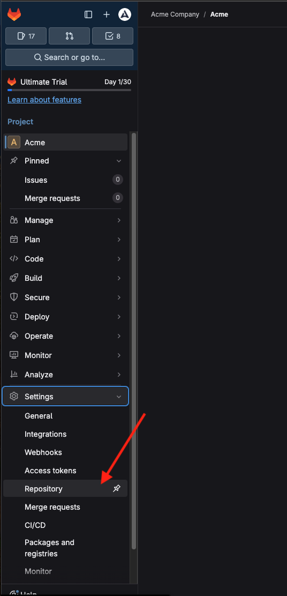
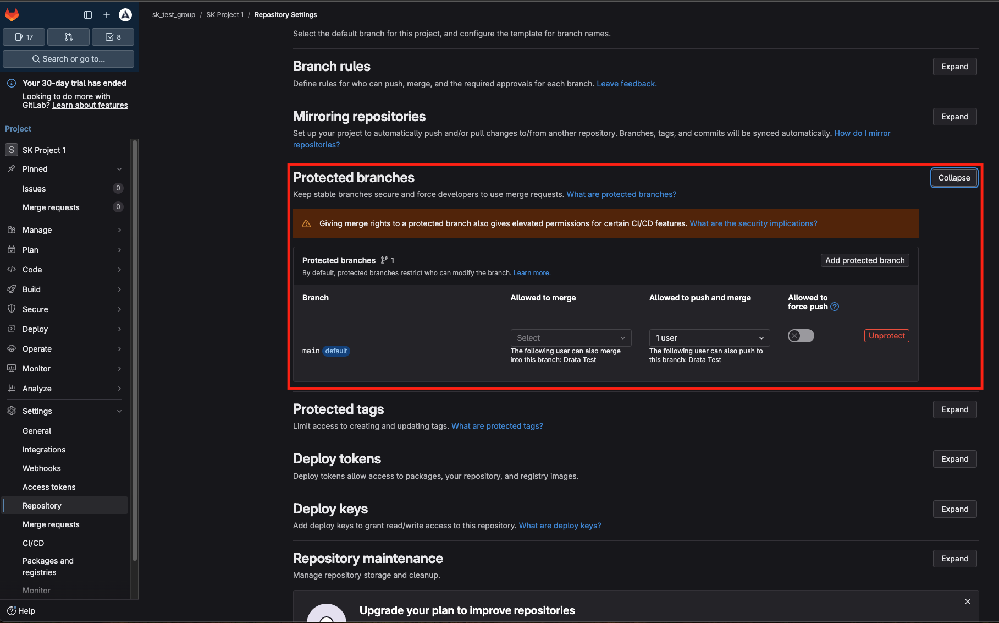
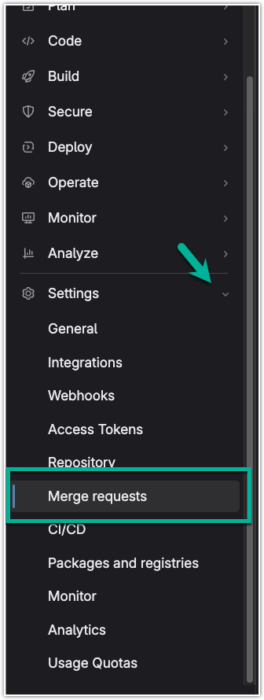
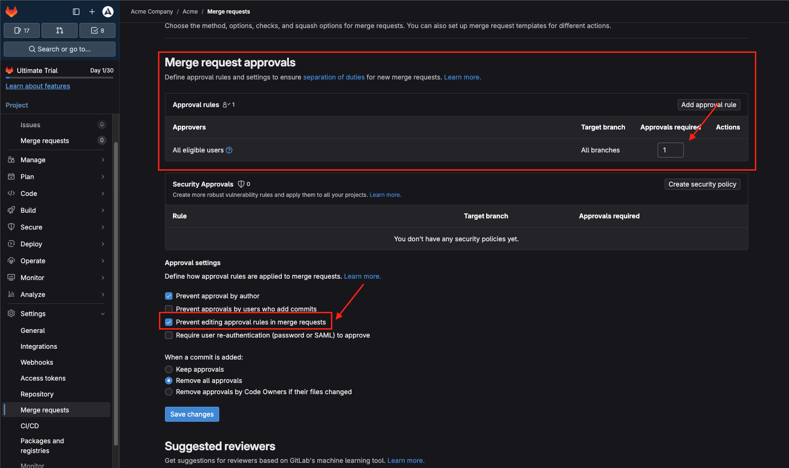
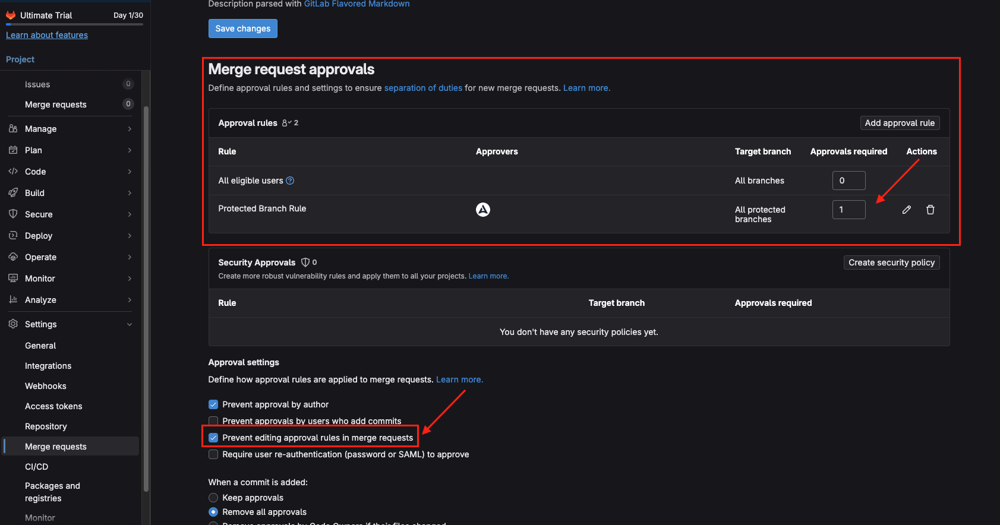
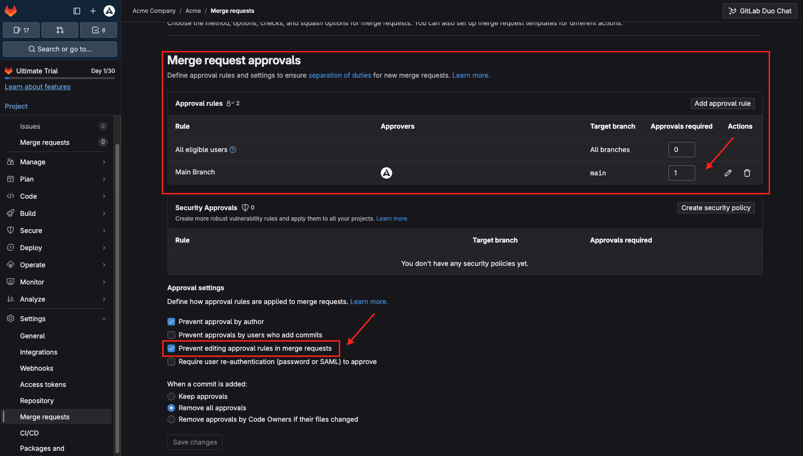

# Test 8: Formal Code Review Process

Source: https://help.drata.com/en/articles/4776886-test-8-formal-code-review-process
Collection: Monitoring Test Guidance
Updated: 2026-11-14
Fetched: 2026-11-22
Description: Drata reads branch configurations for all in-scope repos in your version control system to ensure reviews are required before merging code .

## Article text

## BEFORE DIVING IN 

Please note that inherited permissions are not supported at this time, thus items such as inherited branch restrictions, can not be retrieved by Drata.

## ASSOCIATED DRATA CONTROL

This test is part of the **Code Review Process **control that ensures all application code changes, reviews, and tests are performed by someone other than the person who made the initial code change.

## WHAT TO DO IF A TEST FAILS

If Drata finds that branch configurations allow code changes merged by the same user into the main branch of your version control system, without any other user interaction, the test will fail. With a failed test you will receive a notification from Drata stating that there are code repositories that allow code changes to be merged into the main branch without being reviewed by another team member.

To remediate a failed test, you will need to make sure that a code reviewer is assigned to each merge request, and that reviews cannot be bypassed. It is also recommended to enable a policy on the main branch that requires reviews on all merge requests.

## STEPS TO REMEDIATE

To ensure a validated state when testing for the formal code review process, please follow the steps listed in the table below. Once the provider steps have been completed, navigate back to Drata and execute the test.

---

### AWS CodeCommit

As the Admin:

1. Go to Source -> Approval Rule Templates
2. Click 'Create Template'
3. Ensure a value of at least 2 is provided for 'Number of approvals needed'
4. Select one or more repositories to which to apply this template under 'Associated repositories'
5. Ensure these repositories have a default branch (check under Source -> Repositories -> click on a repo name -> Branches)

---

### Azure DevOps Repos

1. Branch Policies on the default branch must include at least one reviewer, and the checkbox for "Allow requestors to approve their own changes" is off.
   
   **OR**
2. Branch Policies on the default branch includes at least two reviewers.
   

---

### Bitbucket

Both branch match kinds are supported.

If you're setting up branch protection by name (i.e., you selected the option "By name or pattern" at the top of your branch permissions) then you must enter the same branch name you have specified as the default branch in the Repository settings screen -> Advanced dropdown -> Main branch dropdown

In contrast, if you're setting up branch protection by **type** (i.e. you selected the option "By Type") then you must select the "Production" branch type

Then, apply the following two settings:

1. Check the box for "Prevent a merge with unresolved merge checks" at the very bottom of the Branch permissions settings
   - **NOTE:** the use of this checkbox requires you to be on the [Bitbucket Premium plan](https://support.atlassian.com/bitbucket-cloud/docs/bitbucket-cloud-premium-plan/)
2. Check either of the "Check for at least X approval" and "Check for at least X approval from default reviewers" checkboxes
   - Either checkbox is fine, and you need a value of at least 1 for whichever one you decide to use.

---

### GitHub

As the owner:

1. Go to the connected Organization
2. Go to each repo under Repositories
3. Click on the Settings tab
4. In the left menu click on Branches
5. Next to Branch protection rules - click Add rule
6. Enter your Default Branch name pattern, e.g. `Main` or `Production`
7. Select checkbox for "Require a pull request before merging" - refer to [step 6 for more details](https://docs.github.com/en/github/administering-a-repository/defining-the-mergeability-of-pull-requests/managing-a-branch-protection-rule#creating-a-branch-protection-rule)
8. (Optional) We recommended leaving the **Allow force pushes **checkbox unchecked, but depending on your preferences, you canselect that checkbox under "Rules applied to everyone including administrators" - refer to [step 16 for more details](https://docs.github.com/en/github/administering-a-repository/defining-the-mergeability-of-pull-requests/managing-a-branch-protection-rule#creating-a-branch-protection-rule).
   - Selecting this option might create more cases where a single user bypasses other rules to push their code to production.
9. Click the Create button

### GitLab

> **NOTE:**
>
> - Repos on the (legacy) GitLab Bronze plan cannot pass this test. Accounts must be on at least the (legacy) Silver or Premium tier.
> - Changes have been made to how we evaluate Approval Rules as of 08/08/2024. The logic described is how to pass this test as of that date.

As the owner, go to each of the connected projects.

**Verify or Add a Protected Branch**

1. Log into GitLab
2. Navigate to "Projects" -> Select a project
3. Expand the "Settings" dropdown -> Click "Repository"
   - 
4. Expand "Protected Branches"
5. Ensure a protected branch is configured for `main` or `master`. If no such protected branch is configured, set one up.
   
6. Once the protected branch is set up, expand the "Settings" dropdown -> Click "Merge requests"
   
7. Scroll down to "Merge request approvals"
8. The following conditions must be met across all **Merge request approval** rule settings:
   - A protected branch must exist for `main` or `master`
   - All conditions require that “Prevent editing approval rules in merge requests” must be checked
   - At least 1 approver must exist on **Approval rules** targeting `All branches`, or `Protected branches`, or the protected branch from the Repository Settings

**Hierarchy of Approval Rule Checks**

1. Drata first checks if the default approval rule targeting “All branches” has at least ONE approver.
   
2. If that first check fails, another approval rule must exist with a “Target branch” targeting `All Protected branches` or the protected branch from the first check above with at least ONE approver.

Example approval rule targeting `All protected branches`

Example approval rule targeting `main` or `master`

***NOTE: ***If one of your repos shows an error message of "Request failed with status code 404" in the raw test evidence, this means no protected branches have been defined for this repo. You should define at least one according to the instructions above and rerun the test.

## Images

- [image 01] ../../images/integrations/azure-devops/test-8-formal-code-review-process--01.png
- [image 02] ../../images/integrations/azure-devops/test-8-formal-code-review-process--02.png
- [image 03] ../../images/integrations/gitlab/test-8-formal-code-review-process--03.png
- [image 04] ../../images/integrations/gitlab/test-8-formal-code-review-process--04.png
- [image 05] ../../images/integrations/gitlab/test-8-formal-code-review-process--05.png
- [image 06] ../../images/integrations/gitlab/test-8-formal-code-review-process--06.png
- [image 07] ../../images/integrations/gitlab/test-8-formal-code-review-process--07.png
- [image 08] ../../images/integrations/gitlab/test-8-formal-code-review-process--08.png

## Related articles

- [Test 54: Formal Code of Conduct](test-54-formal-code-of-conduct.md)
- [Test 9: Production Code Changes Restricted](test-9-production-code-changes-restricted.md)
- [Test 7: Only Authorized Employees Change Code](test-7-only-authorized-employees-change-code.md)
- [GitHub Rulesets](github-rulesets.md)
- [Manage connected version control](manage-connected-version-control.md)
