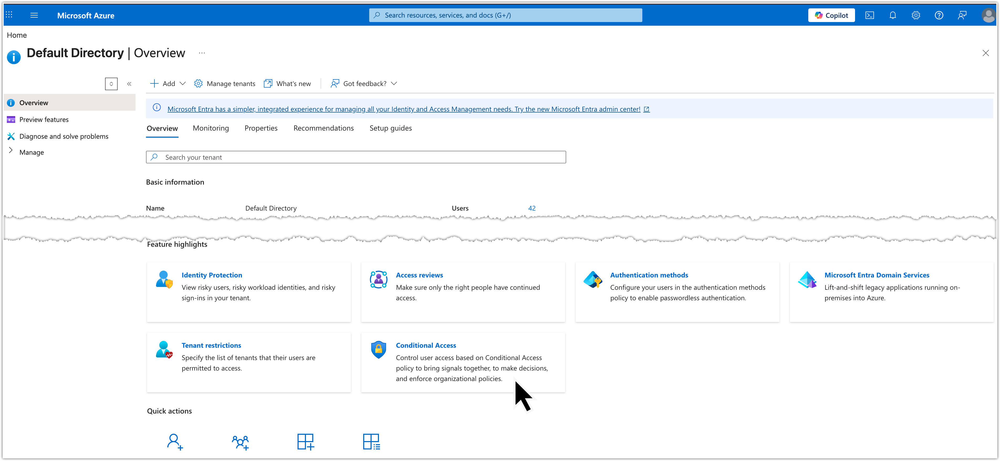

# Test 86: MFA on Identity Provider

Source: https://help.drata.com/en/articles/4776841-test-86-mfa-on-identity-provider
Collection: Monitoring Test Guidance
Updated: 2026-08-17
Fetched: 2026-11-22
Description: Drata uses its synchronized account delegation with your Identity Provider to request a list of all users and determine if MFA is enabled.

## Article text

## ASSOCIATED DRATA CONTROL

This test is part of the **MFA on Accounts **control that ensures Multi-Factor Authentication (MFA) is being required for access to any sensitive systems or applications. Drata will verify that to sign in, a user must provide their ID, a password, and then either a One-Time Password (OTP) or certificate.

Drata does not enable MFA for your users. Enable MFA in the identity provider connected to Drata, such as Okta, Microsoft Entra ID, or Google Workspace. To identify the users who need MFA:

1. Go to **Compliance > Monitoring**.
2. Search for and open **Test 86: MFA on Identity Provider**.
3. Select the **Findings** tab.
4. Note the affected users and their identity provider.
5. Enable MFA for those users in the identity provider.
6. Return to Drata and rerun the test after the identity data sync completes.

## WHAT TO DO IF A TEST FAILS

If Drata finds an identity within your Identity Provider (IdP) that does not have MFA enabled for all users of the application, the test will fail. With a failed test you will receive a list of users that do not have MFA enabled on their account.

To remediate a failed test you will have the ability to send email reminders within Drata to each user, reminding them that they need to enable MFA on their account. The emails sent from Drata will direct your employees back to their onboarding tasks in Drata.

## STEPS FOR PASSING

1. Identify failing identities and providers.
   - Go to **Compliance > Monitoring**.
   - Search for and open **Test 86: MFA on Identity Provider**.
   - Select the **Findings** tab.
   - Review the affected users.
   - Note the identity provider associated with each user.
   - Check whether any affected user has more than one active identity provider connection.
   - Check if a failing user has more than one active IdP connected to Drata. Users with multiple identities must have MFA enabled on every active account to pass. A single non-compliant identity will cause the entire user record to fail Test 86.
2. Enforce MFA in your Identity Provider
   - Log into the relevant IdP and enable MFA for the failing users.
   - We recommend enforcing MFA via Group Policy or Organizational Unit (OU) settings to ensure all current and future users are automatically compliant.
3. Sync your data. After updating settings in your IdP, Drata needs to verify the changes. You can either:
   - **Wait:** Drata performs a nightly sync automatically.
   - **Manual Sync:** To pass the test immediately, navigate to the test and select "Test Now."

**Manage Legitimate Exclusions**: If an account cannot use MFA (e.g., service accounts or "break-glass" admin accounts), create an [exclusion for that account](personnel-exclusions.md).

## Enforce MFA in your Identity Provider steps

For Drata to mark Test 86 as passing, MFA must be **required** (not just available), and each user must have an MFA factor **registered natively in the IdP**.

> ⚠️ **Before making changes:** The steps below modify your Identity Provider's authentication policies, which control how **every user signs in**. Before applying any policy:
>
> - **Test in a non-production environment first** if possible.
> - **Create a break-glass admin account** that's excluded from MFA enforcement, with credentials stored securely offline. This protects against being locked out of your tenant if MFA fails.
> - **Identify and exclude service accounts, automation identities, and shared mailboxes** that can't perform interactive MFA. These should use stronger alternatives (managed identities, certificate-based auth) rather than be subject to user MFA policies.
> - **Communicate to users** before enforcement so they have time to enroll an MFA method.
> - **Roll out in stages** — start with a small pilot group before applying to "All users" or "Everyone."
>
> If you're not the administrator of your IdP, share this article with your IT team rather than making changes yourself.

### Okta

1. Sign in to the **Okta Admin Console**.
2. Go to **Security → Authenticators** and enable the factors you want (Okta Verify, WebAuthn, Google Authenticator, etc.).
3. Go to **Security → Authentication Policies** and edit the **Any two factors** policy (or create a new one).
4. Add a rule: **IF user is in [group] THEN require Password + Another factor.**
5. Assign the policy to the **Everyone** group or a group containing the failing users.
   - Assigning an MFA policy to the **Everyone** group includes service and system accounts.
   - Consider creating a dedicated group of human users instead, and exclude API/service identities.
6. Failing users will be prompted to enroll on next sign-in.

**Provider documentation:**

- [Okta MFA factors](https://help.okta.com/en-us/content/topics/security/mfa/mfa-factors.htm)
- [Launch kit for Okta admins](https://support.okta.com/help/s/launch-kit-for-okta-admins?language=en_US)

---

### Microsoft 365 / Entra ID

Drata evaluates MFA in the following order:

1. **Security Defaults**
   - If Security Defaults are enabled in your tenant, Drata marks all users as MFA-compliant, regardless of other settings.
   - In Microsoft 365 and Microsoft Entra ID, enabling Security Defaults disables legacy authentication. This may prevent older Office clients, IMAP/POP/SMTP connections, and service accounts that use app passwords from connecting.
   - Review the [Microsoft documentation on Security Defaults](https://learn.microsoft.com/en-us/entra/fundamentals/security-defaults) before enabling this setting.
2. **Conditional Access policies (CAPs)**
   - If Security Defaults are disabled, Drata checks for Conditional Access policies that require MFA. To be recognized as compliant, a user must be included in the policy scope and must not be excluded from the policy.
3. **Per-User MFA**
   - If neither Security Defaults nor a relevant Conditional Access policy applies, Drata uses the user’s Per-User MFA status in Microsoft Entra ID. Only in this case do the **Enabled** and **Enforced** states in the Per-User MFA portal affect compliance.

For Drata to recognize a user as MFA-compliant, the user must also have an MFA method **registered natively in Entra ID**. MFA enforced exclusively through a layered system that the Microsoft Graph API cannot see (for example, Duo through ADFS without a native Entra registration) may not be detected.

**Easiest (small orgs):**

1. Sign in to the **Microsoft Entra admin center**.
2. Browse to **Entra ID → Properties**.
3. Select **Manage security defaults**.
4. Set **Security defaults** = **Enabled** and save.

**Recommended (larger orgs):**

1. Sign in to the **Microsoft Entra admin center**.
2. Browse to **Entra ID → Conditional Access → Policies**.
   
3. Select **New policy**.
4. Configure the policy:
   - **Users:** the failing users or a group containing them
   - **Target resources → Resources (formerly cloud apps) → Include:All resources (formerly 'All cloud apps')**
   - **Grant:Require multifactor authentication**
5. Set the policy to **On** and save.

Users will be prompted to register at [aka.ms/mfasetup](https://aka.ms/mfasetup) on next sign-in.

**Troubleshooting tips:**

- If Test 86 unexpectedly passes for everyone, check whether Security Defaults is enabled.
- If a user fails despite a CAP, confirm they're included in the policy scope and have an MFA method registered in Entra.
- After any MFA configuration change, run a manual sync in Drata via **Test now**.
- If MFA is enforced but Test 86 still fails for users, contact Drata Support for review.

⚠️ **Mandatory Microsoft MFA:** As of early 2026, Microsoft has enforced mandatory MFA for all admin portals. If your admin accounts are failing Test 86, ensure you haven't bypassed these defaults with legacy Conditional Access policies.

**Provider documentation:** [Set up multifactor authentication for users](https://learn.microsoft.com/en-us/entra/fundamentals/security-defaults)

---

### Google Workspace

Refer to Google's documentation to enable 2 step verification.

**Provider documentation:**

- [For Google Workspace admins](https://support.google.com/a/answer/9176657?hl=en)
- [For individual employees](https://support.google.com/accounts/answer/185839)

---

## HELPFUL RESOURCES

Drata can identify users without MFA enabled, but MFA settings must be updated directly in your Identity Provider.

- [Personnel exclusions (New experience)](personnel-exclusions.md) — Manage employee statuses and exclusions for Test 86.
- [Identity sync updates in Drata](identity-sync-updates-in-drata.md) — What to do if a user has enabled MFA but the test still shows as failing.
- [What is MFA? (OneLogin primer)](https://www.onelogin.com/learn/what-is-mfa) — Background on the security benefits and common factor types.

## Images

- [image 01] ../../images/integrations/entra-id/test-86-mfa-on-identity-provider--01.png

## Related articles

- [Test 87: MFA on Version Control System](test-87-mfa-on-version-control-system.md)
- [Test 96: Employees have Unique Email Accounts](test-96-employees-have-unique-email-accounts.md)
- [Test 88: MFA on Infrastructure Console](test-88-mfa-on-infrastructure-console.md)
- [Test 214: MFA for AWS Root Account](test-214-mfa-for-aws-root-account.md)
- [Test 225: Hardware MFA for AWS Root Account](test-225-hardware-mfa-for-aws-root-account.md)
