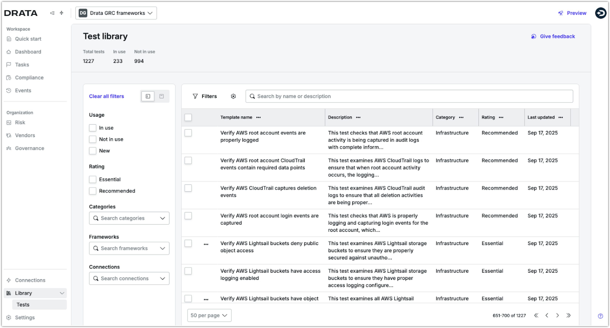
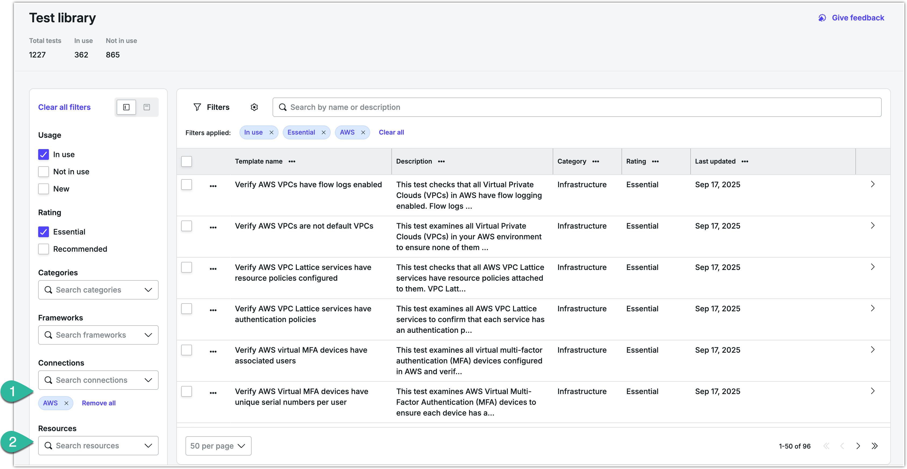
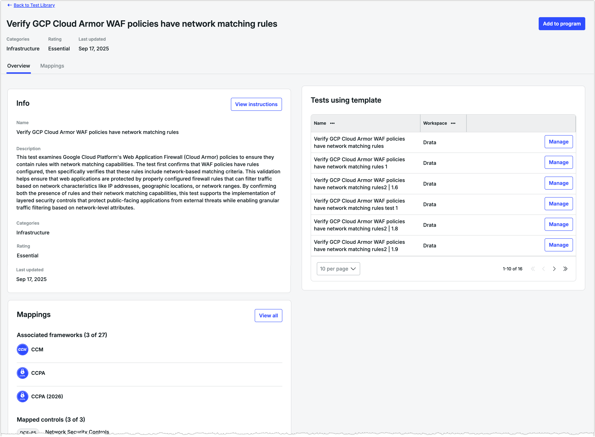
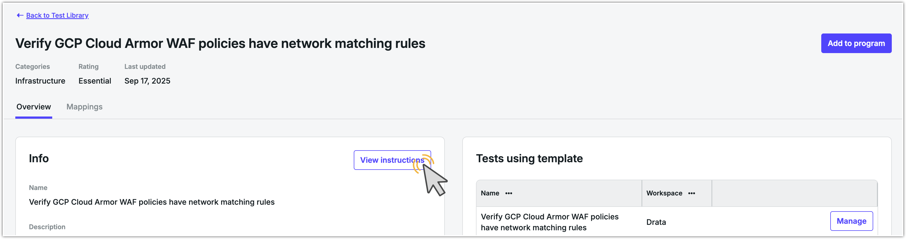
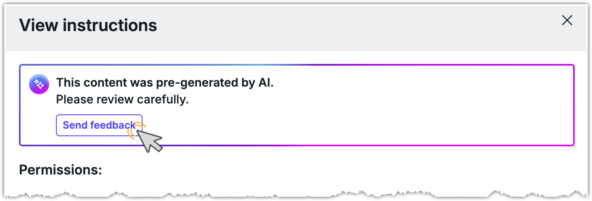

# Test Library (New experience)

Source: https://help.drata.com/en/articles/13394386-test-library-new-experience
Collection: Understand the Drata Platform › Monitoring
Updated: 2026-07-01
Fetched: 2026-11-22

## Article text

> 💡 Only available in the new experience.

## What is the Test Library?

The Test Library is your central hub for discovering and adding compliance tests to your program. When you first open the Test Library, you see a high-level overview that includes the total number of tests available, how many are already in use within your program, and how many are not yet in use.

### Prerequisites

- **RBAC roles**: Admin, Guest Admin, Information Security Lead, Dev Ops Engineer, Control Manager
- **Workspace awareness**: The Test Library is workspace-aware.

### Viewing Tests in the Library

The **Test Library** displays a table of all available tests (shown below).

- Each row represents a test and includes details such as the **test name, description, category, rating,** and **last updated date**.
- You can **sort the table by any column** or use the **search bar** to quickly find a specific test.

To identify tests that are already active in your program, filter by usage or select the **ellipsis(...) at the start of each row**. If the menu is visible, it indicates that active copies of the test exist in your program. Use the menu to **view and manage those active copies**.

## What can I do here?

From the Test Library, you can add tests to a workspace so they begin monitoring your environment.

- **[Add tests from the Test Library to a workspace](add-tests-from-the-test-library-to-a-workspace-new-experience.md)**

### Filter the test library

- **Filter tests by usage** to view tests that are **In Use**, **Not in Use**, or **New**.
- **Filter by rating** to see tests marked as **Essential** or **Recommended**.
- **Filter by category** to narrow results by areas such as **Agent**, **Identity**, or **Infrastructure**.
- **Filter by framework mappings** to find tests associated with specific compliance frameworks or requirements.
- **Filter by connections** to display tests related to specific integrations. **Active and inactive connections are clearly labeled.**
- **Filter by resources** by first selecting an infrastructure connection, then choosing a resource type from that provider. For example, after selecting an **AWS connection**, you can filter by **DB Instances** or other supported resources.
   - **Note:** You can only add tests that have an **active connection**.

Once you select an infrastructure connection, you can also filter out by resources from that provider (e.g. AWS connection, you can filter by DB Instances as the resource).

Note: You can only add tests that have an active connection.

## How are tests added to my environment?

Tests can appear in your environment automatically when you enable a framework or when you manually import them from the Test Library.

- **[Understanding Test Provisioning and the Test Library](understanding-test-provisioning-and-the-test-library-new-experience.md)**

## Use Cases / Best Practices

### Test details page

- Selecting a test opens its details page, where you find test instructions, mappings to specific controls, test logic, template mappings, and any active copies running in your tenant.
- You can review setup instructions to ensure the test runs correctly.

---

### Feedback option

- The setup instructions include a feedback option that applies only to the AI-generated guidance.
- This allows you to share whether the automatically generated setup instructions were helpful, helping Drata refine and improve instruction quality.
- **Important:** AI-generated tests are experimental and may be subject to variation. In some cases, test logic may not fully align with third-party provider behavior or may produce inaccurate results. Customers should independently review AI-generated test results and confirm accuracy before relying on them as evidence of compliance.

To send feedback:

1. Select the test and click **View Instructions **within the Info section.
   
2. The modal indicates whether the test was **generated by AI** and allows you to **submit feedback**.
   

---

### Rating

- Tests in the library are labeled **Essential** or **Recommended** based on guidance from multiple audit partners.
- **Essential** tests represent core checks typically expected for organizations focusing on the foundational **SOC 2 criteria**.
- You should still review each test’s scope to determine what is relevant to your compliance program. Working with your auditor early can also help define the appropriate scope.

---

### New tests

- Tests that were added to the Test Library within the last **45 days** are labeled as New.
- New tests only affect your compliance status **after they are added to your program and published**.
- **AI-generated tests are not automatically provisioned** through framework enablement or mapping updates.
   - **Important:** AI-generated tests are experimental and may be subject to variation. In some cases, test logic may not fully align with third-party provider behavior or may produce inaccurate results. Customers should independently review AI-generated test results and confirm accuracy before relying on them as evidence of compliance.

## Images

- [image 01] ../../images/ux/monitoring/test-library-new-experience--01.png
- [image 02] ../../images/ux/monitoring/test-library-new-experience--02.png
- [image 03] ../../images/ux/monitoring/test-library-new-experience--03.png
- [image 04] ../../images/ux/monitoring/test-library-new-experience--04.png
- [image 05] ../../images/ux/monitoring/test-library-new-experience--05.png

## Related articles

- [Filter and search tests in Monitoring (New Experience)](filter-and-search-tests-in-monitoring-new-experience.md)
- [Roles and permissions overview (New Experience)](roles-and-permissions-overview-new-experience.md)
- [Add tests from the Test Library to a workspace (New Experience)](add-tests-from-the-test-library-to-a-workspace-new-experience.md)
- [Understanding Test Provisioning and the Test Library (New Experience)](understanding-test-provisioning-and-the-test-library-new-experience.md)
- [Understand Accounts, Workspaces, and MIM](understand-accounts-workspaces-and-mim.md)
