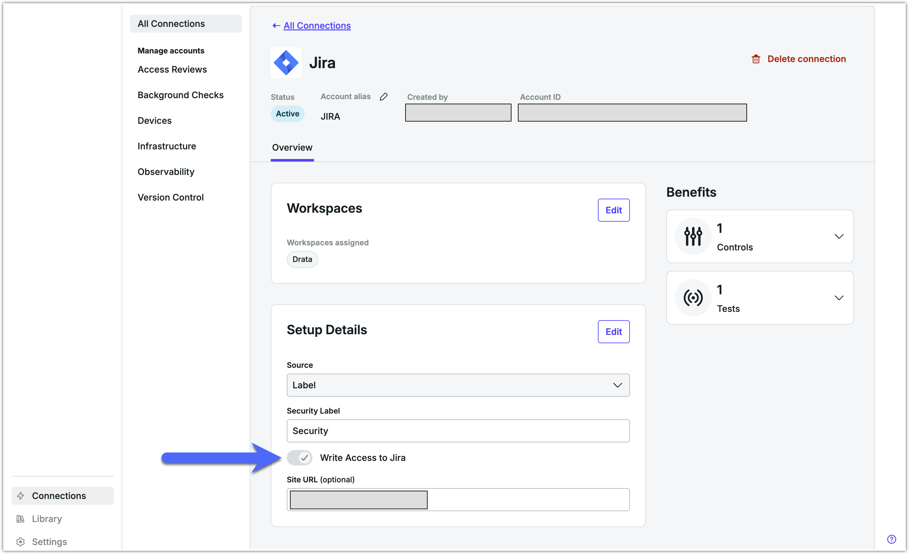

# Ticket Automation (Jira-only) (New experience)

Source: https://help.drata.com/en/articles/13688644-ticket-automation-jira-only-new-experience
Collection: Connection Support › Ticketing Guidance
Updated: 2026-11-09
Fetched: 2026-11-22
Description: Configure rules to automatically create Jira tickets based on control and test events.

## Article text

Managing your security compliance can require coordination and collaboration with other members of your organization. Drata makes this easier by integrating with the tools you already use on a daily basis, including Jira. By configuring ticket automation rules in Drata, you can have tickets automatically opened for key control and test events.

## Prerequisites

- Users with Admin access and DevOps Engineer can create ticket automation rules within Drata; however, a user must have Admin access to set up or edit the Jira connection.
- 'Write Access' can be enabled when creating the initial Jira connection or turned on after the connection has been made (by editing the connection).
- Drata pulls in the required Jira fields as determined by your specific Jira configuration, including Projects, Task Types, and other fields.

## Enable write access for Jira connection

When Jira is connected to Drata, you can optionally enable **Write Access**. Write Access allows Drata to create Jira tickets directly from:

- Controls
- Monitoring tests
- Risk Management

You can enable Write Access:

- During the initial Jira connection setup, or
- Later by editing the existing connection

If you enable Write Access after the connection is already established, you do **not** need to reconnect Jira.

### Important Notes

- You can connect multiple Jira accounts in Drata and enable Write Access for more than one connection.
- To make changes, you must be logged into the specific Jira account you are editing.
- If you cannot create tickets, verify you are logged into the correct Jira account.
- If Jira and Drata appear out of sync, refresh Drata to load the most up-to-date information.

## Create a Ticket Automation Rule

Follow these steps to automatically create Jira tickets based on control or test events.

### Step 1: Open Ticket Automation

1. Go to **Settings**
2. Select **Ticket automation**
3. If you have multiple workspaces, choose the workspace for the rule. If no workspace selector appears, the rule applies to your primary workspace

---

### Step 2: Choose a Trigger Event

Select the event that will create a Jira ticket.

Available trigger events:

- A control’s readiness is **Not Ready**
- A test result is **Failed**
- A test result is **Error**

Important: Once the rule is saved, the trigger event cannot be changed.
To change the event type, you must delete the rule and create a new one.

---

#### If the Trigger Is: Control Readiness = “Not Ready”

You can narrow the scope using:

- Control monitoring status
- Evidence requirements
- Control owners
- Frameworks

If multiple control owners are selected, Drata evaluates them using **OR logic** (Any control assigned to at least one selected owner will match the rule).

---

#### If the Trigger Is: Test Result = “Failed” or “Error”

You can filter by:

- Test category
- Test type (when available)

#### Test Type Behavior

- Most categories only support automation for **Production tests**
- Infrastructure supports additional options

If you select:

- A category other than Infrastructure → Production tests only
- Infrastructure or All categories → you can choose:
   - **Production tests only** (live environment)
   - **Codebase tests only** (pre-deployment testing)
   - **Both production and codebase tests**

---

### Step 3: Customize the Rule Scope

When creating a ticket automation rule for test results (**Failed** or **Error**), you must choose which test categories to include.

Selecting **All** includes **Infrastructure** tests. Because Infrastructure tests can run in different environments, Drata will prompt you to choose which test types to automate:

- **Production tests only**
   Tests run in a live, deployed environment.
- **Codebase tests only**
   Tests run against source code before deployment.
- **Both production and codebase tests**
   Tickets will be created for failures in either environment.

If you choose one or more specific categories (excluding Infrastructure):

- Ticket automation applies only to **Production tests**
- Codebase test options are not available

To configure this:

1. Select **Specific categories**
2. Choose one or more categories
3. Select **Continue**

---

### Step 4: Select the Ticket Destination

Choose and complete the required Jira fields.

---

### How Automation Runs

Ticket automation rules:

- Run **overnight**
- Create tickets for all matching events
- Do not create duplicate automated tickets for the same event

If Jira is connected in multiple workspaces:

- You can create rules in each workspace
- Automation execution runs using data from the **primary workspace**

## Images

- [image 01] ../../images/ux/connections/ticket-automation-jira-only-new-experience--01.png

## Related articles

- [Zoho Desk Integration Guide (Ticketing & UAR)](zoho-desk-integration-guide-ticketing-uar.md)
- [Filter and search tests in Monitoring (New Experience)](filter-and-search-tests-in-monitoring-new-experience.md)
- [Add Jira Tickets as Evidence](add-jira-tickets-as-evidence.md)
- [Create and Manage Workspace Tickets](create-and-manage-workspace-tickets.md)
- [Split Ticket Routing - Private Beta](split-ticket-routing-private-beta.md)
