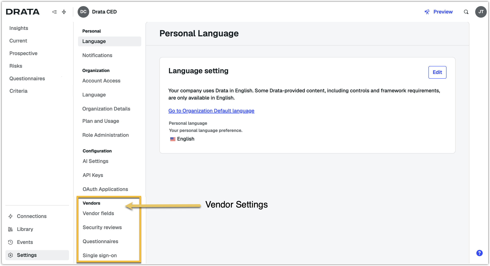
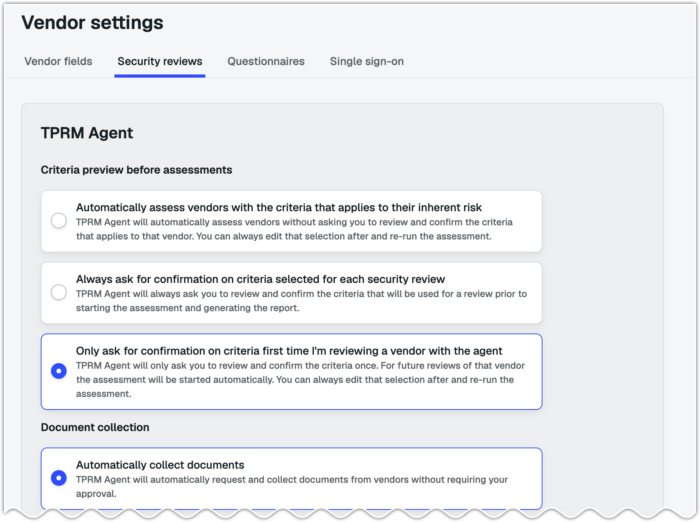

# TPRM Agent Autonomy Settings

Source: https://help.drata.com/en/articles/16880162-tprm-agent-autonomy-settings
Collection: Understand the Drata Platform › Vendors › TPRM Agent
Updated: 2026-09-09
Fetched: 2026-11-22
Description: Learn how to control how much the TPRM Agent does on its own — and where it stops to ask for your approval.

## Article text

TPRM Agent autonomy settings control how much the Agent can do automatically during a vendor security review and when it must pause for your approval. Think of them as approval checkpoints.

A vendor security review involves a series of actions — confirming which criteria apply, collecting documents, sending follow-up questionnaires to vendors, and recording risk decisions. Autonomy settings let you decide, for each of those actions, whether the agent proceeds on its own or pauses for your approval first.

> Note: These settings only apply during a security review—at the specific steps the agent runs for that review. They don't apply when you're simply asking the agent a question or giving it a one-off task outside a review.

After following this article, you'll be able to:

- Find and edit the TPRM Agent autonomy settings
- Understand what each setting controls and what each option does
- Know which option is applied by default if you change nothing
- Choose a configuration that matches how much oversight your process requires
- Understand which of these settings you can also override during an individual review

---

## Where to find these settings

1. Go to **Vendors > Settings**.
   - If you’re using TPRM as a standalone product, you can find this option in **Settings**.
      
2. Select the **Security review tab**.
3. Select **Edit TPRM Agent**.
4. Adjust any of the settings described below.
5. Select **Save**.

Selecting **Cancel** discards your changes.

**Expected outcome:** The TPRM Agent settings page displays each setting group with a set of radio options and one selected. After saving, your selections persist and apply to security reviews going forward.

---

## How autonomy settings work

Each setting marks a point in the review where the agent can either act on its own or pause and wait for you. Set each one to your preference in the TPRM Agent settings.

Two things are worth knowing before you configure them:

- **These are account-wide defaults.** They apply to every security review the agent runs, not to individual vendors.
- **Changing a setting doesn't change reviews already in progress.** New settings apply to reviews going forward.

The agent's behavior is unchanged in one important respect regardless of these settings: **you can always review, edit, and override anything it produces.** Autonomy settings control whether the agent waits for you *before* acting — not whether you can change the result afterward.

---

### Criteria preview before assessments

Controls whether the agent asks you to review and confirm which criteria apply to a vendor before it runs the assessment.

| **Option** | **What happens** |
|---|---|
| **Automatically assess vendors with the criteria that applies to their inherent risk** | TPRM Agent will automatically assess vendors without asking you to review and confirm the criteria that applies to that vendor. |
| **Always ask for confirmation on criteria selected for each security review** | TPRM Agent will always ask you to review and confirm the criteria that will be used for a review prior to starting the assessment and generating the report. |
| **Only ask for confirmation on criteria first time I'm reviewing a vendor with the agent ** | TPRM Agent will only ask you to review and confirm the criteria once. For future reviews of that vendor the assessment will be started automatically. You can always edit that selection after and re-run the assessment. |

**Choosing between them:**

- The first-time-only option is a good middle ground (Only ask for confirmation on criteria first time I'm reviewing a vendor with the agent) — you validate the criteria set once per vendor, then subsequent reviews of that same vendor run without interruption.
- Choose *Always ask* if your process requires a documented scoping decision on every review.
- Choose the automatic option if your criteria configuration is stable and you'd rather adjust scope after seeing results.

Whichever you choose, you can re-scope criteria after the fact and re-run the assessment.

**Expected outcome:** With confirmation enabled, starting a review presents a **Review and confirm criteria** step before the assessment begins. With the automatic option selected, the assessment starts without that step and results appear directly.

---

### Public document collection

Controls whether the agent collects and assesses a vendor's publicly available documents as soon as a security review is created, or waits for you to start that collection.

Some vendors publish security documentation openly — through a trust center, for example — which the agent can retrieve without a formal access request. This setting decides whether it does so immediately or tells you first.

| **Option** | **What happens** |
|---|---|
| **Automatically collect and assess** | TPRM Agent will collect the vendor's public documents and assess them right away, without waiting on a trust center access request. |
| **Ask before collecting public documents** | TPRM Agent will tell you when public documents are available and wait for you to start the collection. |

**Choosing between them:**

- Automatic collection gets a review moving immediately, since publicly available documents often cover a meaningful share of your criteria before the vendor responds to anything.
- Choose *Ask before collecting* if you want to decide which sources are used before any assessment runs.

For more on where public documents come from, see [SafeBase Trust Center integration in Drata TPRM](safebase-trust-center-integration-in-drata-tprm.md).

**Expected outcome:** With *Automatically collect and assess*, creating a security review triggers collection and assessment of the vendor's public documents without a prompt. With *Ask before collecting public documents*, the agent notifies you that public documents are available and waits for you to begin.

---

### Inherent risk recommended decision recording

Controls whether the agent records its recommended inherent risk decision on its own.

| **Option** | **What happens** |
|---|---|
| **Automatically record recommended decision** | TPRM Agent will automatically record its recommended risk decision without requiring your approval. |
| **Surface for confirmation before recording** | TPRM Agent will surface its recommended risk decision for your confirmation before recording it. |

**Expected outcome:**

- With *Surface for confirmation*, the agent presents its recommended inherent risk and waits for you to confirm before it's recorded on the vendor.
- With the *Automatically record *option, the recommendation is applied directly and you can change it afterward.

---

### Residual risk recommended decision recording

Controls whether the agent records its recommended residual risk decision on its own. The options are the same as for inherent risk.

| **Option** | **What happens** |
|---|---|
| **Automatically record recommended decision** | TPRM Agent will automatically record its recommended risk decision without requiring your approval. |
| **Surface for confirmation before recording** | TPRM Agent will surface its recommended risk decision for your confirmation before recording it. |

**Choosing between them:** Residual risk is the rating most likely to be scrutinized in an audit, and the agent shows its full scoring breakdown when it surfaces a recommendation. Keeping confirmation on means someone has explicitly signed off on the number. See [Residual Risk in Security Reviews](conducting-a-security-review-legacy.md) for how the recommendation is calculated.

Note that the agent withholds a residual risk recommendation entirely when too many criteria are inconclusive. That behavior is independent of this setting.

**Expected outcome:** With *Surface for confirmation*, the review pauses at the residual risk step with a recommendation you accept or change. With the *Automatically record *option, the recommended rating is applied and the review advances.

---

## Choosing a configuration

There's no single correct setup. These three postures cover most teams:

**Maximum oversight** — every action waits for you.

- Criteria preview: Always ask for confirmation
- Public document collection: Ask before collecting
- Inherent and residual risk: Surface for confirmation

Best when reviews are audited, when you're new to the agent, or when vendor communication is tightly controlled.

**Balanced (the default)** — the agent handles collection and analysis; you approve anything that leaves Drata or gets recorded as a decision.

- Criteria preview: First time only
- Public document collection: Automatically collect
- Inherent and residual risk: Surface for confirmation

**High throughput** — the agent runs reviews end to end and you review the output.

- Criteria preview: Automatically assess
- Public document collection: Automatically collect
- Inherent and residual risk: Automatically record

Best for high volumes of low-risk vendors. Everything remains editable afterward, but decisions will already be recorded when you look at them.

A reasonable approach is to start at the default, then relax individual settings as you build confidence in the agent's output for your criteria set.

**Expected outcome:** Your saved configuration is reflected on the settings page, and subsequent reviews pause only at the steps where you've kept a confirmation.

---

## FAQ

**Do these settings apply to vendors already under review?** No. Changes apply to reviews going forward. Reviews in progress continue with the behavior in place when they started.

**Can I set different autonomy levels for different vendors?** Not through these settings — they're account-wide. However, you can adjust criteria scope for an individual assessment during the review itself, regardless of your criteria preview setting.

**If the agent records a decision automatically, can I change it?** Yes. Autonomy settings control whether the agent waits for approval before acting, not whether the result can be edited. Every status, rating, and decision remains editable, and you can re-run an assessment at any time. You can also view events that took place in the Events page.

**Does turning off follow-up questionnaires stop the agent from identifying gaps?** No. The agent still assesses every criterion and reports what's not met or inconclusive. The setting only controls whether a questionnaire is sent to the vendor.

**Who can change these settings?** They're configured under Vendors > Settings  > Security review tab and apply account-wide. Confirm with your Drata administrator if you don't see the option.

## Images

- [image 01] ../../images/ux/settings/tprm-agent-autonomy-settings--01.png
- [image 02] ../../images/ux/vendors/tprm-agent-autonomy-settings--02.png

## Related articles

- [Training Video: Conducting an End-to-End Vendor Review with the Drata TPRM Agent (New Experience)](training-video-conducting-an-end-to-end-vendor-review-with-the-drata-tprm-agent-new-experience.md)
- [Getting started with the TPRM Agent](getting-started-with-the-tprm-agent.md)
- [TPRM Agent: Create a Criteria](tprm-agent-create-a-criteria.md)
- [Conducting a Security Review](conducting-a-security-review.md)
